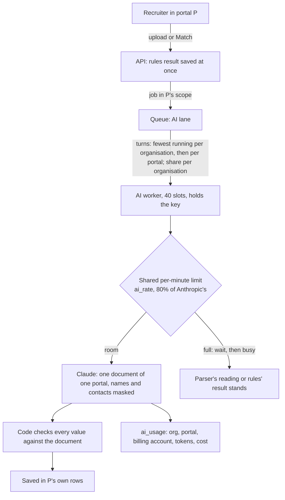

# ADR-005: Claude in the platform, one fair AI lane, billed per portal

Status: accepted by the owner, 8 November 2026 ("no more Ollama"; "being able to bill per portal is the key"; "rate limiting has never been so important").
Supersedes the local-model reader, auditor and second read (Ollama on the Mac and the PC), which are removed.

## Decision

Claude does two jobs, beside the parser and the rules, never instead of them:

| Job | Model | When | If Claude cannot answer |
|---|---|---|---|
| Reading every CV with the parser | Claude Haiku 5.5, low effort, thinking on | after the parser and OCR, before the CV reaches a panel | the parser's reading is published, and the record says why |
| Checking every match | Claude Sonnet 5.5, medium effort | after the rules have answered and the result is shown | the rules' result stands, and the panel says why |

Code checks everything Claude says against the document (a quote must be in the CV, a cited passage must exist). What fails is refused, and the parser's or the rules' answer stands.

Measured before the decision, on the 30 real CVs (8 Nov 2026), job histories fully right:

| Reader | Fully right |
|---|---|
| Parser alone | 53.1% |
| Local model | 84.4% |
| Haiku with the parser | 85.7% |

Haiku with the parser took a median of 10.7 s and cost about R0.04 a CV. On matching, the father's CV ranked first of 31 for the Centre of Excellence job at about R0.42 a match.

## How one request flows

## Isolation and billing

- Every AI call runs inside one portal's scope. Work for a company outside a portal is refused before anything is sent (`src/ai/claude.ts`).
- Each question holds one document of one portal and nothing else. Anthropic's API keeps no conversation between calls. The prompt cache holds only the fixed instructions, the same for every tenant.
- Every organisation has its own billing account, opened by the database when the organisation is created (migration 041). Every call is recorded against the organisation, the portal and that account.
- Row rules let a company read only its own account and lines. Inside a portal, it sees only that portal's lines. `GET /api/ai-usage` is the month's statement by portal.
- Only the AI worker holds the Anthropic key. The API and the document worker are told that a key exists.
- Billing is per use, near production (owner). Until then the owner buys credit by hand. The platform's monthly safety cap (`AI_MONTHLY_CAP_USD`) stops runaway spend; it is not a customer limit.

## Scale (400 users, 1,000 portals at once)

- **Rate limit.** One atomic count per model and minute is shared by every server. `test/ai-load.test.ts` sends 2,000 calls at once, and no minute ever passes its limit.
- **Fairness.** The queue serves whoever has the fewest AI jobs running, by organisation and then by portal. In the load test, 999 portals were served before a 1,000-job flood took more than its share (register R169).
- **Throughput ceiling (estimated from measured costs, not measured under load).** The account's output allowance binds first: 64,000 output tokens a minute per model, at 80% of Anthropic's 80,000. Thinking counts as output.

  | Work | Output per item (rough) | Platform-wide ceiling |
  |---|---|---|
  | Reading a long real CV | about 2,000 tokens | about 30 CVs a minute |
  | Checking a match | about 1,000 to 1,200 tokens | about 50 to 60 matches a minute |

  Past that, the fair queue shares what room there is. A CV that waits more than 5 minutes is published with the parser's reading, and a match keeps the rules' result, so the platform stays responsive and says why.
- **Raising the ceiling.** Anthropic raises an account's limits as it spends, or on request. The ceiling then rises by setting (`AI_HAIKU_OTPM` and the others), not by code. 1,000 portals uploading at the same moment would need that higher tier. The shared limit and the fair queue keep everyone served meanwhile.

## Not done here

- Credit wallets, portal limits, invoices and auto-reload: the owner, near production, read from `ai_usage`.
- The privacy notice telling users that CV text, with personal details masked, is sent to Anthropic: required before other companies use the AI. Its wording is the owner's.
