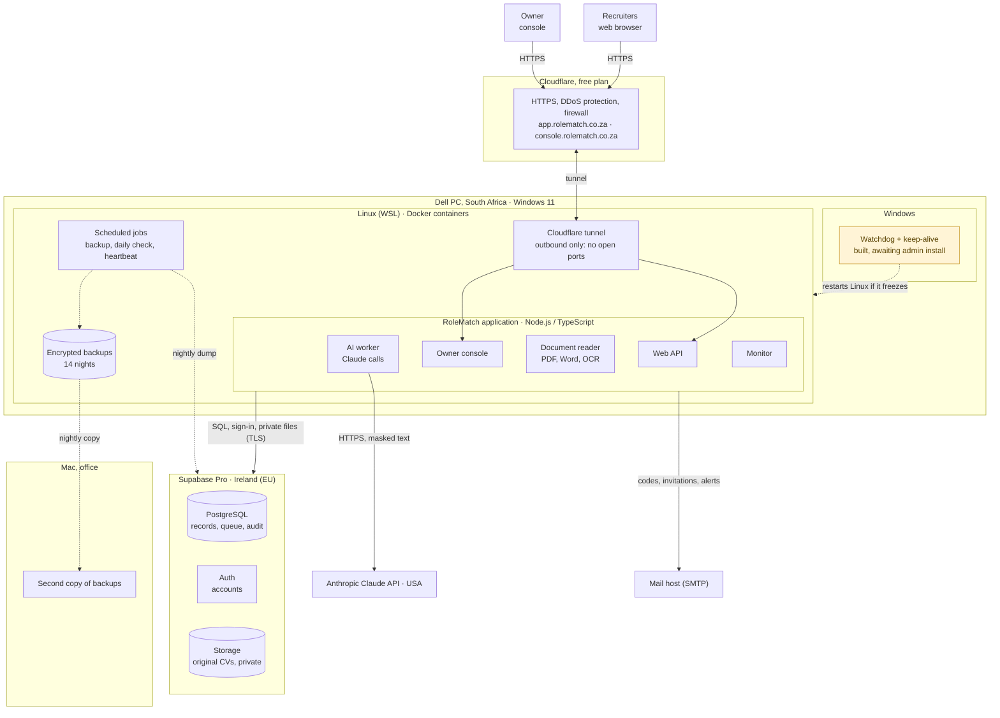
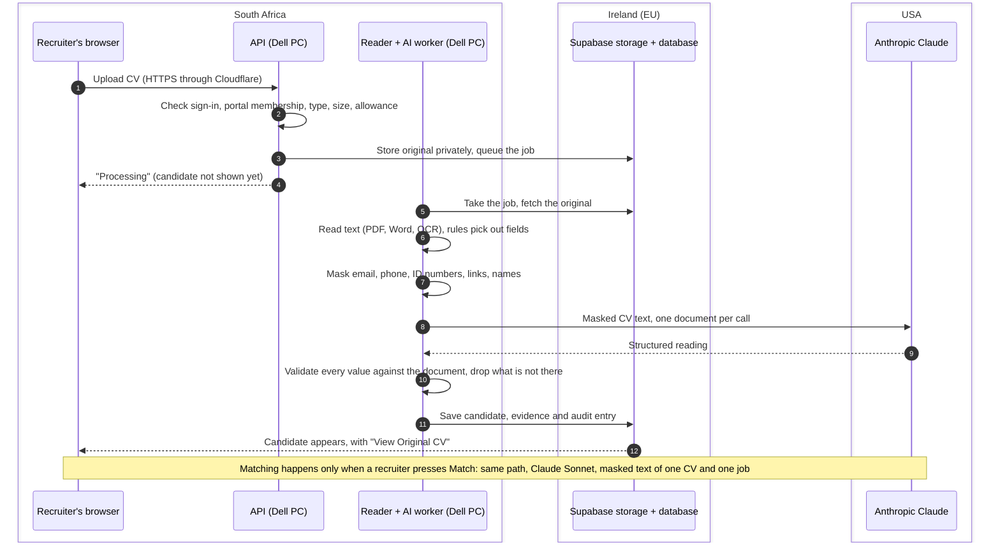
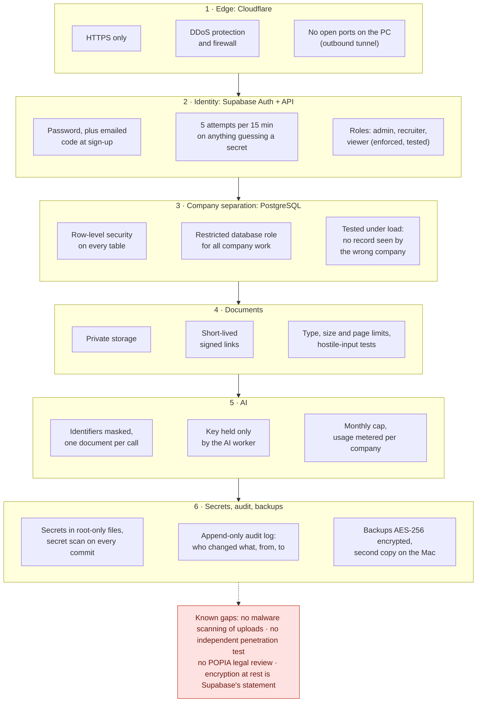
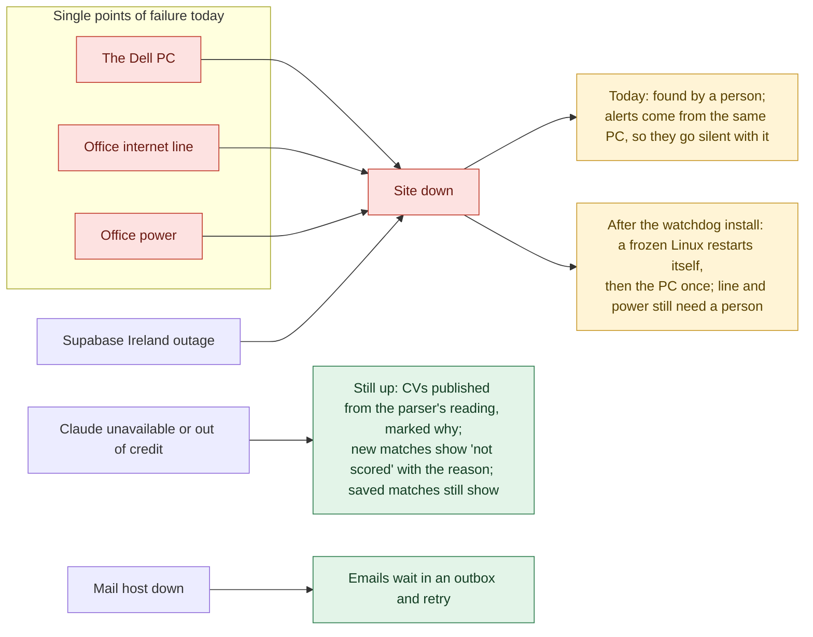

# RoleMatch: the whole picture for a CIO

Checked against the code (release `3db9bba`) and the live machines on 10 November 2026. Each page has one diagram (Mermaid) and what it means. Where something is a provider's statement we have not verified, or a gap, it says so.

**One-line summary:** RoleMatch is a working web service with strong separation between companies and encrypted, tested backups, but it runs on a single PC on an office line, sends CV text (with identifiers masked) to Claude in the USA, and has had no independent security test or legal POPIA review. It is fit for a supervised pilot, not yet for an enterprise production contract.

---

## 1. Infrastructure: what runs where

* **Compute:** one Dell PC in South Africa runs every service in Docker containers inside Linux (WSL 2). Nothing on the PC accepts connections from the internet; Cloudflare reaches it through a tunnel the PC opens outwards.
* **Data:** Supabase Pro in Ireland holds the database, the accounts and the original documents. The PC holds no live records, only encrypted backups.
* **Outside services:** Cloudflare (edge), Supabase (data), Anthropic (AI), an SMTP mail host. The full chart is `INFRASTRUCTURE.mmd`.

---

## 2. One CV's journey, and where personal data crosses a border

**What a CIO should take from this**

* **Personal data leaves South Africa twice.** All records and originals are stored in Ireland. CV text goes to Anthropic in the USA for reading and matching. POPIA section 72 governs both transfers; the legal review (operator agreements, consent and purpose notice, retention) **has not been done**.
* **What is masked before Claude:** email addresses, phone numbers, South African ID numbers, links and the candidate's name. **What still goes:** work history, employers, education and skills. That is still personal information.
* **What Anthropic keeps:** governed by Anthropic's commercial API terms (not used to train models under those terms; retention period per the contract). **To confirm against the signed terms; not verified by us.**
* Nothing enters the candidate list until reading and validation finish, and no person is rejected or shortlisted by the system: it recommends, a recruiter decides.

---

## 3. Security controls, layer by layer

* **Strongest point:** company separation is enforced by the database itself, not only by application code, and is tested under load.
* **Honest limits:** sign-in, the processing queue and rate limits run with full database rights and rely on the code being right. Supabase states that data is encrypted at rest; we rely on that statement. The security review so far is our own engineering review (22 Oct 2026), not an independent test.

---

## 4. Resilience: what fails, and what happens

| Question a CIO asks | Answer today |
|---|---|
| How much data can we lose? | Supabase Pro keeps its own daily backups (provider's statement). Ours: an encrypted dump every night at 01:30, 14 nights kept, copied to the Mac. Worst case on our own backups: the day's work since 01:30. |
| How fast can we recover? | A release can be rolled back to the previous version in minutes. A full restore from our backup is proven by a drill on a test copy; a full restore of live at its real size has **not** been timed. |
| Outages so far | Three on our own hosts: 6 Nov (the Mac on battery), 10 Nov 04:59 to 06:08 (Windows stopped the PC's Linux and it jammed). One provider incident (Supabase gateway, 22 Oct). All recorded in `PRODUCTION_READINESS.md`. |
| How are changes released? | Built on the PC from a fixed commit, the full test suite run first, a backup taken, the previous version kept for rollback, every release logged. There is **no separate staging environment** that mirrors live. |
| How is it watched? | A monitor inside the PC, a daily check emailed at 06:00, an owner console. **No outside uptime check yet**, so a whole-PC outage is not alerted. |
| How much load? | Tested on a test copy on 5 Nov: about 200 people at once comfortably with the database in Ireland, 5,000 working sessions with six servers. **The current Claude-based setup has not been load-tested.** |

**What would close these gaps, in order:** install the watchdog (admin, 5 minutes); add a free outside uptime check with phone alerts; move the application from the PC to a hosted server near the database in Ireland, which removes the PC, line and power from the list; a staging copy of live; a POPIA review and an independent penetration test before an enterprise contract.
