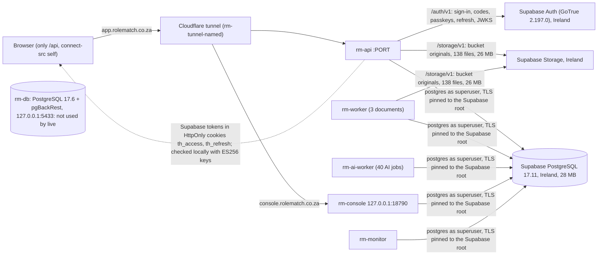
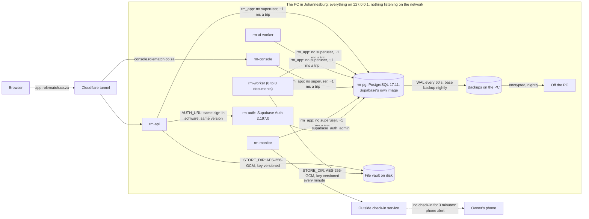
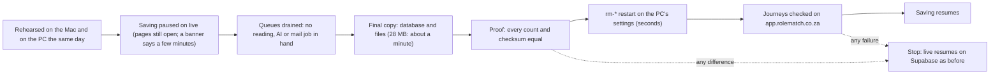

# The move to Johannesburg: design

Owner, 11 Nov 2026: "design everything as a software architect ... inspect our code base, look at what we need, look at connections, look at
pathway, everything"; "these need to impress ... CEOs with 400 million dollar companies"; "before the move, you need to ensure that everything works";
"absolutely nothing changes ... passwords, accounts, and data"; and "we are doing all of this for development ... migrated to a pay plan later".

This design is read from the code at commit 14fc10c and from live (counts and versions only) on 11 Nov 2026. The steps are in
PLAN_JOHANNESBURG_MOVE.md; this document says how each one works and why it is built that way. Nothing in it is built yet.

## 1. The standard

- **Built as production, hosted as development.** The PC is a development home. Everything is built so that moving to a paid host later changes
  addresses and keys, not code. That means standard parts only (PostgreSQL 17, the Supabase Auth service, an encrypted file store) and every setting
  in a file. Every database object is made by a migration or a script in Git, never by hand.
- **Nobody notices.** Same address, same passwords, same passkeys, same records and files. Anyone signed in stays signed in.
- **Live is never at risk while we build.** The copy runs beside live under its own names, ports and settings. It reads live only. Live keeps
  releasing as normal.
- **Proved before it is asked for.** Every step has a check that can fail, and the whole move is rehearsed end to end on the Mac before it is done on
  the PC.

## 2. Today, from the code



What the inventory found that shapes the design:

| Found | Where | Why it matters |
|---|---|---|
| The server connects as `postgres`, the all-powerful role | live, `current_user` | A large company's auditors expect the application to have only the rights it needs |
| Sign-in keeps no server-side session: the Supabase tokens are the session | `auth.ts:18-20, 386-406` | Moving sign-in moves everyone's session with it (section 5) |
| A token's issuer must equal `SUPABASE_URL + /auth/v1` exactly | `supabase.ts:103`, `tokens.ts:82` | The copy's sign-in must be reachable at an address the server is told about |
| The Supabase service key is also the secret behind invitation links, code hashes and mail hashes | `auth.ts:43`, `portals.ts:18`, `mail/index.ts:34` | A new key would break every open invitation and code |
| Any database host with a dot must use TLS signed by Supabase's root | `dbTls.ts:27-32` | A database on the same machine (127.0.0.1) needs no TLS, and gets none |
| Releases refuse a local database for live | `preflight.sh:17` | Correct today; after the move, live's database is local by design |
| Originals can already go to an encrypted vault on disk (`STORE_DIR`, AES-256-GCM, path bound in) | `supabase.ts:170-194`, `fileVault.ts` | No storage service is needed on the PC |
| The startup check looks for the Supabase bucket even when the vault is used | `schema.ts:66` | Must follow the vault |
| Our own sign-in service exists (`IDENTITY=own`) but carries no accounts over and has no passkeys | `ownIdentity.ts`, `20_IDENTITY_V1.md` | Cannot meet "same passwords, same passkeys" |
| Several migrations assume Supabase's roles and schemas (`anon`, `authenticated`, `auth.users`, `storage.buckets`) | 001, 012 and others, 045 | The copy's database must provide them |
| Pool sizes are cut to fit Supabase's 15-connection pooler | `limits.sh:2` | Can be sized for the PC instead |
| The console names the database by matching its address | `console/database.ts:15` | Should be a setting, not a guess |

## 3. The design



### Decisions

| Part | Chosen | Not chosen | Why |
|---|---|---|---|
| Database software | `supabase/postgres:17.11.0.011`, already on the PC | plain PostgreSQL (rm-db, 17.6); a managed database | Same major and minor version as live (17.11). It has Supabase's roles, schemas and extensions, so all 45 migrations and the sign-in service run unchanged. It is PostgreSQL, so any paid PostgreSQL host can take a dump of it later |
| Sign-in | Supabase Auth (GoTrue) 2.197.0, the exact version live runs, already on the PC | our own sign-in (`IDENTITY=own`) | Only GoTrue keeps every password hash, passkey, identity and session exactly as they are. Our own would sign everyone out and lose passkeys |
| Where sign-in is reached | a new setting, `AUTH_URL`, defaulting to `SUPABASE_URL + /auth/v1` | a gateway (Kong, Envoy, nginx) in front of GoTrue | One less part to run and break. The issuer check, the key address and every endpoint follow the one setting. Live is unchanged because the default is today's value |
| Token signing | ES256 key pair made for the copy; its public key published by GoTrue | sharing Supabase's key (impossible: Supabase keeps the private half) | The same algorithm as live, so the server's local check is unchanged |
| Original files | the encrypted file vault already in the code (`STORE_DIR`, `VAULT_KEYS`) | Supabase's storage service self-hosted | The vault encrypts every file at rest; the storage service would keep them in plain files on disk. One less service |
| Secrets behind links and codes | a new setting, `LINK_SECRET`, holding today's service key value | keep using the service key | The Supabase key can then change, now and at the paid host, without breaking a single open invitation or code |
| Application's database role | `rm_app`: may log in, is not a superuser, works inside companies through `rolematch_tenant` and in the console through `rolematch_console` | `postgres` as today | Least privilege. Migrations run as a separate owner role (`rm_owner`) that the application never holds |
| Backups | continuous WAL archiving (at most 60 s of work at risk), a base backup each night, the existing encrypted nightly dump, a weekly restore drill, an encrypted copy off the PC each night | pgBackRest (not in this image) | Point-in-time recovery with tools inside the image; every file that leaves the PC is encrypted |
| rm-db (17.6, the paused own-database work) | removed a week after the switch, with its evidence recorded | kept beside the new database | Two databases on one PC is one too many (owner, 27 Oct: "remove unused completely") |

### Code changes, each with its test first

| # | Change | Live affected? |
|---|---|---|
| C1 | `AUTH_URL` setting: every `/auth/v1` call, the JWKS address and the issuer check use it; default is today's address | No: same value |
| C2 | `LINK_SECRET` setting for the three hashes; default is the service key | No: same value |
| C3 | `STORE_DIR` respected by the startup storage check | No: live has no `STORE_DIR` |
| C4 | `preflight.sh`: live may use a local database only when `DATABASE_HOME=pc` is set, and the rehearsal's secrets must still differ from live's | No |
| C5 | `release.sh` migrates as the owner role when `/etc/rolematch/migrate.env` exists (it holds that role's `DATABASE_URL`, read after live.env), else as today | No |
| C6 | the console's "where is the database" read from a setting, `DATABASE_LOCATION` | No: same words until set |
| C7 | `run.sh` takes a name prefix and its own ports, so the copy runs as `rmn-*` beside `rm-*` | No |
| C8 | `deploy/db/next/`: the database bootstrap (roles `rm_owner`, `rm_app`; settings; WAL archive), GoTrue's settings, start and stop scripts | No |
| C9 | `deploy/move/`: copy, verify and switch scripts (section 6) | No: reads live only |
| C10 | pool sizes for the PC (`max_connections` 100, pools sized to it) | No |

## 4. What runs on the PC

| Name | What | Listens on | Settings |
|---|---|---|---|
| rmn-pg (rm-pg after the switch) | PostgreSQL 17.11 | 127.0.0.1:5434 | `/etc/rolematch/next/db.env` (root only) |
| rmn-auth (rm-auth) | Supabase Auth 2.197.0 | 127.0.0.1:9998 | `/etc/rolematch/next/auth.env` |
| rmn-api, rmn-worker, rmn-ai-worker, rmn-console | the same image as live | API 8792, worker 8793, console 18791 | `/etc/rolematch/next.env` |
| file vault | a directory on disk, encrypted | — | `VAULT_KEYS` in next.env, and a copy of the key with the owner |
| tunnel | next.rolematch.co.za to rmn-api, by a second connector | — | cloudflared.yml |

No monitor and no alerts run for the copy before the switch, so nothing on the owner's phone is about the copy. Mail from the copy goes only to the
owner's and their father's addresses. AI on the copy is capped at $2 for the month.

## 5. Staying signed in through the switch

The server keeps no session of its own. Each browser holds a short-lived access token (an hour) and a long-lived refresh token, both from Supabase.
At the switch:

```mermaid
sequenceDiagram
  participant B as Browser (cookies from Supabase)
  participant A as rm-api (now on the PC)
  participant G as rm-auth (GoTrue on the PC)
  participant D as rm-pg
  Note over D: the switch copied auth.sessions, refresh_tokens and mfa_amr_claims, so every session is known
  B->>A: request with th_access (signed by Supabase)
  A->>A: issuer and key do not match the PC's: not accepted
  A->>G: refresh with th_refresh
  G->>D: the refresh token is found, unused: same session id, same sign-in time
  G-->>A: new tokens, signed by the PC's key
  A-->>B: new cookies; the page loads as normal
```

The person sees nothing, and the session keeps its original sign-in time, so the company's own session-length rule still applies. A session ended
on live before the switch stays ended: `signed_out_sessions` is copied too. This is proved on the Mac first (section 7), not assumed.

## 6. Copying the data, and the switch

**The copy tool** (`deploy/move/copy.sh`) does the same thing for the rehearsal, for every refresh of the copy and for the switch:

1. The database's shape comes from our own migrations, never from a dump. Sign-in's shape comes from GoTrue's own migrations on first start.
2. Data: every table of ours except `schema_migrations` (which the migrations fill), and every sign-in table (users, identities, sessions, refresh
   tokens, sign-in methods, passkeys, one-time tokens), as data only, with sequences.
3. Files: every original read from live's storage, written into the vault, its checksum compared before and after.
4. Proof: row counts for every table on both sides, and a checksum of each table's rows in key order. The tool fails if any differ. Every vault file
   must decrypt to the same checksum.

**The switch** (late at night, after the owner's yes):



**The switch tool** (`deploy/move/switch.sh`, written 12 Nov after the owner's yes):

- `rehearse`: writes the settings live will have (`/etc/rolematch/live.env.pc`: live's own, with only the database, sign-in, vault and key taken
  from next.env), checks them with the release preflight, copies live into the PC's database again, and starts an API on them on a spare port with
  mail held back, which must say it is ready; then checks the pause page. Live is not touched.
- `go`: keeps the way back (`live.env.before-move`), pauses saving (the copy's apps and live's API and workers stop; `deploy/move/pause.sh` answers
  503 "back in a few minutes" on the API's port), counts jobs in hand, takes the final copy with its proof, puts the new settings in place with
  `migrate.env` (the owner role, for migrations and the nightly dumps), restarts live's containers, and retires the copy's apps. Any failure before
  live is ready goes back to Supabase by itself.
- `back`: live's containers restart on the settings they had before.

Found while writing it: after the move the nightly backup would have been refused (the application's login may not read sign-in's tables, and a
bridge network does not reach a database on the same machine). The dumps now run as the owner role over the host's network; proved against the copy
before the switch (139 originals, both dumps).

The tunnel and the address do not change: the same containers keep the same names and ports, with different settings. Supabase is left untouched
for a week. Going back during the window means restarting on the old settings. After saving has resumed on the PC, going back also means copying the
new work back with the same tool, which is written and tested for that direction too.

## 7. Proof that everything works, before anyone is asked

On the Mac, end to end, with nothing real:

1. The Mac's local Supabase plays "live". The full suite and the rehearsal journeys create accounts with passwords, a passkey, sessions, companies,
   CVs, jobs, matches, invitations and an open reset code.
2. The copy tool moves it all into an rm-pg and rm-auth pair on the Mac.
3. Against the copy:
   - the same passwords sign in
   - a browser signed in before the move stays signed in (section 5)
   - an invitation link and a reset code sent before the move still work
   - a session signed out before the move stays out
   - every file opens
   - the full server suite passes, connected as `rm_app`
   - every rehearsal journey passes
4. The switch script is run, then the way back.

On the PC, against the real copy:

- the copy tool's proof
- the full suite, under the copy's settings
- the rehearsal journeys against next.rolematch.co.za, with test accounts only
- speed: the board, the Overview and the console timed against live
- the reading step timed (it should drop from 8.6 s to under 1 s)

Then the owner and their father sign in at next.rolematch.co.za with their own passwords (step 7 of the plan). Only then is the switch asked for.

## 8. Staying on

From the check of the PC on 11 Nov (see PLAN_JOHANNESBURG_MOVE.md):

- the Linux side was cut off at 06:47 that morning, about five minutes down
- Windows may restart for updates outside 11:00 to 02:00
- nothing outside the PC notices if it is off

The design adds:

- updates only in a set weekly window
- a Windows start-up task that starts Linux without anyone signing in, and checks it each minute
- a watchdog that restarts any service failing its health check
- a check-in every minute to an outside service, which alerts the owner's phone when check-ins stop
- the UPS warning the database to shut down cleanly

A standby machine is the only way past one PC's limits, and is for the paid host.

## 9. To the paid host, later

The same tools run again with new addresses:

- the database moves by the copy tool, into any PostgreSQL 17 (or Supabase's own, unchanged)
- sign-in goes with it: GoTrue runs anywhere, or Supabase's hosted one with the same tables
- the vault moves as files, or back into an S3-style store through the same three functions
- nothing in the application changes; only `DATABASE_URL`, `AUTH_URL`, `STORE_DIR` and the keys

## 10. What only the owner can do

- the Windows administrator steps (updates window, start-up task): about 10 minutes, at the PC, with instructions
- an account with the outside check-in service (free), and the address it gives
- keep a copy of the vault key somewhere safe (a password manager): without it the original files cannot be read
- sign in at next.rolematch.co.za, with their father
- the yes for the switch
