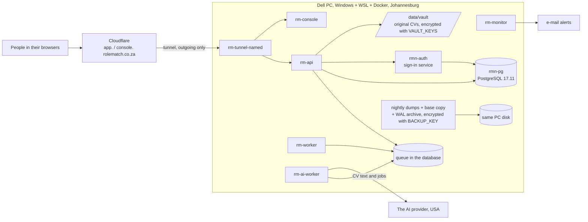
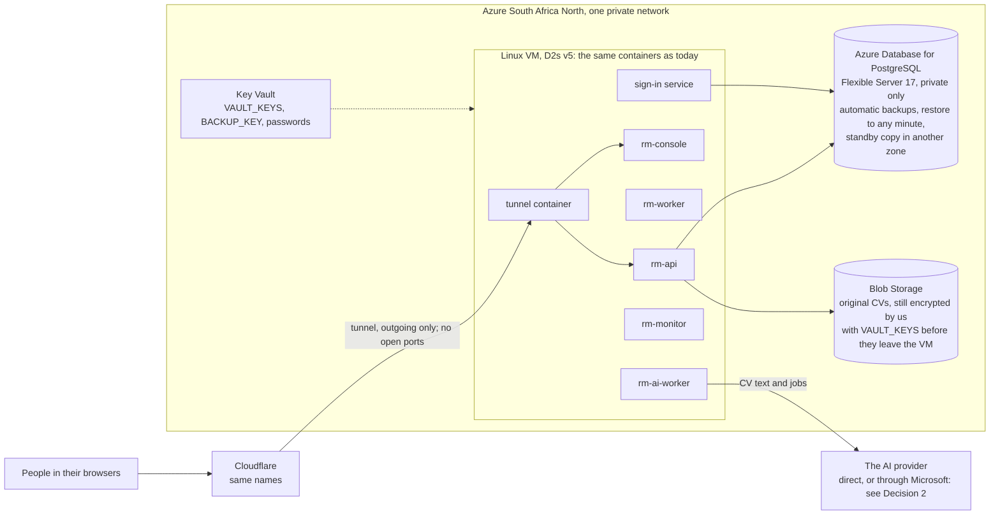

# Moving RoleMatch to Microsoft Azure (Johannesburg) for production

Owner, 12 Nov 2026: "so then I need you to handle this stuff for me". The PC stays the development host until the first corporate customer signs
([pc-is-development-hosting]; "we're in development, we'll make the necessary changes later"). This plan is what to do then, checked against the code
that runs today, with Microsoft's own prices. Nothing here is built or bought yet.

## TODAY: what runs on the PC (read from deploy/ and the live containers, 12 Nov 2026)

## WILL BE: the recommended Azure layout (South Africa North, Johannesburg)

What changes and what doesn't:

| Part | Today (PC) | On Azure | Code change |
|---|---|---|---|
| Our containers | Docker on WSL | Docker on a Linux VM | None: the same images and run.sh |
| Way in | Cloudflare tunnel | The same tunnel | None; switching over is instant, no DNS wait |
| Database | rmn-pg, Postgres 17.11 | Managed Postgres 17 | Bootstrap and backup scripts only (see checks) |
| Backups | Our dumps + WAL archive on the PC's own disk | Microsoft's automatic backups, restore to any minute (7 to 35 days), stored away from the server | Retire our base-copy and WAL scripts; keep the nightly encrypted dump as a second copy in Blob |
| Original CVs | /data/vault on disk | Blob Storage | Small: the vault has three operations (put, get, remove, `server/src/fileVault.ts`); add a Blob version beside the disk one. Encryption stays ours |
| Keys | Root-only settings file | Key Vault | Read the same names at start |
| AI | Provider's own service, USA | Unchanged, or through Microsoft | Decision 2 |

## What I checked against our code (12 Nov 2026)

| Need | Our code | Azure | Status |
|---|---|---|---|
| Postgres version | 17.11 (`docker exec rmn-pg postgres --version`) | Flexible Server: 17 generally available and the default for new servers | Matches |
| Extensions | `pg_trgm`, `pg_stat_statements` (only two in all migrations) | Both on Azure's allow list | Fine |
| Our roles | `rm_app`, `rm_migrate`, `rm_readonly`, `rm_schema_owner`, `rolematch_console`, `rolematch_tenant`, plus the sign-in service's `anon`, `authenticated`, `service_role` | The administrator role may create roles | Fine |
| `rm_app` reads every company's rows (BYPASSRLS, `deploy/db/app-role.sql`) | Needed today | On Postgres 16 and later the administrator may grant it ([Microsoft: access management](https://learn.microsoft.com/en-us/azure/postgresql/security/security-access-control)) | Fine on 17; prove in the rehearsal |
| Bootstrap runs as the database's superuser (`deploy/db/stack/bootstrap.sql`) | Superuser today | No superuser on Azure; an administrator role instead | **Must change**: rewrite the bootstrap for the administrator role; prove in the rehearsal |
| Restore sets `session_replication_role` (`deploy/restore.sh`) | Superuser setting | Not confirmed for the administrator role | **Unproven**: Microsoft's own restore replaces this; keep ours only if it works there |
| WAL archive with pgBackRest (`deploy/db/rolematch.conf`) | Ours | Not allowed (Microsoft runs its own) | Replaced by Microsoft's restore to any minute |
| Sign-in service (its own tables in the same database) | Runs against rmn-pg | Should run against managed Postgres | **Unproven**: its first start creates its tables; prove in the rehearsal |

## Prices (Microsoft's own price list for South Africa North, read 12 Nov 2026, pay as you go, US dollars)

Source: Microsoft's public retail price list (prices.azure.com), 730 hours a month. Rands at today's rate of R16.56 per dollar, an estimate only.
Reserved one- or three-year terms cost less and are not counted here.

| Part | Size | $/month |
|---|---|---|
| Linux VM for our containers | D2s v5, 2 vCPU, 8 GB ($0.127/h) | 93 |
| VM disk | Premium SSD P10, 128 GB | 24 |
| Managed Postgres | General Purpose, 2 vCore ($0.235/h) | 172 |
| Its storage | 128 GB at $0.151 | 19 |
| Standby copy in another zone (high availability) | the same compute and storage again | 191 |
| Blob Storage for CVs and the second backup copy | ~200 GB hot, about $0.021/GB | 4 |
| Backups beyond the free amount (as large as the storage) | $0.113/GB | ~0 at first |

| Setup | $/month | About R/month |
|---|---|---|
| **A. Lift as it is**: one bigger VM (D4s v5, $185) with the database on it, disk, Blob | ~215 | ~R3,560 |
| **B. Recommended start**: VM + managed Postgres without standby + Blob | ~312 | ~R5,170 |
| **C. Corporate grade**: B with the standby copy in another zone | ~503 | ~R8,330 |

Not included: the AI (already the company's own cost, metered per portal), Key Vault and network (a few dollars), Cloudflare (free plan today).
Microsoft for Startups credits may cover the first months; their terms change often, so check before applying.

## Decisions for the owner (and their father)

1. **Which setup.** B to start, C once a contract asks for a stated recovery time. My advice: start at B and switch the standby on (one setting) with the first
   corporate contract.
2. **The AI's route.** Microsoft offers the models we use in two forms: run by Microsoft on Azure, or run by the provider and sold through Azure.
   Neither can be deployed in South Africa North: "global" deployments are offered in US regions and Sweden Central, and Microsoft "processes prompts and
   responses in any Azure region"; the only data-zone option is the United States
   ([Microsoft Learn: region availability](https://learn.microsoft.com/en-us/azure/foundry/foundry-models/concepts/models-from-partners#region-availability-by-deployment-type),
   read 12 Nov 2026). So CVs leave the country either way. Going through Microsoft puts the AI on the Azure invoice and under Microsoft's terms;
   going direct keeps today's setup. Either way, each customer's contract must name the provider and the cross-border transfer (POPIA section 72).
   Two traps from Microsoft's terms: these models **cannot** be bought on a subscription through a reseller (Cloud Solution Provider), nor on one paid only
   by startup credits. Buying Azure through a South African reseller for rand invoices would therefore block this route.
3. **When.** When the first corporate customer signs, with its price covering hosting. Until then, the PC.

## Order of work, each step proven before the next

1. Create the Azure account under the company, with spending alerts, and apply for startup credits.
2. Rewrite the database bootstrap for Azure's administrator role; run every migration against a fresh Azure Postgres 17; run the full test suite against it.
3. Add the Blob version of the vault (put, get, remove) beside the disk one, chosen by a setting; test both; copy the vault across and compare every file's check.
4. Rehearsal side by side, as for the move to the PC: a copy of live on Azure at a spare name (like next.rolematch.co.za), measured against live.
5. Switch: pause, final copy, point the tunnel at Azure, check, and keep the PC as the way back for a week.
6. Afterwards: updates without downtime (two API containers, one replaced at a time), not needed for the move itself.

## What this plan does not solve

- Security questionnaires: Azure answers the building, hardware and network; the application (sign-in, pen test, malware scanning, POPIA processes) is ours
  (Microsoft calls it shared responsibility).
- Key-person risk: answered by contracts and support agreements, not by hosting.
- Sign-in with a company's Microsoft accounts (single sign-on): separate work, and the one corporates ask for first.
