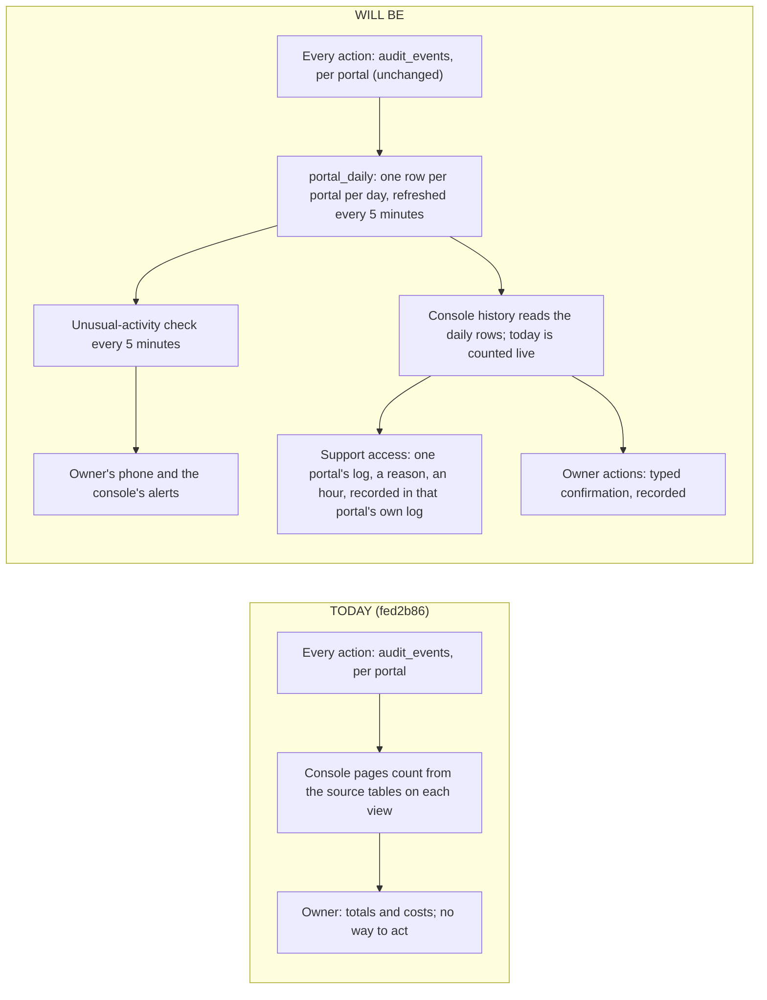
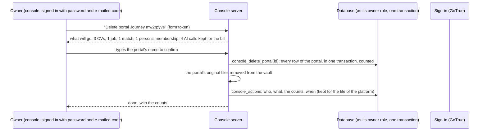

# The console runs the platform: totals, alerts, support access, owner actions (plan, 12 Nov 2026)

Owner, 12 Nov 2026: "portals need details, but we, as a system and a console, we just need to know what's going on in each portal and make sure that
everything's okay. But if a client comes to me saying 'where did this CV go?' ... I need to know what's going on." And earlier the same morning: "I should
have full autonomy of everything ... if I want to delete users, I should be able to."

## The rule

| Who | Sees | Why |
|---|---|---|
| A company's administrator | every action in their own portal: who uploaded, shortlisted, changed what, when | it is their record; their auditors and POPIA ask for it |
| The owner, in the console | totals per portal per day, costs, health, and the unusual | RoleMatch processes companies' data for them; it sees no more than it needs, and a corporate buyer asks exactly this |
| The owner, on a support call | one portal's log, for a stated reason, for an hour, recorded where the company can see it | "where did this CV go?" needs the detail, once, openly |

## Today and what it will be

At 1,000 portals with 5 people each, about a million actions a day are recorded. The daily totals turn that into about 1,000 rows a day, so the console
stays as fast as it is now.

## Owner actions

| Action | What happens | Kept |
|---|---|---|
| Delete a person | their sign-in account removed; their records stay with their portal, credited to no one (migration 044) | the audit log's lines, by account id |
| Sign a person out everywhere | every session of theirs ended at once | |
| Block or allow sign-in | their account refused at sign-in until allowed again | |
| Delete a portal | every record of the portal and its original files | AI usage lines, with the portal's id, for the bill |
| Delete a company | each of its portals, then its people, settings and the company | AI usage lines and the billing account, for the bill |
| Change a company's AI allowance | as deploy/pc/ai-allowance.sh does | the change, with before and after |

Every action needs the form token of the owner's session, the name typed exactly, and is written to `console_actions` and the owner's alerts.

## Unusual activity (raised as owner alerts, pushed to the phone)

- a portal's uploads today more than 10 times its daily average of the last 14 days, and over 50
- a company's AI spend today more than 5 times its daily average, and over $2; a company at 80% of its monthly allowance
- more than 20 failed sign-ins to one portal's people in an hour
- more than 10% of a portal's documents failing today, with at least 5 failed

## Order

1. Daily totals (migration 048, refreshed by the monitor every 5 minutes; the console's Activity reads them)
2. Owner actions and support access (migration 049; the console's People and Portals pages)
3. Unusual-activity alerts (the monitor, reading the daily totals)
4. A live journey with test accounts on app.rolematch.co.za, and its test portals deleted with the new owner actions
5. The Windows watchdog's heartbeat folder and task (the owner, at the PC, as administrator)
