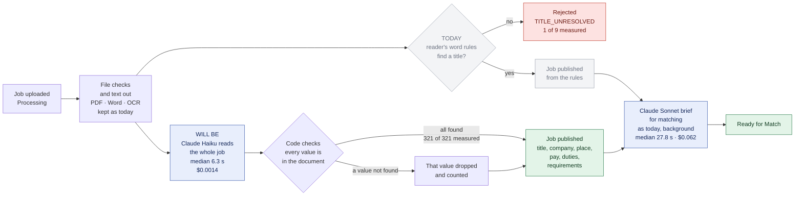
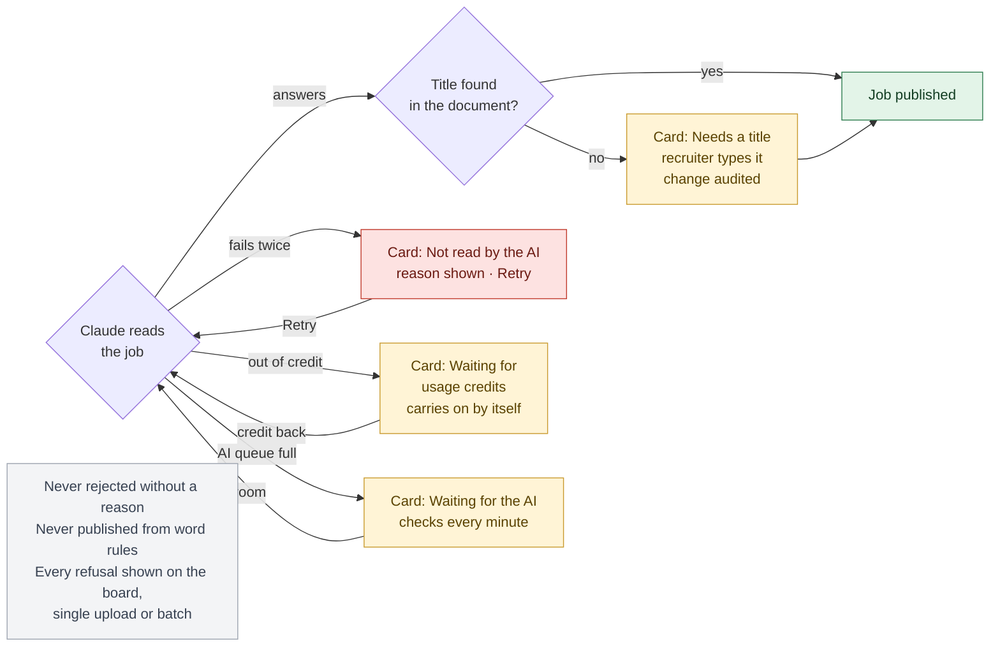
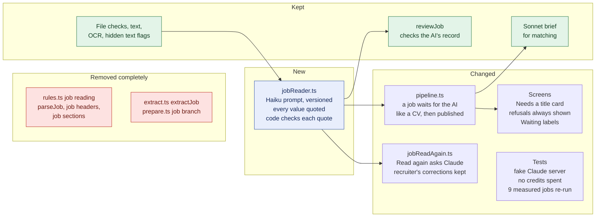

# Plan: job descriptions read by AI

Not built. Measured 10 Nov 2026 on 9 job descriptions (server/test/collection/aiJobReadEval.ts, commit 8d984e8): the reader refused 1, Claude Haiku read all 9 with the right title, 321 quoted values checked and all found, median 6.3 s, $0.0014 a job; the Sonnet brief live already writes costs $0.062 a job, median 27.8 s.

## Jobs read by AI: today and will be

## Jobs read by AI: when something goes wrong

## Jobs read by AI: where in the code

