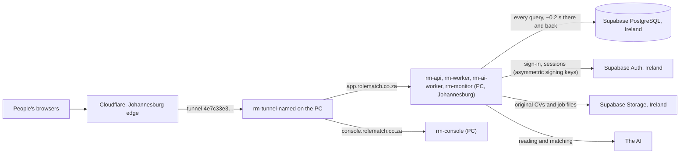
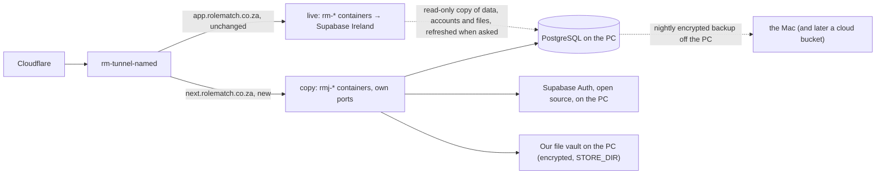
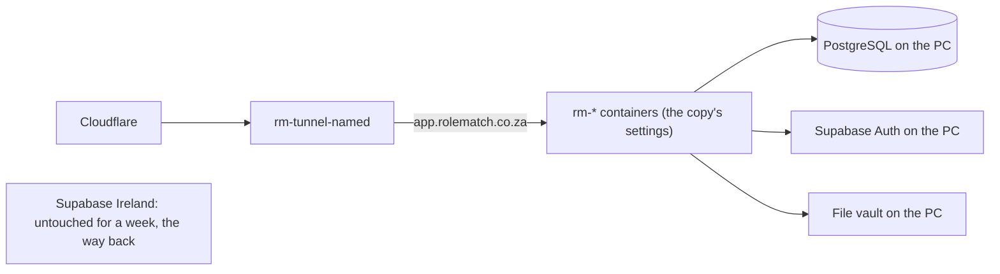

# Everything in Johannesburg: the move off Supabase Ireland

Owner, 11 Nov 2026: "I would like everything to be in Johannesburg ... we're not getting true value if the database is all the way in Ireland." Conditions: "absolutely nothing changes ... people mustn't even know ... passwords, accounts, and data" stay exactly the same; built "without it affecting the live site"; the PC never sleeps. Read from the code and the PC on 11 Nov 2026 (`deploy/pc/release.sh`, `deploy/mac/run.sh`, `server/src/supabase.ts`, `server/src/fileVault.ts`, `/etc/rolematch/cloudflared.yml`).

## TODAY

## WHILE BUILDING: a second copy beside live, live untouched

## AFTER THE SWITCH

## Steps, and how each is proven

| # | Step | Proven by | Live affected? |
|---|---|---|---|
| 1 | Test address next.rolematch.co.za: one CNAME to the tunnel, added in Cloudflare | `dig` answers; the address shows a 404 page until the copy exists | No |
| 2 | Settings for the copy: its own env file, ports, container names (run.sh takes a name prefix), mail restricted to test addresses | the copy starts and `/api/ready` answers on its own port | No |
| 3 | PostgreSQL, Supabase Auth and the file vault for the copy on the PC, same versions as Supabase uses | the server's own schema check and migrations pass | No |
| 4 | Copy live's data: a read-only dump of live's database (our tables and the sign-in tables, so every account, password hash, passkey and ID is identical), and every original file into the vault | row counts and checksums equal on both sides, every file opens | No (reads only) |
| 5 | Sessions: the copy trusts live's sign-in keys as well as its own, so a person already signed in stays signed in | a session made on live works on the copy | No |
| 6 | Every check against the copy: the full server suite's contract tests, the rehearsal journeys pointed at next.rolematch.co.za, the speed of the board measured on both | all pass; the database trip goes from ~0.2 s to ~0 | No |
| 6a | Use more of the PC for scanned CVs: the copy reads 6 to 8 documents at once instead of 3 (WORKER_CONCURRENCY), with a limit per company so no company takes them all (PER_ORG_CONCURRENCY). Measured 11 Nov 2026 on the PC (i9-10920X, 20 threads, invented scans): 12.9 s a scan one at a time, 2.6 s a scan with six at once. Raised a step at a time, with a load test at each step: several companies uploading scans and Word CVs at once | server/test/speed/readTime.ts and the live stage times: a Word CV's reading step from 8.6 s to under 1 s; scans no slower one by one while more run at once; no company waits on another | No |
| 7 | You and your dad try next.rolematch.co.za with your own accounts | your word | No |
| 8 | Off-PC backups of the copy every night, and one restore rehearsed | a restore onto a scratch database matches | No |
| 9 | The switch, late at night: saving pauses for a few minutes, the last changes copy across, app.rolematch.co.za points at the copy | the same checks as step 6, on the live address | ~5 minutes of paused saving |
| 10 | A week with Supabase untouched; then it is retired | — | No |

Releases keep going to live throughout; from step 2 each release also goes to the copy, so the two never differ.

## What only you can do

- Step 1 needs Cloudflare (your account): either add the CNAME record yourself, or sign in to Cloudflare in the app's browser so it can be added for you.
- The PC's BIOS setting to switch itself back on after a power cut; a UPS; an LTE backup if the line drops often.
- Your yes before step 9.
