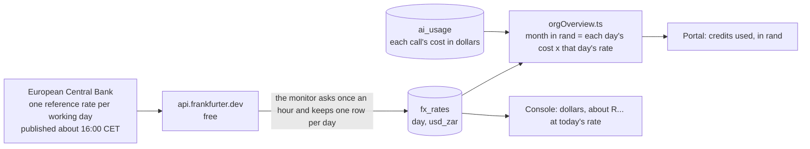
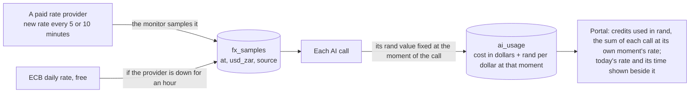

# A live rand-dollar rate for the portals (plan, not built)

Owner, 12 Nov 2026: "it's important to have a live exchange rate. Like it constantly needs to be changing ... I need you to think of it. This is
complex." Nothing here is bought or built; the owner decides the provider and the cost.

## TODAY (read from the code, 12 Nov 2026)

So the portals' rand figures change once a working day, not during the day, and a weekend uses Friday's rate.

## WILL BE

The idea that makes it fair: **each charge is turned into rand once, at the moment it happens**, at the rate of that moment, and never again. The
month's rand total then never jumps backwards or forwards when the rate moves, a customer can check any line, and the number beside it ("R16.56 per
dollar at 10:40") is what changes through the day.

## Providers (their own price pages, read 12 Nov 2026)

| Provider | Plan | Updates | Requests a month | Price a month | Commercial use |
|---|---|---|---|---|---|
| ExchangeRate-API | Pro | every 60 minutes | 30,000 | $10 | not stated on the page: to confirm |
| ExchangeRate-API | Business | every 5 minutes | 125,000 | $30 | not stated on the page: to confirm |
| currencylayer | Basic | every 60 minutes | 10,000 | $14.99 | yes |
| currencylayer | Enterprise | every 10 minutes | 100,000 | $59.99 | yes |
| ECB via frankfurter (today) | free | once a working day | unlimited | $0 | yes |

Sampling every 5 minutes is about 8,640 requests a month; every 10 minutes about 4,320; every hour 720. Every plan above covers that.

**Recommendation:** ExchangeRate-API Business at $30 a month (5-minute rate), once its terms confirm commercial use; otherwise currencylayer
Enterprise at $59.99 (10-minute rate). An hourly rate at $10 to $15 is the cheaper middle ground if "constantly" can mean "every hour".

## Order of work (all of it can be built and tested before anything is bought)

1. `fx_samples` table and a rate source with the provider behind one function (the ECB stays as the fallback, so it works with no key at all).
2. `ai_usage` gains the rand per dollar at the moment of each call, filled in as the call is recorded; past rows keep their day's rate.
3. The portal's credits card adds each line at its own rate and shows today's rate with its time; the console keeps dollars with "about R...".
4. Tests: a charge keeps its rand value when the rate later moves; the month adds each charge at its own rate; a provider failure falls back to
   the ECB and says so.
5. Only then: the owner buys the plan, the key goes into live's settings, and the monitor samples it.

## Decisions for the owner

1. Which provider and how often (5 minutes, 10 minutes, or hourly), and the monthly cost.
2. What a customer is billed: the dollars at each call's own rate (the plan above), or something simpler, such as the month's dollars at the rate on
   the invoice date. The plan above is fairer and auditable; a fixed invoice-date rate is easier to explain.
