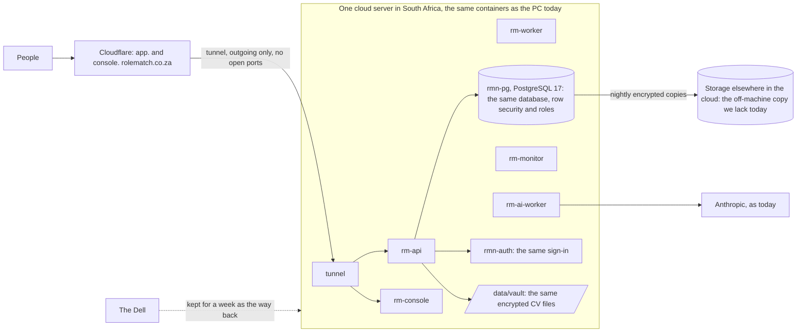

# Moving live off the PC now, paid for by startup credits (plan, 12 Nov 2026)

Owner, 12 Nov 2026 (after the area's power cut took live down at 11:04): "go do some serious research ... to see maybe if we can already be on the
databases and servers. If we're getting credit ... I just need an easy migration with a live server that does not live on my PC, as well as the
database ... I need to be able to still go into that console and see exactly the same things that we set up."

## The answer in one line

Yes. Apply for startup credits, then move the exact same containers, database and files onto **one cloud server in South Africa**. The move is the
one we did this morning from Ireland to the PC: side by side, copy, switch the tunnel, keep the PC as the way back. Portal isolation and the console
come across unchanged, because they live in our code and our database, not in the PC.

## What the credits are (each programme's own page, read 12 Nov 2026)

| Programme | For a self-funded startup | Can it pay for our AI? | Notes |
|---|---|---|---|
| [Microsoft for Startups](https://www.microsoft.com/en-us/startups) | "up to $5,000 ... through business verification", more later with usage | No: our AI models on Azure are bought through its marketplace, which credits do not pay; we keep paying Anthropic directly, as today | Johannesburg region; the corporate brand |
| [AWS Activate Founders](https://aws.amazon.com/startups/credits) | "Start with $1,000", some up to $5,000 | **Yes**: Activate credits pay for "Bedrock 3P Model Spend", i.e. Claude on Amazon Bedrock ([terms](https://aws.amazon.com/activate/terms/)) | Cape Town region; Claude reached from Cape Town by "global" routing (processed abroad, as today) |
| [Google for Startups](https://cloud.google.com/startup) | $2,000 for one year, for startups under 2 years old with a working product that "plan to seek venture funding soon" | Not checked | Johannesburg region |
| Oracle Always Free | Free for ever: 2 to 4 ARM processors, 12 to 24 GB | No | Johannesburg; **tried 5 Nov 2026: no capacity**, which is why live moved to the PC (`deploy/oracle/create-server.sh`) |

Credits are not a loan: nothing is paid back. They expire, they pay only that provider's eligible services, and when they run out normal billing
starts, so a spending alert and a limit go on from day one. AWS's terms add: credits "cannot be passed on to any end customers" (they pay for
running RoleMatch, not for reselling).

## What one server costs, and how long credits last

RoleMatch today is a small load (the database's nightly dump is 81 MB; about 120 AI calls a day). One server with 2 processors and 8 GB runs all of it.

| | Azure Johannesburg | AWS Cape Town |
|---|---|---|
| Server, 2 processors, 8 GB | D2s v5: $0.127/h, about $93/month | t3.large: $0.1085/h, about $79/month |
| Disk, 128 GB fast | about $24 | about $12 |
| Backup copies in storage elsewhere | a few dollars | a few dollars |
| **About a month** | **$120 (about R2,000)** | **$95 (about R1,600)** |
| $1,000 of credits lasts | about 8 months | about 10 months (less if the AI is also on credits) |
| $5,000 lasts | about 3½ years | about 4 years |

Sources: Microsoft's retail price list and ec2.shop's AWS prices, read 12 Nov 2026; rands at today's R16.56 per dollar.

## Owner's decision, 12 Nov 2026

"While in development ... I don't think we need to go balls to the walls ... We just need to have a live server and database. It's okay if we do
the upkeep for now." So: **one server, our own containers and our own database on it, upkeep by us.** No managed database or standby copy until a
corporate contract pays for them. Microsoft's verified credits are reported to last 180 days from approval (community answers on Microsoft's own
Q&A; to confirm when approved), which at about $120 a month uses a small part of them: that is fine.

## Recommendation

1. **Apply to Microsoft for Startups and AWS Activate Founders, both now.** Applying costs nothing.
2. **Move live to whichever approves first**, and prefer Microsoft if both do: up to $5,000, Johannesburg, and the name corporates already trust.
3. **Keep the AI as it is** (Anthropic directly). If AWS approves, moving the AI onto Bedrock so credits pay for it is a separate, measured step
   later (our code calls the AI in one place, `server/src/ai/claude.ts`; Bedrock's features must be checked against the ones we use).
4. **Same layout as the PC: one server, our own containers, our own database on it.** A managed database comes later, with the first corporate
   contract (`PLAN_AZURE_PRODUCTION.md`). Keeping our own database is what keeps the console's Database and Backups pages exactly as they are.

## Multi-tenancy and portal isolation: unchanged, and proven again after the move

Isolation is not in the PC. It is in:
- **The database:** row security on every table, the `rolematch_tenant` role, each company reading only its own portal's rows (`own_portal`
  policies, migrations 014 onwards, tested by `test/tenant-separation.test.ts`).
- **The files:** each organisation's own folder in the vault, each file encrypted with its path bound in, so a file copied to another company's
  folder fails its check (`server/src/fileVault.ts`).

Both move byte for byte. After the copy, the tenant-separation tests and the console's own checks run against the new server before the switch.

## The console: what stays and what changes

| Console page | After the move |
|---|---|
| Overview, Organisations, Portals, Activity, People, AI, Alerts, Schema, owner actions, support access, period switch | **Exactly the same**: all read from the database through the console's functions |
| Database | Exactly the same (our own PostgreSQL); its location line says Johannesburg (Azure) or Cape Town (AWS) |
| Backups and files | The same checks; "Copy on the Mac" becomes "Copy in storage elsewhere", which is better: an off-machine copy that does not depend on the Mac being on |
| Host lines (disk, clock, containers) | The same script (`deploy/pc/host-status.sh`) runs on the server; the PC-only lines (the Windows watchdog, the paused rm-db) are dropped |

## The move, step by step (the same method as this morning's move from Ireland)

| Step | Who | What |
|---|---|---|
| 1 | Owner | Apply to Microsoft for Startups and AWS Activate Founders: company details, website rolematch.co.za, a card for verification |
| 2 | Owner | Once approved: set a spending alert and limit; create the server from a script I write, run in the provider's own browser shell (as with Oracle on 5 Nov). I never hold the account's password |
| 3 | Me | Install Docker and our stack on it; it joins the tunnel at next.rolematch.co.za |
| 4 | Me | Copy live's database and files to it; run the full suite, tenant separation and the console's checks against it; measure speed beside live |
| 5 | Me, at a quiet time, with the owner's yes | Pause, final copy, switch the tunnel (instant), check; about 3 minutes unavailable |
| 6 | Me | Keep the PC as the way back for a week, then stop live there; the PC becomes development only |

Code changes needed: none for the application. Deploy scripts get a server variant of the PC's (`deploy/pc/` without the Windows and WSL parts),
and the backups' off-machine copy goes to cloud storage.

## Decisions for the owner

1. Apply to both programmes (recommended), or only one.
2. If both approve: Azure Johannesburg (recommended) or AWS Cape Town.
3. A UPS for the Dell is still worth it while it hosts live, which will be at least until the credits are approved.
