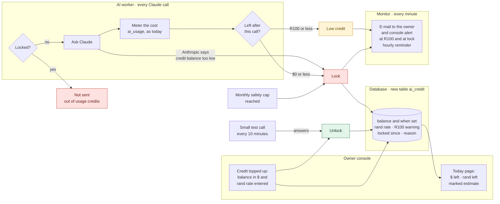
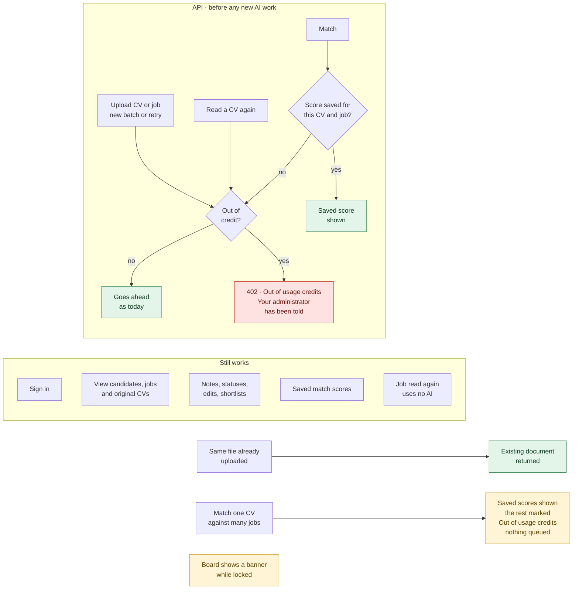
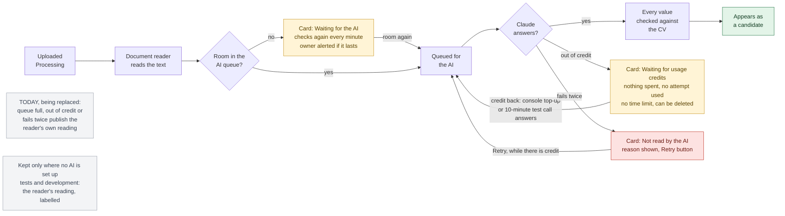
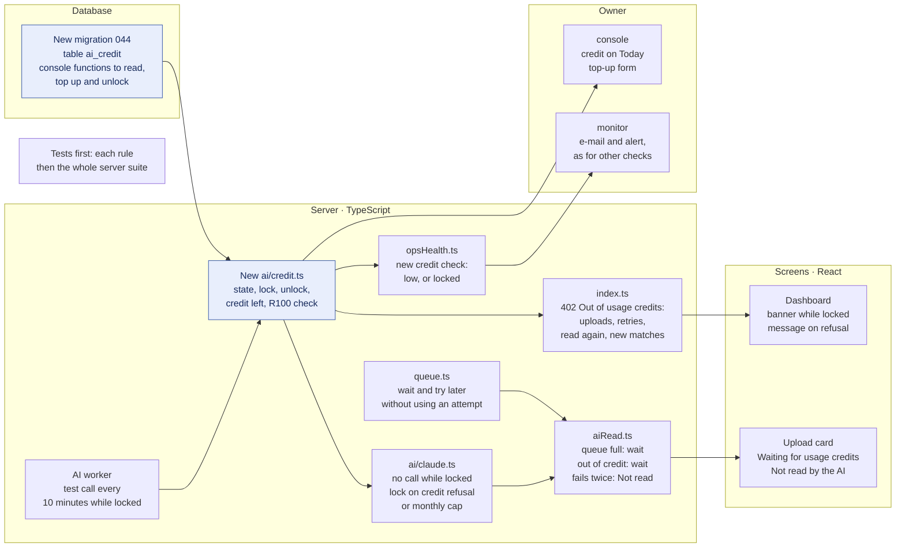

# Plan: out of usage credits

Mermaid source of the plan, 10 November 2026. Not built yet.

## Plan A: credit, warning, lock, unlock

## Plan B: what a recruiter can do when out of credit

## Plan C: a CV already in progress, no parser fallback

## Plan D: where in the code

