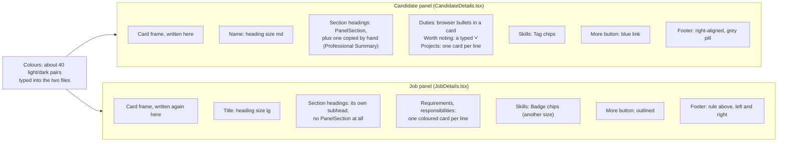
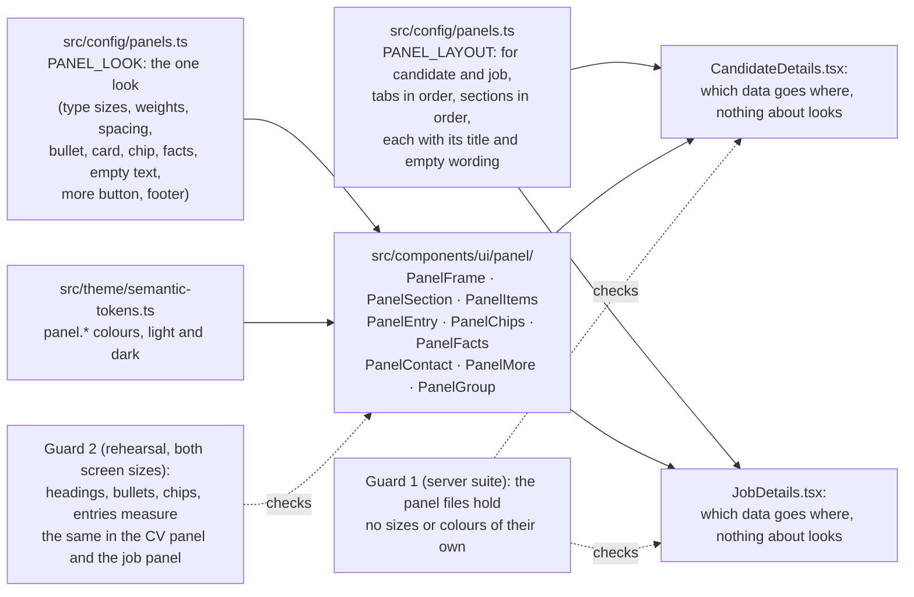

# Panels from one configuration

Owner, 11 Nov 2026: "We need to configure these panels to look the same, no matter how the CVs look. Same font, same sizes, same bullet points, same kind of header, same everything ... It must be clean, slick, corporate level ... No matter the CV, we need settings, configurations, rules, specifics, to ensure consistency."

Read from the code that runs on 11 Nov 2026 (`src/components/CandidateDetails.tsx`, `src/components/JobDetails.tsx`, `src/components/ui/PanelSection.tsx`, `src/components/ui/PanelTabs.tsx`).

## TODAY: each panel draws itself

The same thing is drawn in different ways: three kinds of bullet, two heading sizes for the record's name, two chip styles, two "show more" buttons, two footers. Every size and colour is typed inside the panel files, so keeping them alike depends on someone remembering to.

## WILL BE: one configuration, one set of building blocks

### The rules the configuration holds

| What | One rule for every panel |
|---|---|
| Record name | one heading size and weight; under it one muted line (role or company, then the rest joined by " · ") |
| Section | the same heading (bold, the blue rule under it, count in brackets) over the same grey box; a section never vanishes, it says in words that the document has nothing |
| A line of the document's own words (duty, requirement, responsibility, worth noting, project, anything under More) | one bullet: the same small marker, the same text size and spacing. A setting switches every list at once between bullets and cards |
| A thing with a heading of its own (a role, a qualification, a competency) | one card: white ground, thin coloured rule on the left; the rule's colour means one thing everywhere |
| A skill | one chip, the same size on both panels |
| A fact (location, pay, reports to) and a contact detail | label above value for facts; the contact line keeps its icon |
| More than the limit | one "View N more" / "Show fewer" button, and the limits come from Settings as now |
| Bottom of the panel | one footer: how it was read, View original, uploaded on |

### Order of work and how each step is proven

1. Add `PANEL_LOOK`, `PANEL_LAYOUT` and the `panel.*` colours. Nothing changes on screen yet.
2. Build the blocks in `src/components/ui/panel/` from the configuration alone.
3. Move the candidate panel onto the blocks. Proof: the hosted panel checks (same sections, same order, nothing clipped, phone width) still pass.
4. Move the job panel onto the same blocks, so it gains real sections. Proof: as above for jobs, with its sections listed.
5. Guards: a server-suite test that fails if a panel file sets its own size or colour, and a rehearsal check that measures heading, bullet, chip and card styles on a CV panel and a job panel and requires them equal, at desktop and phone size.
6. Look at both panels in the browser, light and dark, wide and narrow, with a clean CV, a thin one, a long one and an agency one. Then release.

Not in this step: the match assessment panel (`CandidateMatchPanel.tsx`). It moves onto the same blocks next, once these two are settled.
