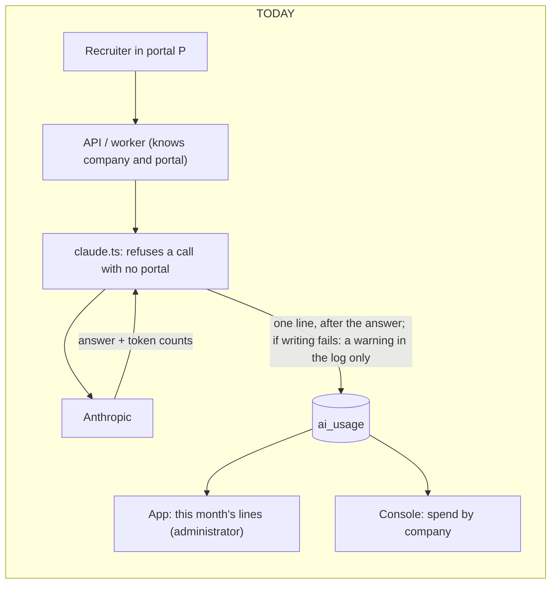
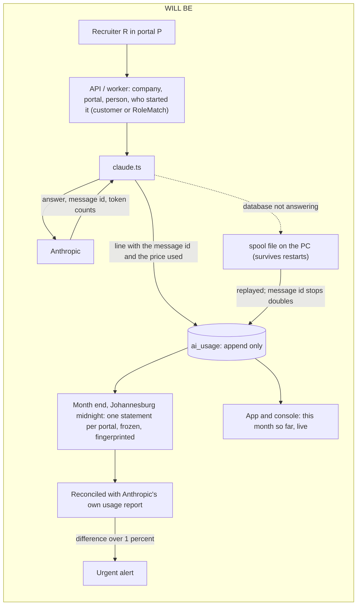

# Each portal: who is responsible for it, and exactly what its AI use cost (plan)

Owner, 11 Nov 2026: "I want to see the email of the portal administrator, whoever created the portal, or if it later switches, we need to see that ...
each portal, we need to be able to measure the AI credit usage ... this is probably where the money is going to be with this platform. So this is not
something that can just be taken as, just put it there now. This one needs to be solid."

Read from the running code and the live database (counts only) on 11 Nov 2026, release 02b9c0f. Nothing in sections 3 to 6 is built yet.

## 1. Today, measured

Every AI call goes through one place (`server/src/ai/claude.ts`). A call for a company outside a portal is refused before it is sent. After the
answer, one line is written to `ai_usage`: company, portal, billing account, purpose, model, the tokens Anthropic counted (including cached ones), the
cost in millionths of a dollar, and the outcome. A company's administrator sees their lines in the app; row security holds each company to its own.

Live, since metering began (8 Nov, 23:59 UTC):

| Measured | Value |
|---|---|
| lines | 1,920 |
| company lines with no portal | 0 |
| company lines with no billing account | 0 |
| platform lines (our own testing) | 7 |
| failed calls | 61, none charged |
| total | $13.35 |
| portals with no recorded creator | 0 of 6 |
| changes of administrator recorded in the company's audit log | yes: appointed, role changed, left, removed |

So the basics hold: nothing has gone unattributed so far. "So far" is not good enough for money. Section 2 lists what could still go wrong.

## 2. What could still go wrong (the gaps)

| # | Gap | What it would do to a bill | Seen live? |
|---|---|---|---|
| G1 | If writing the line fails (database busy, connection dropped), the call has still been paid to Anthropic, and the failure is only a warning in the log. | We pay, the customer is never billed. Silent. | not measurable today: nothing counts these warnings |
| G2 | Nothing stops a line being written twice, or changed or deleted afterwards. | A bill that cannot be trusted or reproduced. | no |
| G3 | Our own work is billed to the customer: on 11 Nov we re-read 67 CVs and 19 jobs on two portals to apply a reader fix; those calls are on those portals' lines. | The customer pays for our fixes. | **yes** |
| G4 | Months are cut at midnight UTC in the app and the AI limit, and at midnight Johannesburg in the console. | A call at 01:30 on the 1st is in one month on one screen and the previous month on another. | **yes**: the database runs on UTC. Fixed in code 16 Nov 2026 (code review C-M5): every month and day that decides money or counts goes through one helper (server/src/sast.ts, migration 065); not yet released |
| G5 | The line keeps only the cost, not the price it used. | When prices change, an old line cannot be explained. | no |
| G6 | Deleting a portal empties the portal on its lines (`on delete set null`). The portals plan being built elsewhere (PLAN_PEOPLE_AND_PORTALS.md, decision 7) relies on this. | Its past bills can no longer be reproduced. | not yet: no portal deleted |
| G7 | Deleting an account blanks the person's e-mail everywhere (the same plan, decision 6). | The person a past bill was addressed to disappears from it. | not yet |
| G8 | A company is not told what things cost: what reading one CV, one match and one batch upload typically comes to. | People cannot do the sums for themselves. | no |
| G9 | Nothing compares our total with Anthropic's invoice. | A metering fault would only show on our own bill. | no |

## 3. Who is responsible for a portal

For each portal the console shows:

- **created by**: the person and their e-mail, and when
- **administrator now**: name and e-mail (one administrator per portal, as the portals plan decides)
- **every change**: date, from whom, to whom, who made the change, and why (appointed, took over when the last one left, account deleted with a
  successor), from the company's audit log, which already records these
- **billing contact**: who the bill goes to; the administrator unless set otherwise

Each month's statement keeps a copy of the billing contact as they were that month. A later change of administrator never rewrites a past bill.

G7 needs your decision (section 7, question 1). A deleted person's e-mail is blanked everywhere for privacy, but a bill must say whom it was
addressed to, and South African tax rules require invoices to be kept for years. Proposed: blanked everywhere as planned, except on monthly statements,
which keep the billing contact's name and e-mail for 5 years. To confirm with an accountant.

## 4. The meter, made bill-grade

| Fix | Closes | How |
|---|---|---|
| Never lose a line | G1 | if the line cannot be written, it goes to a spool file on the PC and is written later; a line still waiting after 5 minutes raises an urgent alert |
| Never count one twice | G1, G2 | each line carries Anthropic's own message id, unique: a replay or a retry cannot add it again |
| Never change a line | G2 | the database refuses updates and deletes on `ai_usage`; a correction is a new line (a credit) with its reason and who made it |
| Who started it | G3 | each line says customer or RoleMatch (a re-read, a fix, an evaluation that we start). Recorded only: what is charged for it is the owner's decision, still open |
| One clock | G4 | every month is cut at midnight Johannesburg, everywhere: app, console, AI limit, statements |
| The price on the line | G5 | each line keeps the per-million-token prices it was charged at, so any line can be recalculated and explained |
| Portals are closed, not removed | G6 | deleting a portal deletes everything in it (CVs, jobs, matches, originals), but keeps its name and id as a closed portal, so its bills stand |
| Informed, not policed | G8 | the owner, 11 Nov 2026: "we can't control everything here, but they must be informed". The company's Overview shows what a CV read, a match and a batch upload typically cost, worked out from the company's own metered lines (the middle of the last 30 days, in rand), so anyone who sees that a match was run can do the sums. The AI is never named. No split by person |
| Statements | G2, G7 | at month end, one statement per portal: the totals by purpose, in dollars and in rand at a stated exchange rate, the billing contact, and a fingerprint of the lines it sums. Never changed afterwards |
| Reconciliation | G9 | each day, our total compared with Anthropic's own usage report; a difference over 1 percent is an urgent alert. Needs an Anthropic Admin key (section 7, question 3) |

What a customer pays for is the owner's to decide (11 Nov 2026: "I'm not paying for that ... I'll think of something creative. Just leave it as it is
for now"). Until then nothing changes in what is charged: the meter only records, for every call, who started it and how it ended, so whatever is
decided can be applied to the record exactly.

Not in this plan: what RoleMatch charges on top of the AI's cost (prepaid plans, credits, markup), and each company's own Anthropic key. Both are
planned separately. Both depend on this meter being exact first.

## 5. In the console

**Portals** (new page, and on each company's page):

| Portal | Company | Administrator (e-mail) | Created by | AI this month | Calls | Last month | Last activity |
|---|---|---|---|---|---|---|---|

Opening a portal shows:
- its administrator history as a timeline
- this month's spend by purpose, day by day, and the typical cost of a CV read, a match and a batch
- last month's frozen statement
- any lines that RoleMatch carried rather than billed

**AI** gains:
- the reconciliation result
- lines waiting in the spool (normally none)
- credits issued, and why

## 6. How it is proved (each a test, failing first)

1. Every company line has a portal, an account, a person, who started it and its prices: checked on the rehearsal, and on live each day (counts only).
2. With the database stopped mid-call, the line reaches the ledger afterwards, exactly once.
3. The same message id written twice gives one line.
4. An update or delete on `ai_usage` is refused, even by the platform.
5. A call at 23:59 and one at 00:01 Johannesburg on the last night of a month land in different months, the same way in the app, the console and the
   statement.
6. Ten portals in different companies, a hundred calls each at the same moment: every portal's total is exact to the cent, and no portal sees another's.
7. A portal deleted after a month of use: its statement is unchanged, line for line.
8. A re-read started by RoleMatch appears on the portal's page as carried by RoleMatch, and on no bill.
9. A statement's fingerprint changes if any line under it changes. Changing one has to be impossible anyway (test 4).

## 7. Decisions for the owner

1. A deleted person's e-mail on past statements: kept for 5 years, or removed? (Proposed: kept, to confirm with an accountant.)
2. What a customer pays for (failed calls, refused calls, work RoleMatch starts): the owner's, open. Charging stays as it is meanwhile.
3. Reconciliation needs an Admin key from the Anthropic console. Only you can create it. It is stored on the PC like the other key and never shown.

## 8. Order

1. G4 first (months cut at the wrong midnight, live), and recording who started each call (G3, recording only).
2. Then G1 and G2: no line lost, none doubled, none changed.
3. Then G5, G6, G8: the price on each line, closed portals, typical costs on the Overview.
4. Then statements, reconciliation and the console pages.
5. G6 and G7 touch the portals work in progress (PLAN_PEOPLE_AND_PORTALS.md, decisions 6 and 7). Agree the change with whoever is building that before
   either lands.
