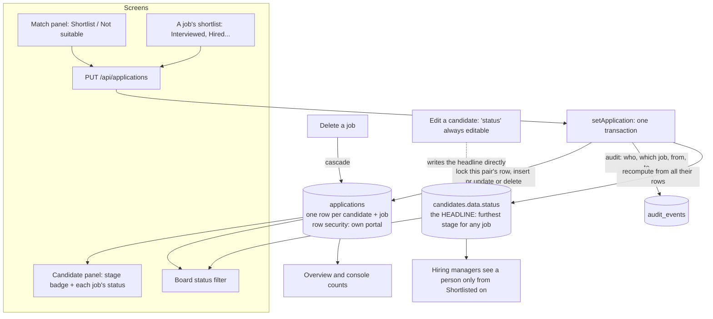
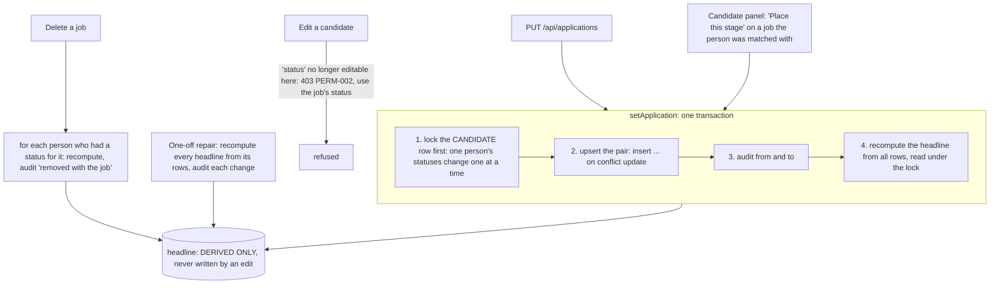

# Status per application: what is built, what is unsafe in production, and the fix (plan, 12 Nov 2026)

Owner, 12 Nov 2026: "lets map this out ... you need to think like this thing is already in production." Read from the running code on that day, not
from documents: `supabase/migrations/043_applications.sql`, `server/src/applications.ts`, `server/src/deletion.ts`, `server/src/editPolicy.ts`,
`server/src/hiringManager.ts`, `src/components/CandidateDetails.tsx`, `src/pages/Dashboard.tsx`.

**Correction first.** CLAUDE.md says "workflow status is still on the candidate rather than per application". That is out of date: status per job
was built on 9 Nov 2026 (commit ba69fdb, migration 043). What follows is the production review of that work.

## TODAY



What is right: one row per person and job, kept to its portal by row security, every change audited with from and to, the headline recomputed in the
same transaction, a hiring manager's sight limited to named stages, and old statuses placed on a job only where it could not be anyone else ("Nothing
is guessed").

## Production findings

| # | Finding (from the code) | What goes wrong for a customer | Severity |
|---|---|---|---|
| P1 | The first status for a pair is a plain `insert`; the lock (`for update`) only holds a row that already exists | Two recruiters shortlist the same person for the same job within the same moment: one gets an error (unique key) instead of the same result | Medium |
| P2 | The headline is computed from the rows this transaction can see; nothing locks the candidate | Two recruiters set statuses for one person on two different jobs at once: the last to commit writes a headline that ignores the other's change. A person "Interviewed" for job B can show "Shortlisted" | Medium |
| P3 | Deleting a job removes its rows by cascade (`deletion.ts`) but never recomputes the headline | A person shortlisted only for the deleted job keeps "Shortlisted": the panel says "(job not recorded)", the board filter finds them, and **hiring managers can still see someone on no shortlist** | **High** (who sees whom) |
| P4 | The headline is also writable directly: `status` is always editable on a candidate (`editPolicy.ts`), with no job | Any client (or a future screen) can set "Hired" with no job, and the headline then disagrees with every per-job row | Medium |
| P5 | Statuses from before 9 Nov that could not be placed show "(job not recorded)", and there is no way for a recruiter to place them | The record stays ambiguous for ever | Low |
| P6 | A closed or archived job's statuses still count towards the headline | A person shortlisted for a job closed months ago still reads "Shortlisted" everywhere | Decision |

## WILL BE



## The work, in order, each step proven

1. **P1 and P2 together:** in `setApplication`, lock the candidate (`select ... from candidates where id = ... for update`) before anything else, re-read
   it inside the transaction, and upsert the pair. Test: 20 parallel requests on one person across two jobs end with the right headline and no error.
2. **P3:** in `deleteRecord` for a job, inside the same transaction and before the cascade, list the people with a status for it, then recompute each
   headline and audit `application.removed_with_job`. Test: shortlisted only for a deleted job, the person goes back to New, and a hiring manager no
   longer sees them.
3. **P4:** drop `status` from the candidate's always-editable fields; an attempt is refused with the policy's usual 403 and a message naming the job's
   status. First check that no screen sends it (none found on 12 Nov). Jobs keep their own status (open, closed) unchanged.
4. **Repair, once:** a migration recomputes every headline from its rows and records each change in the audit log by no person (RoleMatch). Before
   releasing, run the read-only count below on live to know how many it will change; it must be explained, not surprising.
5. **P5:** a small "Place this stage" control on the candidate panel, listing only the jobs the person was matched with; never guessed, audited.
6. **P6:** after the owner's decision.

```sql
-- How many people's headline disagrees with their per-job statuses today (read-only; run on live before step 4)
select count(*) from candidates c
where coalesce(c.data->>'status', 'new') <> 'new'
  and not exists (select 1 from applications a where a.candidate_id = c.id and a.status not in ('declined'));
```

## Release like production

- Every step is additive: no column is dropped, no screen loses anything; the repair is idempotent (running it twice changes nothing more).
- The full suite plus the new tests pass first; release.sh takes its backup before the migration, as always.
- Rollback is the previous image; the repair's audit lines say what it changed, so even its effect can be reversed by hand.

## Decisions for the owner

1. **P6:** should a closed or archived job still count towards a person's headline stage? Suggested: no; the job's own list keeps its statuses as
   history, but the headline, the board filter and hiring managers' sight follow open jobs only.
2. **P5:** is "Place this stage" worth building, or should old unplaced statuses simply be cleared to New with an audit line? Suggested: build it; it
   is small, and nothing a recruiter set is silently thrown away.
