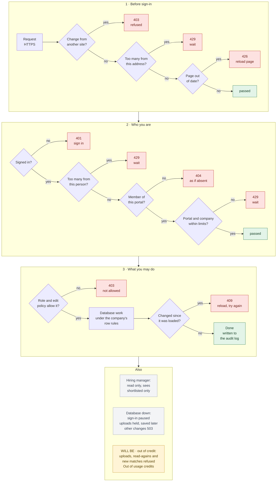
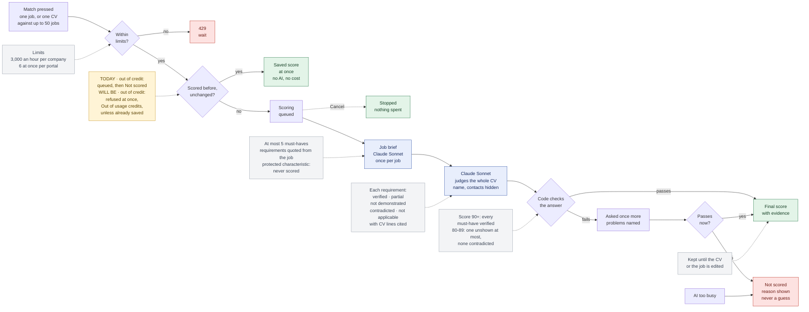

# RoleMatch: how the API behaves

Mermaid source of each diagram, checked against the code on 10 November 2026. Paste a block into a Mermaid viewer to see it drawn.

## Every API request

## How a match runs

