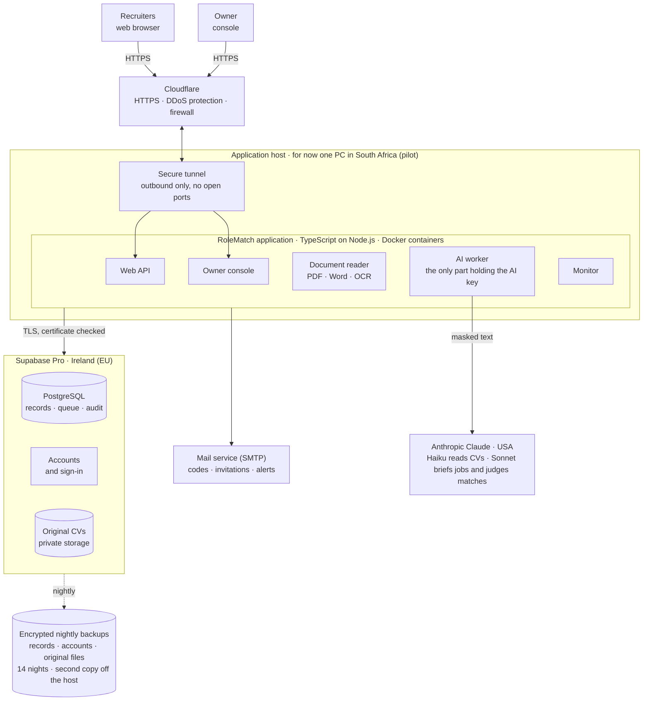
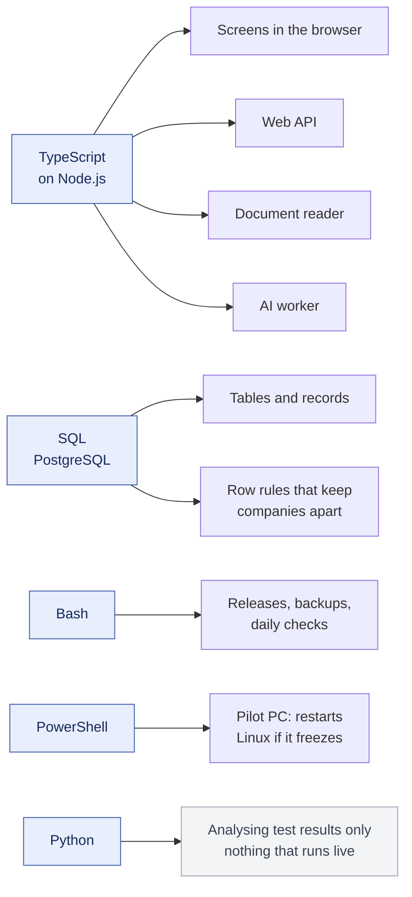
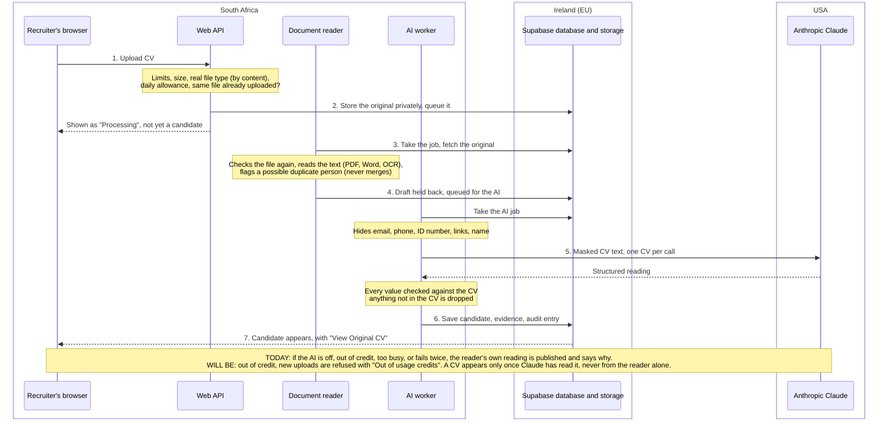
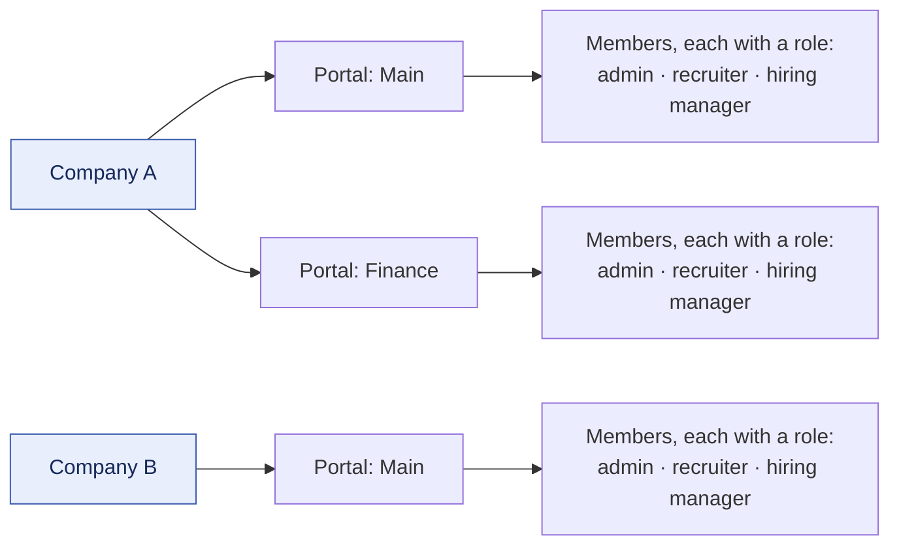
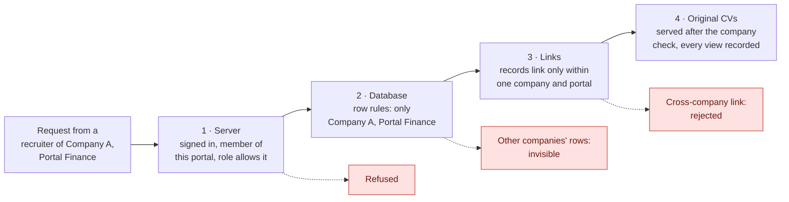

# RoleMatch: how it's built

Mermaid source of each diagram, checked against the code on 10 November 2026. Paste a block into a Mermaid viewer to see it drawn.

## What runs where

## Languages and where they run

## One CV's journey

## Who belongs where

## 3b. Four separation checks

