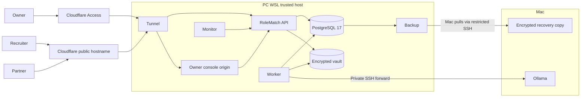

# Architecture and flows

Proposed topology from ADR-004 §§3, 9–10. Current seams: server/src/{supabase,db,queue,localVault,originalsCopy,auth,tokens,passkeys}.ts.

| Boundary | Proposed endpoint |
|---|---|
| Browser/partner to edge | HTTPS 443, distinct application and console origins |
| Tunnel to origins | Outbound only. Preserve existing loopback deployment mapping, separate console port in config, deny unmatched host |
| PostgreSQL | 5432 inside private namespace, host publication loopback only if needed, prefer Unix socket for local administration |
| PC to model | Existing 127.0.0.1:11500 forward; no public Ollama |
| Operator / Mac collection | SSH 22 restricted to approved home LAN addresses and separate key principals |
| Worker outbound | Existing configured SMTP, model forward and explicitly approved webhook destinations |

Container loopback is namespace-local. Use a private Docker network with no public port publishing or a shared Unix socket. Verify Windows, WSL and Docker exposure separately.

| Flow | Ordered actions and boundary |
|---|---|
| Upload | Session → portal membership → quota/idempotency → encrypted durable write → document + queue commit → processing card |
| Extraction | Claim lease → authorised document read → parser/OCR → Mac via SSH → evidence validation → one transaction publishes record and terminal state |
| Match | User selects Match → scoped candidate/job versions → configured evidence assessment → immutable snapshot → explain result |
| Original | Authorise → short grant → reauthorise on redemption → decrypt and serve with no-store |
| Delete | Authorise → tombstone/revoke grants → scrub scoped records and append audit → outbox removes bytes and verifies |
| Sign-in | Edge guard → shared attempt reservation → credentials → membership → session/cookies |
| Refresh | Read cookie → atomic family rotation → new cookies or revoke on replay |
| Reset | Generic request response → eligible code through mail → verify atomically → replace hash and revoke all sessions |
| Passkey | Issue bound challenge → verify RP/origin/user verification → consume challenge and create session |
| Console | Access assertion + owner session → allowlisted query → masked response or audited reveal |
| Alert | Commit redacted event → SSE replay + channel delivery → acknowledge or resolve |

Separate identity authority, tenant transactions, owner operations and model inference. A model result cannot write directly to PostgreSQL. Preserve release/config provenance for extraction and matching. See [identity sequences](05_IDENTITY.md) and [cutover](12_MIGRATION_AND_CUTOVER.md).
