# Schema (generated from the database)

Written by `server/src/scripts/schemaBible.ts` from a database built by the migrations; **do not edit by hand**. A test fails when this file and the migrations disagree.
Purpose, personal information and retention come from `data-classes.json`; owners and grants are in `04_ROLES_AND_SECURITY.md` and `deploy/db/`.

48 tables. Row security is on for 48 of them.

```mermaid
erDiagram
  BILLING_ACCOUNTS ||--o{ AI_USAGE : "ai_usage_account_id_fkey"
  ORGS ||--o{ AI_USAGE : "ai_usage_org_id_fkey"
  PORTALS ||--o{ AI_USAGE : "ai_usage_portal_id_fkey"
  CANDIDATES ||--o{ APPLICATIONS : "applications_candidate_id_portal_id_fkey"
  JOBS ||--o{ APPLICATIONS : "applications_job_id_portal_id_fkey"
  PORTALS ||--o{ APPLICATIONS : "applications_portal_id_org_id_fkey"
  ORGS ||--o{ AUDIT_EVENTS : "audit_events_org_id_fkey"
  UPLOAD_BATCHES ||--o{ BATCH_ACKNOWLEDGEMENTS : "batch_acknowledgements_batch_id_portal_id_fkey"
  PORTALS ||--o{ BATCH_ACKNOWLEDGEMENTS : "batch_acknowledgements_portal_id_org_id_fkey"
  MEMBERS ||--o{ BATCH_ACKNOWLEDGEMENTS : "batch_acknowledgements_user_id_fkey"
  ORGS ||--o{ BILLING_ACCOUNTS : "billing_accounts_org_id_fkey"
  DOCUMENTS ||--o{ CANDIDATES : "candidates_document_id_fkey"
  DOCUMENTS ||--o{ CANDIDATES : "candidates_document_portal_fk"
  ORGS ||--o{ CANDIDATES : "candidates_org_id_fkey"
  PORTALS ||--o{ CANDIDATES : "candidates_portal_org_fk"
  ORGS ||--o{ DEFECT_GROUPS : "defect_groups_org_id_fkey"
  PORTALS ||--o{ DEFECT_GROUPS : "defect_groups_portal_org_fk"
  UPLOAD_BATCHES ||--o{ DOCUMENTS : "documents_batch_id_fkey"
  UPLOAD_BATCHES ||--o{ DOCUMENTS : "documents_batch_portal_fk"
  MEMBERS ||--o{ DOCUMENTS : "documents_created_by_fkey"
  ORGS ||--o{ DOCUMENTS : "documents_org_id_fkey"
  PORTALS ||--o{ DOCUMENTS : "documents_portal_org_fk"
  ORGS ||--o{ ERROR_OCCURRENCES : "error_occurrences_org_id_fkey"
  PORTALS ||--o{ ERROR_OCCURRENCES : "error_occurrences_portal_org_fk"
  ORGS ||--o{ ERROR_REGISTER : "error_register_org_id_fkey"
  PORTALS ||--o{ ERROR_REGISTER : "error_register_portal_org_fk"
  IDENTITY_ACCOUNTS ||--o{ IDENTITY_CODES : "identity_codes_account_id_fkey"
  IDENTITY_ACCOUNTS ||--o{ IDENTITY_SESSIONS : "identity_sessions_account_id_fkey"
  DOCUMENTS ||--o{ JOBS : "jobs_doc_fk"
  DOCUMENTS ||--o{ JOBS : "jobs_document_portal_fk"
  ORGS ||--o{ JOBS : "jobs_org_fk"
  PORTALS ||--o{ JOBS : "jobs_portal_org_fk"
  OUTBOX ||--o{ MAIL_ATTEMPTS : "mail_attempts_outbox_id_fkey"
  CANDIDATES ||--o{ MATCHES : "matches_candidate_id_fkey"
  CANDIDATES ||--o{ MATCHES : "matches_candidate_portal_fk"
  MEMBERS ||--o{ MATCHES : "matches_created_by_fkey"
  JOBS ||--o{ MATCHES : "matches_job_id_fkey"
  JOBS ||--o{ MATCHES : "matches_job_portal_fk"
  ORGS ||--o{ MATCHES : "matches_org_id_fkey"
  PORTALS ||--o{ MATCHES : "matches_portal_org_fk"
  ORGS ||--o{ MEMBERS : "members_org_id_fkey"
  USERS ||--o{ MEMBERS : "members_user_id_fkey"
  PORTALS ||--o{ MODEL_PROPOSALS : "model_proposals_portal_id_org_id_fkey"
  MODEL_REVIEWS ||--o{ MODEL_PROPOSALS : "model_proposals_review_id_fkey"
  PORTALS ||--o{ MODEL_REVIEWS : "model_reviews_portal_id_org_id_fkey"
  ORGS ||--o{ ORG_SETTINGS : "org_settings_org_id_fkey"
  MEMBERS ||--o{ ORG_SETTINGS : "org_settings_updated_by_fkey"
  MEMBERS ||--o{ ORG_SETTINGS_HISTORY : "org_settings_history_changed_by_fkey"
  ORGS ||--o{ ORG_SETTINGS_HISTORY : "org_settings_history_org_id_fkey"
  PORTALS ||--o{ OUTBOX : "outbox_portal_id_org_id_fkey"
  PORTALS ||--o{ PORTAL_CAPACITY : "portal_capacity_portal_id_org_id_fkey"
  ORGS ||--o{ PORTAL_DAILY : "portal_daily_org_id_fkey"
  PORTALS ||--o{ PORTAL_DAILY : "portal_daily_portal_id_fkey"
  PORTALS ||--o{ PORTAL_INVITATIONS : "portal_invitations_portal_id_org_id_fkey"
  PORTALS ||--o{ PORTAL_MEMBERS : "portal_members_portal_id_org_id_fkey"
  MEMBERS ||--o{ PORTAL_MEMBERS : "portal_members_user_id_fkey"
  ORGS ||--o{ PORTALS : "portals_org_id_fkey"
  ORGS ||--o{ QUEUE : "queue_org_id_fkey"
  PORTALS ||--o{ QUEUE : "queue_portal_org_fk"
  PORTALS ||--o{ QUOTA_HOLDS : "quota_holds_portal_id_org_id_fkey"
  MEMBERS ||--o{ UPLOAD_BATCHES : "upload_batches_created_by_fkey"
  ORGS ||--o{ UPLOAD_BATCHES : "upload_batches_org_id_fkey"
  UPLOAD_BATCHES ||--o{ UPLOAD_BATCHES : "upload_batches_parent_batch_id_fkey"
  PORTALS ||--o{ UPLOAD_BATCHES : "upload_batches_portal_org_fk"
  PORTALS ||--o{ UPLOAD_HISTORY_REMOVED : "upload_history_removed_portal_id_org_id_fkey"
  AI_PLATFORM_MONTH {
    timestamptz month
    bigint settled_micro
    bigint held_micro
  }
  AI_RATE {
    text model
    timestamptz minute
    integer requests
    integer input_tokens
    integer output_tokens
  }
  AI_USAGE {
    bigint id
    uuid org_id
    text purpose
    text provider
    text model
    integer input_tokens
    integer output_tokens
    bigint cost_micro_usd
    text outcome
    timestamptz at
    uuid portal_id
    uuid account_id
    integer cache_read_tokens
    integer cache_write_tokens
  }
  APPLICATIONS {
    uuid id
    uuid org_id
    uuid portal_id
    uuid candidate_id
    uuid job_id
    text status
    uuid created_by
    uuid updated_by
    timestamptz created_at
    timestamptz updated_at
  }
  AUDIT_EVENTS {
    uuid id
    uuid org_id
    uuid actor_id
    text action
    text entity_type
    uuid entity_id
    jsonb detail
    text correlation_id
    timestamptz created_at
    uuid portal_id
  }
  BATCH_ACKNOWLEDGEMENTS {
    uuid batch_id
    uuid portal_id
    uuid org_id
    uuid user_id
    timestamptz acknowledged_at
  }
  BILLING_ACCOUNTS {
    uuid org_id
    uuid id
    timestamptz opened_at
  }
  CANDIDATES {
    uuid id
    uuid org_id
    uuid document_id
    jsonb data
    jsonb extracted
    integer version
    timestamptz created_at
    timestamptz updated_at
    text search
    uuid portal_id
  }
  CONSOLE_ACTIONS {
    bigint id
    timestamptz at
    text action
    text target_kind
    uuid target_id
    text target_name
    jsonb detail
    text by_email
  }
  CONSOLE_CODES {
    text pending_hash
    text code_hash
    timestamptz issued_at
    timestamptz used_at
    text owner_email
  }
  CONSOLE_OWNER {
    text email
    text password_hash
    timestamptz set_at
    text set_by
    smallint slot
  }
  CONSOLE_SESSIONS {
    text id_hash
    timestamptz started_at
    timestamptz last_used_at
    timestamptz ends_at
    timestamptz ended_at
    text client
    text owner_email
  }
  DEFECT_GROUPS {
    uuid org_id
    text defect_key
    text component
    text code
    text kind
    timestamptz first_seen
    timestamptz last_seen
    integer occurrences
    text status
    text register_ref
    uuid status_changed_by
    timestamptz status_changed_at
    uuid portal_id
  }
  DOCUMENTS {
    uuid id
    uuid org_id
    text kind
    text original_name
    text mime
    integer size
    text sha256
    text storage_path
    text status
    text stage
    text scan_result
    text error_code
    text error_message
    uuid record_id
    text source_text
    uuid created_by
    timestamptz created_at
    timestamptz updated_at
    timestamptz dismissed_at
    bigint original_size
    boolean optimised
    uuid batch_id
    integer manual_retries
    uuid portal_id
    text uploaded_by_email
    jsonb awaiting_audit
  }
  ERROR_OCCURRENCES {
    uuid id
    uuid org_id
    timestamptz occurred_at
    text correlation_id
    text component
    text stage
    text code
    text kind
    text severity
    uuid batch_id
    uuid document_id
    uuid user_id
    text defect_key
    integer attempt
    jsonb versions
    jsonb detail
    uuid portal_id
  }
  ERROR_REGISTER {
    uuid id
    uuid org_id
    text record_kind
    uuid record_id
    uuid document_id
    text field_path
    jsonb from_value
    jsonb to_value
    text change_kind
    text category
    text status
    text parser_version
    uuid created_by
    timestamptz created_at
    uuid portal_id
    text scope
    text permitted_use
    text component
    text component_version
    jsonb evidence_ref
    text label_provenance
    text experiment
    text regression_case
    text decision
    text dedupe_key
  }
  FILE_REMOVALS {
    text path
    timestamptz requested_at
    integer tries
    text last_error
  }
  FX_RATES {
    date day
    numeric_12_6_ usd_zar
    date published
    text source
    timestamptz fetched_at
  }
  IDENTITY_ACCOUNTS {
    uuid id
    text email
    text password_hash
    timestamptz confirmed_at
    jsonb meta
    timestamptz created_at
    timestamptz password_set_at
  }
  IDENTITY_CODES {
    bigint id
    uuid account_id
    text purpose
    text digest
    timestamptz issued_at
    timestamptz used_at
    timestamptz superseded_at
  }
  IDENTITY_SESSIONS {
    uuid id
    uuid account_id
    timestamptz signed_in_at
    text refresh_hash
    text previous_hash
    timestamptz refreshed_at
    timestamptz ends_at
    timestamptz ended_at
    text ended_why
  }
  JOBS {
    uuid id
    uuid org_id
    uuid document_id
    jsonb data
    jsonb extracted
    integer version
    timestamptz created_at
    timestamptz updated_at
    text search
    uuid portal_id
  }
  MAIL_ATTEMPTS {
    uuid id
    uuid outbox_id
    uuid org_id
    uuid portal_id
    text class
    text template
    text template_version
    text transport
    boolean simulated
    text recipient_hash
    text recipient_domain
    timestamptz started_at
    timestamptz finished_at
    text outcome
    integer smtp_code
    text error_class
    text message_id
    text response
  }
  MAIL_SUPPRESSIONS {
    text recipient_hash
    text reason
    text enhanced_status
    timestamptz created_at
    timestamptz expires_at
  }
  MATCHES {
    uuid id
    uuid org_id
    uuid candidate_id
    uuid job_id
    integer candidate_version
    integer job_version
    text engine_version
    jsonb result
    uuid created_by
    timestamptz created_at
    uuid portal_id
  }
  MEMBERS {
    uuid user_id
    uuid org_id
    text name
    text role
    timestamptz created_at
    text email
    boolean can_create_portals
    timestamptz left_at
  }
  MODEL_PROPOSALS {
    uuid id
    uuid org_id
    uuid portal_id
    uuid review_id
    uuid subject_id
    text field
    text value
    text quote
    integer line
    text recorded
    text outcome
    text decision
    uuid decided_by
    timestamptz decided_at
    boolean undone
    text model
    text prompt_version
    text policy_version
    timestamptz created_at
  }
  MODEL_REVIEWS {
    uuid id
    uuid org_id
    uuid portal_id
    text kind
    uuid subject_id
    text input_hash
    text status
    text model
    text model_digest
    text prompt_version
    jsonb result
    text reason
    integer ms
    timestamptz created_at
    timestamptz finished_at
    timestamptz lease_at
  }
  ORG_SETTINGS {
    uuid org_id
    integer version
    jsonb settings
    uuid updated_by
    timestamptz updated_at
  }
  ORG_SETTINGS_HISTORY {
    uuid id
    uuid org_id
    integer version
    jsonb settings
    jsonb change
    uuid changed_by
    timestamptz created_at
  }
  ORGS {
    uuid id
    text name
    timestamptz created_at
    numeric_10_2_ ai_monthly_cap_usd
  }
  OUTBOX {
    uuid id
    uuid org_id
    uuid portal_id
    text kind
    uuid aggregate_id
    integer version
    text dedupe_key
    jsonb payload
    text status
    text class
    smallint priority
    timestamptz expires_at
    integer attempts
    integer max_attempts
    timestamptz run_after
    timestamptz locked_at
    text last_error
    timestamptz created_at
    timestamptz done_at
  }
  OWNER_EVENTS {
    bigint id
    text fingerprint
    text severity
    text source
    text title
    text meaning
    text action
    timestamptz first_at
    timestamptz last_at
    integer times
    timestamptz cleared_at
    timestamptz acknowledged_at
    timestamptz muted_until
  }
  PASSWORD_RESETS {
    uuid id
    text email
    text code_hash
    timestamptz issued_at
    timestamptz superseded_at
    timestamptz consumed_at
  }
  PORTAL_CAPACITY {
    uuid portal_id
    uuid org_id
    integer reserved
  }
  PORTAL_DAILY {
    uuid portal_id
    uuid org_id
    date day
    integer cvs
    integer jobs
    integer matches
    integer shortlisted
    integer failed
    integer ai_calls
    bigint ai_micro_usd
    timestamptz refreshed_at
  }
  PORTAL_INVITATIONS {
    uuid id
    uuid org_id
    uuid portal_id
    text email
    text role
    text token_hash
    uuid invited_by
    text invited_by_email
    timestamptz created_at
    timestamptz expires_at
    timestamptz accepted_at
    uuid accepted_by
    timestamptz revoked_at
    integer token_version
    text email_state
    integer email_attempts
    timestamptz email_sent_at
    text email_last_error
    integer resend_count
  }
  PORTAL_MEMBERS {
    uuid portal_id
    uuid org_id
    uuid user_id
    text role
    uuid added_by
    timestamptz created_at
    timestamptz last_seen_at
  }
  PORTALS {
    uuid id
    uuid org_id
    text name
    uuid created_by
    timestamptz created_at
  }
  QUEUE {
    uuid id
    uuid org_id
    text type
    jsonb payload
    text status
    integer attempts
    integer max_attempts
    timestamptz run_after
    text last_error
    timestamptz created_at
    timestamptz locked_at
    uuid portal_id
  }
  QUOTA_HOLDS {
    uuid id
    uuid org_id
    uuid portal_id
    text kind
    integer units
    bigint bytes
    timestamptz expires_at
  }
  RATE_LIMITS {
    text key
    bigint window_start
    integer count
  }
  SCHEMA_MIGRATIONS {
    text name
    timestamptz applied_at
  }
  SIGNED_OUT_SESSIONS {
    text session_hash
    bigint expires_at
  }
  SIGNUP_CHALLENGES {
    uuid id
    text email
    text code_hash
    timestamptz issued_at
    timestamptz superseded_at
    timestamptz consumed_at
  }
  SUPPORT_ACCESS {
    bigint id
    uuid portal_id
    uuid org_id
    text reason
    timestamptz opened_at
    timestamptz ends_at
  }
  UPLOAD_BATCHES {
    uuid id
    uuid org_id
    uuid created_by
    text kind
    integer declared_files
    bigint declared_bytes
    integer duplicate_files
    jsonb refusals
    timestamptz cancelled_at
    timestamptz last_activity_at
    timestamptz closed_at
    timestamptz created_at
    jsonb skipped
    jsonb duplicate_names
    uuid portal_id
    integer reserved_slots
    text reservation_state
    timestamptz released_at
    timestamptz finished_at
    uuid parent_batch_id
    text submitted_by_email
    text request_key
  }
  UPLOAD_HISTORY_REMOVED {
    uuid id
    uuid org_id
    uuid portal_id
    text kind
    text uploaded_by
    timestamptz uploaded_at
    boolean via_batch
    text deleted_by
    timestamptz deleted_at
  }
```

## ai_platform_month

The platform's AI spend per Johannesburg month, settled and held, kept by a trigger on ai_usage on every write to it (066_ai_platform_month.sql); every call reserves against it, so the platform's monthly budget is held exactly.

* **Personal information:** None: a month and two sums of money.
* **Kept:** Kept with the ai_usage rows it sums: 7 years.
* **Row security:** on

| Column | Type | Required | Default |
|---|---|---|---|
| month | timestamp with time zone | yes |  |
| settled_micro | bigint | yes | `0` |
| held_micro | bigint | yes | `0` |

**Constraints**

* `ai_platform_month_pkey`: `PRIMARY KEY (month)`

**Indexes**

* `ai_platform_month_pkey`: `UNIQUE USING btree (month)`

## ai_rate

The platform's shared per-minute count of what has been asked of each Claude model (requests, input and output tokens), so every server together stays inside Anthropic's limits.

* **Personal information:** None: a model name, a minute and three counts.
* **Kept:** A day; the AI worker deletes older minutes every hour.
* **Row security:** on

| Column | Type | Required | Default |
|---|---|---|---|
| model | text | yes |  |
| minute | timestamp with time zone | yes |  |
| requests | integer | yes | `0` |
| input_tokens | integer | yes | `0` |
| output_tokens | integer | yes | `0` |

**Constraints**

* `ai_rate_pkey`: `PRIMARY KEY (model, minute)`

**Indexes**

* `ai_rate_pkey`: `UNIQUE USING btree (model, minute)`

## ai_usage

One row per call to Claude (Anthropic, owner 8 Nov 2026): organisation, portal, billing account, purpose, model, tokens (cache reads and writes apart) and cost; what each portal's monthly bill and the platform's safety cap are counted from. Each organisation reads its own lines; each portal only its own.

* **Personal information:** None: no text of any question or answer, no name or address; only the organisation, portal and account ids.
* **Kept:** Kept for 7 years as billing records; a deleted portal's or organisation's rows lose their ids.
* **Row security:** on

| Column | Type | Required | Default |
|---|---|---|---|
| id | bigint | yes |  |
| org_id | uuid |  |  |
| purpose | text | yes |  |
| provider | text | yes |  |
| model | text | yes |  |
| input_tokens | integer | yes | `0` |
| output_tokens | integer | yes | `0` |
| cost_micro_usd | bigint | yes | `0` |
| outcome | text | yes |  |
| at | timestamp with time zone | yes | `now()` |
| portal_id | uuid |  |  |
| account_id | uuid |  |  |
| cache_read_tokens | integer | yes | `0` |
| cache_write_tokens | integer | yes | `0` |

**Constraints**

* `ai_usage_cache_read_tokens_check`: `CHECK ((cache_read_tokens >= 0))`
* `ai_usage_cache_write_tokens_check`: `CHECK ((cache_write_tokens >= 0))`
* `ai_usage_cost_micro_usd_check`: `CHECK ((cost_micro_usd >= 0))`
* `ai_usage_input_tokens_check`: `CHECK ((input_tokens >= 0))`
* `ai_usage_outcome_check`: `CHECK ((outcome = ANY (ARRAY['answered'::text, 'refused'::text, 'failed'::text, 'reserved'::text, 'uncertain'::text])))`
* `ai_usage_output_tokens_check`: `CHECK ((output_tokens >= 0))`
* `ai_usage_purpose_check`: `CHECK ((purpose = ANY (ARRAY['extraction'::text, 'matching'::text, 'evaluation'::text])))`
* `ai_usage_account_id_fkey`: `FOREIGN KEY (account_id) REFERENCES billing_accounts(id) ON DELETE SET NULL`
* `ai_usage_org_id_fkey`: `FOREIGN KEY (org_id) REFERENCES orgs(id) ON DELETE SET NULL`
* `ai_usage_portal_id_fkey`: `FOREIGN KEY (portal_id) REFERENCES portals(id) ON DELETE SET NULL`
* `ai_usage_pkey`: `PRIMARY KEY (id)`

**Indexes**

* `ai_usage_account_month`: `USING btree (account_id, at)`
* `ai_usage_month`: `USING btree (at)`
* `ai_usage_org_month`: `USING btree (org_id, at)`
* `ai_usage_pkey`: `UNIQUE USING btree (id)`
* `ai_usage_portal_month`: `USING btree (portal_id, at)`
* `ai_usage_reserved`: `USING btree (org_id, at) WHERE (outcome = 'reserved'::text)`

**Row-security policies**

* `own_org` (SELECT to {rolematch_tenant}): `((org_id = ( SELECT (NULLIF(current_setting('app.org_id'::text, true), ''::text))::uuid AS "nullif")) AND ((( SELECT NULLIF(current_setting('app.portal_id'::text, true), ''::text) AS "nullif") IS NULL) OR (portal_id = ( SELECT (NULLIF(current_setting('app.portal_id'::text, true), ''::text))::uuid AS "nullif"))))`

**Triggers**

* `ai_usage_platform_month`: `CREATE TRIGGER ai_usage_platform_month AFTER INSERT OR DELETE OR UPDATE OF outcome, cost_micro_usd, at ON ai_usage FOR EACH ROW EXECUTE FUNCTION ai_platform_month_track()`

## applications

A candidate's workflow status for one job (shortlisted, not suitable, interviewed, hired): who set it and when; the history is in the audit log.

* **Personal information:** Links a person to a job decision: medium sensitivity.
* **Kept:** Not set; removed with the candidate or the job.
* **Row security:** on

| Column | Type | Required | Default |
|---|---|---|---|
| id | uuid | yes | `gen_random_uuid()` |
| org_id | uuid | yes |  |
| portal_id | uuid | yes | `(NULLIF(current_setting('app.portal_id'::text, true), ''::text))::uuid` |
| candidate_id | uuid | yes |  |
| job_id | uuid | yes |  |
| status | text | yes |  |
| created_by | uuid |  |  |
| updated_by | uuid |  |  |
| created_at | timestamp with time zone | yes | `now()` |
| updated_at | timestamp with time zone | yes | `now()` |

**Constraints**

* `applications_status_check`: `CHECK (((status <> 'new'::text) AND ((length(status) >= 1) AND (length(status) <= 40))))`
* `applications_candidate_id_portal_id_fkey`: `FOREIGN KEY (candidate_id, portal_id) REFERENCES candidates(id, portal_id) ON DELETE CASCADE`
* `applications_job_id_portal_id_fkey`: `FOREIGN KEY (job_id, portal_id) REFERENCES jobs(id, portal_id) ON DELETE CASCADE`
* `applications_portal_id_org_id_fkey`: `FOREIGN KEY (portal_id, org_id) REFERENCES portals(id, org_id)`
* `applications_pkey`: `PRIMARY KEY (id)`
* `applications_candidate_id_job_id_key`: `UNIQUE (candidate_id, job_id)`

**Indexes**

* `applications_candidate_id_job_id_key`: `UNIQUE USING btree (candidate_id, job_id)`
* `applications_job`: `USING btree (job_id)`
* `applications_pkey`: `UNIQUE USING btree (id)`
* `applications_portal`: `USING btree (portal_id)`

**Row-security policies**

* `own_portal` (ALL to {rolematch_tenant}): `((org_id = ( SELECT (NULLIF(current_setting('app.org_id'::text, true), ''::text))::uuid AS "nullif")) AND (portal_id = ( SELECT (NULLIF(current_setting('app.portal_id'::text, true), ''::text))::uuid AS "nullif")))` check `((org_id = ( SELECT (NULLIF(current_setting('app.org_id'::text, true), ''::text))::uuid AS "nullif")) AND (portal_id = ( SELECT (NULLIF(current_setting('app.portal_id'::text, true), ''::text))::uuid AS "nullif")))`

## audit_events

Who did what, when, from what to what. Append-only (trigger audit_no_update); personal detail is scrubbed on deletion.

* **Personal information:** Actor ids and change details.
* **Kept:** As long as the records it describes.
* **Row security:** on

| Column | Type | Required | Default |
|---|---|---|---|
| id | uuid | yes | `gen_random_uuid()` |
| org_id | uuid | yes |  |
| actor_id | uuid |  |  |
| action | text | yes |  |
| entity_type | text | yes |  |
| entity_id | uuid |  |  |
| detail | jsonb | yes | `'{}'::jsonb` |
| correlation_id | text |  |  |
| created_at | timestamp with time zone | yes | `now()` |
| portal_id | uuid |  | `(NULLIF(current_setting('app.portal_id'::text, true), ''::text))::uuid` |

**Constraints**

* `audit_events_org_id_fkey`: `FOREIGN KEY (org_id) REFERENCES orgs(id)`
* `audit_events_pkey`: `PRIMARY KEY (id)`

**Indexes**

* `audit_entity`: `USING btree (org_id, entity_id)`
* `audit_events_pkey`: `UNIQUE USING btree (id)`
* `audit_org_time`: `USING btree (org_id, created_at DESC)`
* `audit_portal_time`: `USING btree (portal_id, created_at DESC)`

**Row-security policies**

* `own_org` (ALL to {rolematch_tenant}): `((org_id = ( SELECT (NULLIF(current_setting('app.org_id'::text, true), ''::text))::uuid AS "nullif")) AND ((portal_id IS NULL) OR (portal_id = ( SELECT (NULLIF(current_setting('app.portal_id'::text, true), ''::text))::uuid AS "nullif"))))` check `((org_id = ( SELECT (NULLIF(current_setting('app.org_id'::text, true), ''::text))::uuid AS "nullif")) AND ((portal_id IS NULL) OR (portal_id = ( SELECT (NULLIF(current_setting('app.portal_id'::text, true), ''::text))::uuid AS "nullif"))))`

**Triggers**

* `audit_no_update`: `CREATE TRIGGER audit_no_update BEFORE DELETE OR UPDATE ON audit_events FOR EACH ROW EXECUTE FUNCTION audit_immutable()`

## batch_acknowledgements

Who has seen a batch's report.

* **Personal information:** Links a person to a batch.
* **Kept:** With the batch.
* **Row security:** on

| Column | Type | Required | Default |
|---|---|---|---|
| batch_id | uuid | yes |  |
| portal_id | uuid | yes | `(NULLIF(current_setting('app.portal_id'::text, true), ''::text))::uuid` |
| org_id | uuid | yes |  |
| user_id | uuid | yes |  |
| acknowledged_at | timestamp with time zone | yes | `now()` |

**Constraints**

* `batch_acknowledgements_batch_id_portal_id_fkey`: `FOREIGN KEY (batch_id, portal_id) REFERENCES upload_batches(id, portal_id)`
* `batch_acknowledgements_portal_id_org_id_fkey`: `FOREIGN KEY (portal_id, org_id) REFERENCES portals(id, org_id)`
* `batch_acknowledgements_user_id_fkey`: `FOREIGN KEY (user_id) REFERENCES members(user_id) ON DELETE CASCADE`
* `batch_acknowledgements_pkey`: `PRIMARY KEY (batch_id, user_id)`

**Indexes**

* `batch_acknowledgements_pkey`: `UNIQUE USING btree (batch_id, user_id)`

**Row-security policies**

* `own_portal` (ALL to {rolematch_tenant}): `((org_id = ( SELECT (NULLIF(current_setting('app.org_id'::text, true), ''::text))::uuid AS "nullif")) AND (portal_id = ( SELECT (NULLIF(current_setting('app.portal_id'::text, true), ''::text))::uuid AS "nullif")))` check `((org_id = ( SELECT (NULLIF(current_setting('app.org_id'::text, true), ''::text))::uuid AS "nullif")) AND (portal_id = ( SELECT (NULLIF(current_setting('app.portal_id'::text, true), ''::text))::uuid AS "nullif")))`

## billing_accounts

Each organisation's own billing account, opened by the database when the organisation is created (owner 8 Nov 2026: every new organisation comes with an isolated bill). Its id is what AI use is billed to.

* **Personal information:** None: an organisation id, the account's own id and when it was opened.
* **Kept:** Kept while the organisation exists; deleted with it (its usage lines keep their figures).
* **Row security:** on

| Column | Type | Required | Default |
|---|---|---|---|
| org_id | uuid | yes |  |
| id | uuid | yes | `gen_random_uuid()` |
| opened_at | timestamp with time zone | yes | `now()` |

**Constraints**

* `billing_accounts_org_id_fkey`: `FOREIGN KEY (org_id) REFERENCES orgs(id) ON DELETE CASCADE`
* `billing_accounts_pkey`: `PRIMARY KEY (org_id)`
* `billing_accounts_id_key`: `UNIQUE (id)`

**Indexes**

* `billing_accounts_id_key`: `UNIQUE USING btree (id)`
* `billing_accounts_pkey`: `UNIQUE USING btree (org_id)`

**Row-security policies**

* `own_org` (SELECT to {rolematch_tenant}): `(org_id = ( SELECT (NULLIF(current_setting('app.org_id'::text, true), ''::text))::uuid AS "nullif"))`

## candidates

The candidate panel built from a CV, with evidence and the recruiter's edits.

* **Personal information:** Everything the CV states about the person: high sensitivity.
* **Kept:** Until the organisation deletes it; edit history scrubbed of personal detail on deletion.
* **Row security:** on

| Column | Type | Required | Default |
|---|---|---|---|
| id | uuid | yes | `gen_random_uuid()` |
| org_id | uuid | yes |  |
| document_id | uuid | yes |  |
| data | jsonb | yes |  |
| extracted | jsonb | yes |  |
| version | integer | yes | `1` |
| created_at | timestamp with time zone | yes | `now()` |
| updated_at | timestamp with time zone | yes | `now()` |
| search | text |  | `lower(((((((((COALESCE((data ->> 'name'::text), ''::text) \|\| ' '::text) \|\| COALESCE((data ->> 'role'::text), ''::text)) \|\| ' '::text) \|\| COALESCE((data ->> 'skills'::text), ''::text)) \|\| ' '::text) \|\| COALESCE((data ->> 'location'::text), ''::text)) \|\| ' '::text) \|\| COALESCE((data ->> 'email'::text), ''::text)))` |
| portal_id | uuid | yes | `(NULLIF(current_setting('app.portal_id'::text, true), ''::text))::uuid` |

**Constraints**

* `candidates_document_id_fkey`: `FOREIGN KEY (document_id) REFERENCES documents(id)`
* `candidates_document_portal_fk`: `FOREIGN KEY (document_id, portal_id) REFERENCES documents(id, portal_id)`
* `candidates_org_id_fkey`: `FOREIGN KEY (org_id) REFERENCES orgs(id)`
* `candidates_portal_org_fk`: `FOREIGN KEY (portal_id, org_id) REFERENCES portals(id, org_id)`
* `candidates_pkey`: `PRIMARY KEY (id)`
* `candidates_id_portal`: `UNIQUE (id, portal_id)`

**Indexes**

* `candidates_document`: `USING btree (document_id)`
* `candidates_id_portal`: `UNIQUE USING btree (id, portal_id)`
* `candidates_org_created`: `USING btree (org_id, created_at DESC)`
* `candidates_org_review`: `USING btree (org_id, ((data ->> 'reviewState'::text)))`
* `candidates_org_status`: `USING btree (org_id, ((data ->> 'status'::text)))`
* `candidates_pkey`: `UNIQUE USING btree (id)`
* `candidates_portal`: `USING btree (portal_id)`
* `candidates_search_trgm`: `USING gin (search gin_trgm_ops)`

**Row-security policies**

* `own_portal` (ALL to {rolematch_tenant}): `((org_id = ( SELECT (NULLIF(current_setting('app.org_id'::text, true), ''::text))::uuid AS "nullif")) AND (portal_id = ( SELECT (NULLIF(current_setting('app.portal_id'::text, true), ''::text))::uuid AS "nullif")))` check `((org_id = ( SELECT (NULLIF(current_setting('app.org_id'::text, true), ''::text))::uuid AS "nullif")) AND (portal_id = ( SELECT (NULLIF(current_setting('app.portal_id'::text, true), ''::text))::uuid AS "nullif")))`

## console_actions

Every action the owner took in the console (a person signed out, blocked or deleted; a portal or company deleted; an allowance set; support access opened), with what it touched and its counts and reason (migration 050).

* **Personal information:** The name and e-mail of a person acted on, a company's name, and which console account acted (migration 052).
* **Kept:** For the life of the platform: it is the record of what the owner did. Nothing may change or remove a row.
* **Row security:** on

| Column | Type | Required | Default |
|---|---|---|---|
| id | bigint | yes | `nextval('console_actions_id_seq'::regclass)` |
| at | timestamp with time zone | yes | `now()` |
| action | text | yes |  |
| target_kind | text | yes |  |
| target_id | uuid |  |  |
| target_name | text | yes |  |
| detail | jsonb | yes | `'{}'::jsonb` |
| by_email | text |  |  |

**Constraints**

* `console_actions_target_kind_check`: `CHECK ((target_kind = ANY (ARRAY['person'::text, 'portal'::text, 'company'::text])))`
* `console_actions_pkey`: `PRIMARY KEY (id)`

**Indexes**

* `console_actions_pkey`: `UNIQUE USING btree (id)`

**Row-security policies**

* `console_actions_console` (ALL to {rolematch_console}): `true` check `true`

**Triggers**

* `console_actions_by`: `CREATE TRIGGER console_actions_by BEFORE INSERT ON console_actions FOR EACH ROW EXECUTE FUNCTION console_actions_by()`

## console_codes

The console's second sign-in step (18_CONSOLE_V0.md, slice 2): the code e-mailed to the owner after the right password, bound to the browser that entered it.

* **Personal information:** Which console account it was sent to; otherwise a hash of the browser's pending token and a hash of the code bound to it; no browser or code.
* **Kept:** Deleted 1 day after it was issued; a code works for 10 minutes, once.
* **Row security:** on

| Column | Type | Required | Default |
|---|---|---|---|
| pending_hash | text | yes |  |
| code_hash | text | yes |  |
| issued_at | timestamp with time zone | yes | `now()` |
| used_at | timestamp with time zone |  |  |
| owner_email | text |  |  |

**Constraints**

* `console_codes_code_hash_check`: `CHECK ((length(code_hash) = 64))`
* `console_codes_pending_hash_check`: `CHECK ((length(pending_hash) = 64))`
* `console_codes_pkey`: `PRIMARY KEY (pending_hash)`

**Indexes**

* `console_codes_issued`: `USING btree (issued_at)`
* `console_codes_pkey`: `UNIQUE USING btree (pending_hash)`

**Row-security policies**

* `console_only` (ALL to {rolematch_console}): `true` check `true`

## console_owner

The console's accounts: two at most, the owner and their father (owner 12 Nov 2026, migration 052; a third row is impossible).

* **Personal information:** Each account's e-mail; the password only as an argon2id hash.
* **Kept:** While the account exists; removed at the PC's terminal (console-password.sh --remove).
* **Row security:** on

| Column | Type | Required | Default |
|---|---|---|---|
| email | text | yes |  |
| password_hash | text | yes |  |
| set_at | timestamp with time zone | yes | `now()` |
| set_by | text | yes |  |
| slot | smallint | yes |  |

**Constraints**

* `console_owner_email_check`: `CHECK (((email = lower(btrim(email))) AND (email ~~ '%_@_%'::text)))`
* `console_owner_password_hash_check`: `CHECK ((password_hash ~~ '$argon2id$%'::text))`
* `console_owner_two`: `CHECK ((slot = ANY (ARRAY[1, 2])))`
* `console_owner_pkey`: `PRIMARY KEY (slot)`
* `console_owner_email_once`: `UNIQUE (email)`

**Indexes**

* `console_owner_email_once`: `UNIQUE USING btree (email)`
* `console_owner_pkey`: `UNIQUE USING btree (slot)`

**Row-security policies**

* `console_only` (ALL to {rolematch_console}): `true` check `true`

## console_sessions

The owner's console sessions, known only by a hash of their id.

* **Personal information:** A short browser description (for example 'Mac · Safari') and which console account it belongs to; no address.
* **Kept:** Not set; ended sessions are kept for the owner's own list.
* **Row security:** on

| Column | Type | Required | Default |
|---|---|---|---|
| id_hash | text | yes |  |
| started_at | timestamp with time zone | yes | `now()` |
| last_used_at | timestamp with time zone | yes | `now()` |
| ends_at | timestamp with time zone | yes |  |
| ended_at | timestamp with time zone |  |  |
| client | text |  |  |
| owner_email | text |  |  |

**Constraints**

* `console_sessions_id_hash_check`: `CHECK ((length(id_hash) = 64))`
* `console_sessions_pkey`: `PRIMARY KEY (id_hash)`

**Indexes**

* `console_sessions_open`: `USING btree (ends_at) WHERE (ended_at IS NULL)`
* `console_sessions_pkey`: `UNIQUE USING btree (id_hash)`

**Row-security policies**

* `console_only` (ALL to {rolematch_console}): `true` check `true`

## defect_groups

Failures grouped by cause, with their status.

* **Personal information:** None beyond who changed the status.
* **Kept:** Not set.
* **Row security:** on

| Column | Type | Required | Default |
|---|---|---|---|
| org_id | uuid | yes |  |
| defect_key | text | yes |  |
| component | text | yes |  |
| code | text | yes |  |
| kind | text | yes |  |
| first_seen | timestamp with time zone | yes | `now()` |
| last_seen | timestamp with time zone | yes | `now()` |
| occurrences | integer | yes | `1` |
| status | text | yes | `'suspected'::text` |
| register_ref | text |  |  |
| status_changed_by | uuid |  |  |
| status_changed_at | timestamp with time zone |  |  |
| portal_id | uuid | yes | `(NULLIF(current_setting('app.portal_id'::text, true), ''::text))::uuid` |

**Constraints**

* `defect_groups_status_check`: `CHECK ((status = ANY (ARRAY['suspected'::text, 'confirmed'::text, 'resolved'::text, 'accepted_limitation'::text])))`
* `defect_groups_org_id_fkey`: `FOREIGN KEY (org_id) REFERENCES orgs(id)`
* `defect_groups_portal_org_fk`: `FOREIGN KEY (portal_id, org_id) REFERENCES portals(id, org_id)`
* `defect_groups_pkey`: `PRIMARY KEY (org_id, portal_id, defect_key)`

**Indexes**

* `defect_groups_pkey`: `UNIQUE USING btree (org_id, portal_id, defect_key)`
* `defect_groups_portal`: `USING btree (portal_id)`

**Row-security policies**

* `own_portal` (ALL to {rolematch_tenant}): `((org_id = ( SELECT (NULLIF(current_setting('app.org_id'::text, true), ''::text))::uuid AS "nullif")) AND (portal_id = ( SELECT (NULLIF(current_setting('app.portal_id'::text, true), ''::text))::uuid AS "nullif")))` check `((org_id = ( SELECT (NULLIF(current_setting('app.org_id'::text, true), ''::text))::uuid AS "nullif")) AND (portal_id = ( SELECT (NULLIF(current_setting('app.portal_id'::text, true), ''::text))::uuid AS "nullif")))`

## documents

Each uploaded CV or job description: its processing state and where its original is stored.

* **Personal information:** File name, uploader, and the extracted text of a CV (source_text): high sensitivity.
* **Kept:** Until the organisation deletes it (deletion.ts removes the original, text and record together).
* **Row security:** on

| Column | Type | Required | Default |
|---|---|---|---|
| id | uuid | yes | `gen_random_uuid()` |
| org_id | uuid | yes |  |
| kind | text | yes |  |
| original_name | text | yes |  |
| mime | text | yes |  |
| size | integer | yes |  |
| sha256 | text | yes |  |
| storage_path | text | yes |  |
| status | text | yes |  |
| stage | text | yes |  |
| scan_result | text |  |  |
| error_code | text |  |  |
| error_message | text |  |  |
| record_id | uuid |  |  |
| source_text | text |  |  |
| created_by | uuid |  |  |
| created_at | timestamp with time zone | yes | `now()` |
| updated_at | timestamp with time zone | yes | `now()` |
| dismissed_at | timestamp with time zone |  |  |
| original_size | bigint |  |  |
| optimised | boolean | yes | `false` |
| batch_id | uuid |  |  |
| manual_retries | integer | yes | `0` |
| portal_id | uuid | yes | `(NULLIF(current_setting('app.portal_id'::text, true), ''::text))::uuid` |
| uploaded_by_email | text | yes | `''::text` |
| awaiting_audit | jsonb |  |  |

**Constraints**

* `documents_kind_check`: `CHECK ((kind = ANY (ARRAY['cv'::text, 'jd'::text])))`
* `documents_batch_id_fkey`: `FOREIGN KEY (batch_id) REFERENCES upload_batches(id)`
* `documents_batch_portal_fk`: `FOREIGN KEY (batch_id, portal_id) REFERENCES upload_batches(id, portal_id)`
* `documents_created_by_fkey`: `FOREIGN KEY (created_by) REFERENCES members(user_id) ON DELETE SET NULL`
* `documents_org_id_fkey`: `FOREIGN KEY (org_id) REFERENCES orgs(id)`
* `documents_portal_org_fk`: `FOREIGN KEY (portal_id, org_id) REFERENCES portals(id, org_id)`
* `documents_pkey`: `PRIMARY KEY (id)`
* `documents_id_portal`: `UNIQUE (id, portal_id)`
* `documents_portal_kind_sha256`: `UNIQUE (portal_id, kind, sha256)`

**Indexes**

* `documents_batch`: `USING btree (org_id, batch_id) WHERE (batch_id IS NOT NULL)`
* `documents_id_portal`: `UNIQUE USING btree (id, portal_id)`
* `documents_org_created`: `USING btree (org_id, created_at DESC)`
* `documents_org_status`: `USING btree (org_id, status, created_at DESC)`
* `documents_pkey`: `UNIQUE USING btree (id)`
* `documents_portal`: `USING btree (portal_id)`
* `documents_portal_kind_sha256`: `UNIQUE USING btree (portal_id, kind, sha256)`

**Row-security policies**

* `own_portal` (ALL to {rolematch_tenant}): `((org_id = ( SELECT (NULLIF(current_setting('app.org_id'::text, true), ''::text))::uuid AS "nullif")) AND (portal_id = ( SELECT (NULLIF(current_setting('app.portal_id'::text, true), ''::text))::uuid AS "nullif")))` check `((org_id = ( SELECT (NULLIF(current_setting('app.org_id'::text, true), ''::text))::uuid AS "nullif")) AND (portal_id = ( SELECT (NULLIF(current_setting('app.portal_id'::text, true), ''::text))::uuid AS "nullif")))`

## error_occurrences

Each time a known failure happened.

* **Personal information:** Ids only.
* **Kept:** Not set.
* **Row security:** on

| Column | Type | Required | Default |
|---|---|---|---|
| id | uuid | yes | `gen_random_uuid()` |
| org_id | uuid | yes |  |
| occurred_at | timestamp with time zone | yes | `now()` |
| correlation_id | text | yes |  |
| component | text | yes |  |
| stage | text |  |  |
| code | text | yes |  |
| kind | text | yes |  |
| severity | text | yes |  |
| batch_id | uuid |  |  |
| document_id | uuid |  |  |
| user_id | uuid |  |  |
| defect_key | text | yes |  |
| attempt | integer |  |  |
| versions | jsonb | yes | `'{}'::jsonb` |
| detail | jsonb | yes | `'{}'::jsonb` |
| portal_id | uuid | yes | `(NULLIF(current_setting('app.portal_id'::text, true), ''::text))::uuid` |

**Constraints**

* `error_occurrences_kind_check`: `CHECK ((kind = ANY (ARRAY['expected_validation'::text, 'operational_transient'::text, 'suspected_defect'::text, 'confirmed_defect'::text, 'model_error'::text, 'ambiguous'::text])))`
* `error_occurrences_severity_check`: `CHECK ((severity = ANY (ARRAY['info'::text, 'low'::text, 'medium'::text, 'high'::text, 'critical'::text])))`
* `error_occurrences_org_id_fkey`: `FOREIGN KEY (org_id) REFERENCES orgs(id)`
* `error_occurrences_portal_org_fk`: `FOREIGN KEY (portal_id, org_id) REFERENCES portals(id, org_id)`
* `error_occurrences_pkey`: `PRIMARY KEY (id)`

**Indexes**

* `error_occurrences_org_key`: `USING btree (org_id, defect_key, occurred_at DESC)`
* `error_occurrences_org_time`: `USING btree (org_id, occurred_at DESC)`
* `error_occurrences_pkey`: `UNIQUE USING btree (id)`
* `error_occurrences_portal`: `USING btree (portal_id)`

**Row-security policies**

* `own_portal` (ALL to {rolematch_tenant}): `((org_id = ( SELECT (NULLIF(current_setting('app.org_id'::text, true), ''::text))::uuid AS "nullif")) AND (portal_id = ( SELECT (NULLIF(current_setting('app.portal_id'::text, true), ''::text))::uuid AS "nullif")))` check `((org_id = ( SELECT (NULLIF(current_setting('app.org_id'::text, true), ''::text))::uuid AS "nullif")) AND (portal_id = ( SELECT (NULLIF(current_setting('app.portal_id'::text, true), ''::text))::uuid AS "nullif")))`

## error_register

The learning register: every corrected or failed extraction, with its cause and evidence.

* **Personal information:** Values from documents (from and to): high sensitivity.
* **Kept:** Not set; removed with the document.
* **Row security:** on

| Column | Type | Required | Default |
|---|---|---|---|
| id | uuid | yes | `gen_random_uuid()` |
| org_id | uuid | yes |  |
| record_kind | text | yes |  |
| record_id | uuid | yes |  |
| document_id | uuid |  |  |
| field_path | text | yes |  |
| from_value | jsonb |  |  |
| to_value | jsonb |  |  |
| change_kind | text | yes |  |
| category | text |  |  |
| status | text | yes | `'unverified'::text` |
| parser_version | text |  |  |
| created_by | uuid |  |  |
| created_at | timestamp with time zone | yes | `now()` |
| portal_id | uuid | yes | `(NULLIF(current_setting('app.portal_id'::text, true), ''::text))::uuid` |
| scope | text | yes | `'record'::text` |
| permitted_use | text | yes | `'this_organisation'::text` |
| component | text |  |  |
| component_version | text |  |  |
| evidence_ref | jsonb |  |  |
| label_provenance | text | yes | `'person_correction'::text` |
| experiment | text |  |  |
| regression_case | text |  |  |
| decision | text | yes | `'pending'::text` |
| dedupe_key | text |  |  |

**Constraints**

* `error_register_change_kind_check`: `CHECK ((change_kind = ANY (ARRAY['extraction_correction'::text, 'candidate_update'::text, 'recruiter_preference'::text, 'disputed_interpretation'::text])))`
* `error_register_decision_check`: `CHECK ((decision = ANY (ARRAY['pending'::text, 'promoted'::text, 'rejected'::text])))`
* `error_register_general_is_fictional`: `CHECK (((scope <> 'general'::text) OR ((status = 'verified'::text) AND (regression_case IS NOT NULL) AND (permitted_use = 'fictional_reproduction_only'::text))))`
* `error_register_permitted_use_check`: `CHECK ((permitted_use = ANY (ARRAY['this_organisation'::text, 'evaluation'::text, 'fictional_reproduction_only'::text])))`
* `error_register_record_kind_check`: `CHECK ((record_kind = ANY (ARRAY['candidate'::text, 'job'::text])))`
* `error_register_scope_check`: `CHECK ((scope = ANY (ARRAY['record'::text, 'organisation'::text, 'general'::text])))`
* `error_register_status_check`: `CHECK ((status = ANY (ARRAY['unverified'::text, 'verified'::text, 'rejected'::text])))`
* `error_register_org_id_fkey`: `FOREIGN KEY (org_id) REFERENCES orgs(id)`
* `error_register_portal_org_fk`: `FOREIGN KEY (portal_id, org_id) REFERENCES portals(id, org_id)`
* `error_register_pkey`: `PRIMARY KEY (id)`

**Indexes**

* `error_register_one_lesson`: `UNIQUE USING btree (org_id, dedupe_key) WHERE (dedupe_key IS NOT NULL)`
* `error_register_org_record`: `USING btree (org_id, record_id)`
* `error_register_org_scope`: `USING btree (org_id, scope, status)`
* `error_register_org_status`: `USING btree (org_id, status, created_at)`
* `error_register_pkey`: `UNIQUE USING btree (id)`
* `error_register_portal`: `USING btree (portal_id)`

**Row-security policies**

* `own_portal` (ALL to {rolematch_tenant}): `((org_id = ( SELECT (NULLIF(current_setting('app.org_id'::text, true), ''::text))::uuid AS "nullif")) AND (portal_id = ( SELECT (NULLIF(current_setting('app.portal_id'::text, true), ''::text))::uuid AS "nullif")))` check `((org_id = ( SELECT (NULLIF(current_setting('app.org_id'::text, true), ''::text))::uuid AS "nullif")) AND (portal_id = ( SELECT (NULLIF(current_setting('app.portal_id'::text, true), ''::text))::uuid AS "nullif")))`

## file_removals

Original files of portals and companies the owner deleted, waiting for the monitor to remove them from the vault (migration 050).

* **Personal information:** The file's path in the vault, which names no one.
* **Kept:** Until the file is gone: each row is removed once its file is.
* **Row security:** on

| Column | Type | Required | Default |
|---|---|---|---|
| path | text | yes |  |
| requested_at | timestamp with time zone | yes | `now()` |
| tries | integer | yes | `0` |
| last_error | text |  |  |

**Constraints**

* `file_removals_pkey`: `PRIMARY KEY (path)`

**Indexes**

* `file_removals_pkey`: `UNIQUE USING btree (path)`

## fx_rates

The rand per US dollar for each day (the European Central Bank's reference rate), so each company's AI use is shown in rands at the rate of its own day (migration 048).

* **Personal information:** None.
* **Kept:** Kept: a past day's rate explains a past bill.
* **Row security:** on

| Column | Type | Required | Default |
|---|---|---|---|
| day | date | yes |  |
| usd_zar | numeric(12,6) | yes |  |
| published | date | yes |  |
| source | text | yes |  |
| fetched_at | timestamp with time zone | yes | `now()` |

**Constraints**

* `fx_rates_usd_zar_check`: `CHECK ((usd_zar > (0)::numeric))`
* `fx_rates_pkey`: `PRIMARY KEY (day)`

**Indexes**

* `fx_rates_pkey`: `UNIQUE USING btree (day)`

**Row-security policies**

* `fx_rates_read` (SELECT to {public}): `true`

## identity_accounts

Our own sign-in's accounts (20_IDENTITY_V1.md), off until IDENTITY=own: the same ids as today's accounts.

* **Personal information:** E-mail address, the name given at sign-up and what the sign-up was for; the password only as an argon2id hash.
* **Kept:** While the person has an account; removed with the account, its sessions and codes going with it.
* **Row security:** on

| Column | Type | Required | Default |
|---|---|---|---|
| id | uuid | yes |  |
| email | text | yes |  |
| password_hash | text |  |  |
| confirmed_at | timestamp with time zone |  |  |
| meta | jsonb | yes | `'{}'::jsonb` |
| created_at | timestamp with time zone | yes | `now()` |
| password_set_at | timestamp with time zone |  |  |

**Constraints**

* `identity_accounts_email_check`: `CHECK (((email = lower(btrim(email))) AND (email ~~ '%_@_%'::text)))`
* `identity_accounts_password_hash_check`: `CHECK (((password_hash IS NULL) OR (password_hash ~~ '$argon2id$%'::text)))`
* `identity_accounts_pkey`: `PRIMARY KEY (id)`

**Indexes**

* `identity_accounts_email`: `UNIQUE USING btree (email)`
* `identity_accounts_pkey`: `UNIQUE USING btree (id)`

## identity_codes

E-mailed sign-up and password-reset codes of our own sign-in: one live code per account and purpose, used once.

* **Personal information:** Which account; the code only as a keyed digest.
* **Kept:** Deleted 2 days after it was issued, whether used, replaced or expired (a code works for OTP_EXPIRY_MINUTES), as signup_challenges and password_resets.
* **Row security:** on

| Column | Type | Required | Default |
|---|---|---|---|
| id | bigint | yes |  |
| account_id | uuid | yes |  |
| purpose | text | yes |  |
| digest | text | yes |  |
| issued_at | timestamp with time zone | yes | `now()` |
| used_at | timestamp with time zone |  |  |
| superseded_at | timestamp with time zone |  |  |

**Constraints**

* `identity_codes_digest_check`: `CHECK ((length(digest) = 64))`
* `identity_codes_purpose_check`: `CHECK ((purpose = ANY (ARRAY['signup'::text, 'recovery'::text])))`
* `identity_codes_account_id_fkey`: `FOREIGN KEY (account_id) REFERENCES identity_accounts(id) ON DELETE CASCADE`
* `identity_codes_pkey`: `PRIMARY KEY (id)`

**Indexes**

* `identity_codes_issued`: `USING btree (issued_at)`
* `identity_codes_live`: `USING btree (account_id, purpose) WHERE ((used_at IS NULL) AND (superseded_at IS NULL))`
* `identity_codes_pkey`: `UNIQUE USING btree (id)`

## identity_sessions

Each signed-in session of our own sign-in: when it began, was last refreshed and ended, and why.

* **Personal information:** Which account; no address, browser or token (the refresh token only as a SHA-256 hash).
* **Kept:** An open session ends after 7 days unused or 30 days in all; an ended one is deleted 90 days after it ended (one never signed out counts as ended at its 30-day limit), so a reused token or a sign-out can be looked into for a quarter.
* **Row security:** on

| Column | Type | Required | Default |
|---|---|---|---|
| id | uuid | yes |  |
| account_id | uuid | yes |  |
| signed_in_at | timestamp with time zone | yes | `now()` |
| refresh_hash | text | yes |  |
| previous_hash | text |  |  |
| refreshed_at | timestamp with time zone | yes | `now()` |
| ends_at | timestamp with time zone | yes |  |
| ended_at | timestamp with time zone |  |  |
| ended_why | text |  |  |

**Constraints**

* `identity_sessions_ended_why_check`: `CHECK (((ended_why IS NULL) OR (ended_why = ANY (ARRAY['signed out'::text, 'password changed'::text, 'reused token'::text, 'ended by request'::text, 'expired'::text, 'account deleted'::text]))))`
* `identity_sessions_previous_hash_check`: `CHECK (((previous_hash IS NULL) OR (length(previous_hash) = 64)))`
* `identity_sessions_refresh_hash_check`: `CHECK ((length(refresh_hash) = 64))`
* `identity_sessions_account_id_fkey`: `FOREIGN KEY (account_id) REFERENCES identity_accounts(id) ON DELETE CASCADE`
* `identity_sessions_pkey`: `PRIMARY KEY (id)`
* `identity_sessions_refresh_hash_key`: `UNIQUE (refresh_hash)`

**Indexes**

* `identity_sessions_finished`: `USING btree (COALESCE(ended_at, ends_at))`
* `identity_sessions_open`: `USING btree (account_id) WHERE (ended_at IS NULL)`
* `identity_sessions_pkey`: `UNIQUE USING btree (id)`
* `identity_sessions_previous`: `USING btree (previous_hash) WHERE (previous_hash IS NOT NULL)`
* `identity_sessions_refresh_hash_key`: `UNIQUE USING btree (refresh_hash)`

## jobs

The job specification built from a job description.

* **Personal information:** Normally none; a contact name if the description names one.
* **Kept:** Until the organisation deletes it.
* **Row security:** on

| Column | Type | Required | Default |
|---|---|---|---|
| id | uuid | yes | `gen_random_uuid()` |
| org_id | uuid | yes |  |
| document_id | uuid | yes |  |
| data | jsonb | yes |  |
| extracted | jsonb | yes |  |
| version | integer | yes | `1` |
| created_at | timestamp with time zone | yes | `now()` |
| updated_at | timestamp with time zone | yes | `now()` |
| search | text |  | `lower(((((((((COALESCE((data ->> 'title'::text), ''::text) \|\| ' '::text) \|\| COALESCE((data ->> 'company'::text), ''::text)) \|\| ' '::text) \|\| COALESCE((data ->> 'department'::text), ''::text)) \|\| ' '::text) \|\| COALESCE((data ->> 'location'::text), ''::text)) \|\| ' '::text) \|\| COALESCE((data ->> 'skills'::text), ''::text)))` |
| portal_id | uuid | yes | `(NULLIF(current_setting('app.portal_id'::text, true), ''::text))::uuid` |

**Constraints**

* `jobs_doc_fk`: `FOREIGN KEY (document_id) REFERENCES documents(id)`
* `jobs_document_portal_fk`: `FOREIGN KEY (document_id, portal_id) REFERENCES documents(id, portal_id)`
* `jobs_org_fk`: `FOREIGN KEY (org_id) REFERENCES orgs(id)`
* `jobs_portal_org_fk`: `FOREIGN KEY (portal_id, org_id) REFERENCES portals(id, org_id)`
* `jobs_pkey`: `PRIMARY KEY (id)`
* `jobs_id_portal`: `UNIQUE (id, portal_id)`

**Indexes**

* `jobs_document`: `USING btree (document_id)`
* `jobs_id_portal`: `UNIQUE USING btree (id, portal_id)`
* `jobs_org_created`: `USING btree (org_id, created_at DESC)`
* `jobs_org_status`: `USING btree (org_id, ((data ->> 'status'::text)))`
* `jobs_pkey`: `UNIQUE USING btree (id)`
* `jobs_portal`: `USING btree (portal_id)`
* `jobs_search_trgm`: `USING gin (search gin_trgm_ops)`

**Row-security policies**

* `own_portal` (ALL to {rolematch_tenant}): `((org_id = ( SELECT (NULLIF(current_setting('app.org_id'::text, true), ''::text))::uuid AS "nullif")) AND (portal_id = ( SELECT (NULLIF(current_setting('app.portal_id'::text, true), ''::text))::uuid AS "nullif")))` check `((org_id = ( SELECT (NULLIF(current_setting('app.org_id'::text, true), ''::text))::uuid AS "nullif")) AND (portal_id = ( SELECT (NULLIF(current_setting('app.portal_id'::text, true), ''::text))::uuid AS "nullif")))`

## mail_attempts

Each attempt to deliver an outbox message.

* **Personal information:** Recipient as a hash and its domain only.
* **Kept:** Not set.
* **Row security:** on

| Column | Type | Required | Default |
|---|---|---|---|
| id | uuid | yes |  |
| outbox_id | uuid |  |  |
| org_id | uuid |  |  |
| portal_id | uuid |  |  |
| class | text | yes |  |
| template | text | yes |  |
| template_version | text | yes |  |
| transport | text | yes |  |
| simulated | boolean | yes | `false` |
| recipient_hash | text | yes |  |
| recipient_domain | text | yes |  |
| started_at | timestamp with time zone | yes | `now()` |
| finished_at | timestamp with time zone |  |  |
| outcome | text | yes | `'attempting'::text` |
| smtp_code | integer |  |  |
| error_class | text |  |  |
| message_id | text |  |  |
| response | text |  |  |

**Constraints**

* `mail_attempts_outcome_check`: `CHECK ((outcome = ANY (ARRAY['attempting'::text, 'accepted'::text, 'temporary_failure'::text, 'permanent_failure'::text, 'uncertain'::text, 'unavailable'::text, 'suppressed'::text, 'cancelled'::text, 'blocked'::text])))`
* `mail_attempts_outbox_id_fkey`: `FOREIGN KEY (outbox_id) REFERENCES outbox(id) ON DELETE SET NULL`
* `mail_attempts_pkey`: `PRIMARY KEY (id)`

**Indexes**

* `mail_attempts_outbox`: `USING btree (outbox_id)`
* `mail_attempts_pkey`: `UNIQUE USING btree (id)`
* `mail_attempts_recent`: `USING btree (started_at)`

**Row-security policies**

* `own_org` (SELECT to {rolematch_tenant}): `(org_id = ( SELECT (NULLIF(current_setting('app.org_id'::text, true), ''::text))::uuid AS "nullif"))`

## mail_suppressions

Addresses that must not be mailed again (hard bounces, complaints).

* **Personal information:** Recipient as a hash only.
* **Kept:** Until the suppression expires.
* **Row security:** on

| Column | Type | Required | Default |
|---|---|---|---|
| recipient_hash | text | yes |  |
| reason | text | yes |  |
| enhanced_status | text |  |  |
| created_at | timestamp with time zone | yes | `now()` |
| expires_at | timestamp with time zone | yes |  |

**Constraints**

* `mail_suppressions_pkey`: `PRIMARY KEY (recipient_hash)`

**Indexes**

* `mail_suppressions_pkey`: `UNIQUE USING btree (recipient_hash)`

## matches

Each match a recruiter asked for, with its evidence, gaps and confidence, frozen at the versions matched.

* **Personal information:** Derived from the candidate: high sensitivity.
* **Kept:** Removed with the candidate or the job.
* **Row security:** on

| Column | Type | Required | Default |
|---|---|---|---|
| id | uuid | yes | `gen_random_uuid()` |
| org_id | uuid | yes |  |
| candidate_id | uuid | yes |  |
| job_id | uuid | yes |  |
| candidate_version | integer | yes |  |
| job_version | integer | yes |  |
| engine_version | text | yes |  |
| result | jsonb | yes |  |
| created_by | uuid |  |  |
| created_at | timestamp with time zone | yes | `now()` |
| portal_id | uuid | yes | `(NULLIF(current_setting('app.portal_id'::text, true), ''::text))::uuid` |

**Constraints**

* `matches_candidate_id_fkey`: `FOREIGN KEY (candidate_id) REFERENCES candidates(id)`
* `matches_candidate_portal_fk`: `FOREIGN KEY (candidate_id, portal_id) REFERENCES candidates(id, portal_id)`
* `matches_created_by_fkey`: `FOREIGN KEY (created_by) REFERENCES members(user_id) ON DELETE SET NULL`
* `matches_job_id_fkey`: `FOREIGN KEY (job_id) REFERENCES jobs(id)`
* `matches_job_portal_fk`: `FOREIGN KEY (job_id, portal_id) REFERENCES jobs(id, portal_id)`
* `matches_org_id_fkey`: `FOREIGN KEY (org_id) REFERENCES orgs(id)`
* `matches_portal_org_fk`: `FOREIGN KEY (portal_id, org_id) REFERENCES portals(id, org_id)`
* `matches_pkey`: `PRIMARY KEY (id)`

**Indexes**

* `matches_candidate`: `USING btree (candidate_id)`
* `matches_job`: `USING btree (job_id)`
* `matches_org_candidate`: `USING btree (org_id, candidate_id, created_at DESC)`
* `matches_org_job`: `USING btree (org_id, job_id, created_at DESC)`
* `matches_pkey`: `UNIQUE USING btree (id)`
* `matches_portal`: `USING btree (portal_id)`
* `matches_waiting_on_ai`: `USING btree ((((result -> 'ai'::text) ->> 'pair'::text))) WHERE (((result -> 'ai'::text) ->> 'state'::text) = 'pending'::text)`

**Row-security policies**

* `own_portal` (ALL to {rolematch_tenant}): `((org_id = ( SELECT (NULLIF(current_setting('app.org_id'::text, true), ''::text))::uuid AS "nullif")) AND (portal_id = ( SELECT (NULLIF(current_setting('app.portal_id'::text, true), ''::text))::uuid AS "nullif")))` check `((org_id = ( SELECT (NULLIF(current_setting('app.org_id'::text, true), ''::text))::uuid AS "nullif")) AND (portal_id = ( SELECT (NULLIF(current_setting('app.portal_id'::text, true), ''::text))::uuid AS "nullif")))`

## members

Who belongs to an organisation, with their role.

* **Personal information:** Name and work e-mail of recruiters.
* **Kept:** While the person is a member; a departure is recorded (left_at), deletion period not set.
* **Row security:** on

| Column | Type | Required | Default |
|---|---|---|---|
| user_id | uuid | yes |  |
| org_id | uuid | yes |  |
| name | text | yes |  |
| role | text | yes | `'recruiter'::text` |
| created_at | timestamp with time zone | yes | `now()` |
| email | text |  |  |
| can_create_portals | boolean | yes | `false` |
| left_at | timestamp with time zone |  |  |

**Constraints**

* `members_role_check`: `CHECK ((role = ANY (ARRAY['admin'::text, 'recruiter'::text, 'hiring_manager'::text])))`
* `members_org_id_fkey`: `FOREIGN KEY (org_id) REFERENCES orgs(id)`
* `members_user_id_fkey`: `FOREIGN KEY (user_id) REFERENCES auth.users(id) ON DELETE CASCADE`
* `members_pkey`: `PRIMARY KEY (user_id)`

**Indexes**

* `members_org`: `USING btree (org_id)`
* `members_pkey`: `UNIQUE USING btree (user_id)`

**Row-security policies**

* `own_org` (ALL to {rolematch_tenant}): `(org_id = ( SELECT (NULLIF(current_setting('app.org_id'::text, true), ''::text))::uuid AS "nullif"))` check `(org_id = ( SELECT (NULLIF(current_setting('app.org_id'::text, true), ''::text))::uuid AS "nullif"))`

## model_proposals

Each correction the model proposed and what the recruiter decided.

* **Personal information:** Quoted values from the document.
* **Kept:** Not set; removed with the document.
* **Row security:** on

| Column | Type | Required | Default |
|---|---|---|---|
| id | uuid | yes | `gen_random_uuid()` |
| org_id | uuid | yes |  |
| portal_id | uuid | yes |  |
| review_id | uuid | yes |  |
| subject_id | uuid | yes |  |
| field | text | yes |  |
| value | text | yes |  |
| quote | text | yes | `''::text` |
| line | integer | yes | `0` |
| recorded | text |  |  |
| outcome | text | yes |  |
| decision | text |  |  |
| decided_by | uuid |  |  |
| decided_at | timestamp with time zone |  |  |
| undone | boolean | yes | `false` |
| model | text | yes |  |
| prompt_version | text | yes |  |
| policy_version | text | yes |  |
| created_at | timestamp with time zone | yes | `now()` |

**Constraints**

* `model_proposals_decision_check`: `CHECK ((decision = ANY (ARRAY['accepted'::text, 'rejected'::text])))`
* `model_proposals_outcome_check`: `CHECK ((outcome = ANY (ARRAY['suggested'::text, 'applied'::text, 'logged'::text, 'conflict'::text])))`
* `model_proposals_portal_id_org_id_fkey`: `FOREIGN KEY (portal_id, org_id) REFERENCES portals(id, org_id) ON DELETE CASCADE`
* `model_proposals_review_id_fkey`: `FOREIGN KEY (review_id) REFERENCES model_reviews(id) ON DELETE CASCADE`
* `model_proposals_pkey`: `PRIMARY KEY (id)`

**Indexes**

* `model_proposals_measure`: `USING btree (field, prompt_version) WHERE (decision IS NOT NULL)`
* `model_proposals_pkey`: `UNIQUE USING btree (id)`
* `model_proposals_review`: `USING btree (review_id)`
* `model_proposals_subject`: `USING btree (subject_id, created_at DESC)`

**Row-security policies**

* `own_portal` (ALL to {rolematch_tenant}): `((org_id = ( SELECT (NULLIF(current_setting('app.org_id'::text, true), ''::text))::uuid AS "nullif")) AND (portal_id = ( SELECT (NULLIF(current_setting('app.portal_id'::text, true), ''::text))::uuid AS "nullif")))` check `((org_id = ( SELECT (NULLIF(current_setting('app.org_id'::text, true), ''::text))::uuid AS "nullif")) AND (portal_id = ( SELECT (NULLIF(current_setting('app.portal_id'::text, true), ''::text))::uuid AS "nullif")))`

## model_reviews

Each time the local model reviewed a document or a match, with the model and prompt versions.

* **Personal information:** The model's answer may quote the document: high sensitivity.
* **Kept:** Not set; removed with the document.
* **Row security:** on

| Column | Type | Required | Default |
|---|---|---|---|
| id | uuid | yes |  |
| org_id | uuid | yes |  |
| portal_id | uuid | yes |  |
| kind | text | yes |  |
| subject_id | uuid | yes |  |
| input_hash | text | yes |  |
| status | text | yes | `'queued'::text` |
| model | text | yes |  |
| model_digest | text |  |  |
| prompt_version | text | yes |  |
| result | jsonb |  |  |
| reason | text |  |  |
| ms | integer |  |  |
| created_at | timestamp with time zone | yes | `now()` |
| finished_at | timestamp with time zone |  |  |
| lease_at | timestamp with time zone |  |  |

**Constraints**

* `model_reviews_kind_check`: `CHECK ((kind = ANY (ARRAY['extraction'::text, 'matching'::text, 'audit'::text, 'job-reading'::text, 'match-score'::text])))`
* `model_reviews_status_check`: `CHECK ((status = ANY (ARRAY['queued'::text, 'running'::text, 'done'::text, 'failed'::text, 'skipped'::text])))`
* `model_reviews_portal_id_org_id_fkey`: `FOREIGN KEY (portal_id, org_id) REFERENCES portals(id, org_id)`
* `model_reviews_pkey`: `PRIMARY KEY (id)`
* `model_reviews_kind_subject_id_input_hash_model_key`: `UNIQUE (kind, subject_id, input_hash, model)`

**Indexes**

* `model_reviews_kind_input_hash`: `USING btree (kind, input_hash) WHERE (status = 'done'::text)`
* `model_reviews_kind_subject_id_input_hash_model_key`: `UNIQUE USING btree (kind, subject_id, input_hash, model)`
* `model_reviews_pkey`: `UNIQUE USING btree (id)`
* `model_reviews_subject`: `USING btree (subject_id, kind, created_at DESC)`

**Row-security policies**

* `own_portal` (ALL to {rolematch_tenant}): `((org_id = ( SELECT (NULLIF(current_setting('app.org_id'::text, true), ''::text))::uuid AS "nullif")) AND (portal_id = ( SELECT (NULLIF(current_setting('app.portal_id'::text, true), ''::text))::uuid AS "nullif")))` check `((org_id = ( SELECT (NULLIF(current_setting('app.org_id'::text, true), ''::text))::uuid AS "nullif")) AND (portal_id = ( SELECT (NULLIF(current_setting('app.portal_id'::text, true), ''::text))::uuid AS "nullif")))`

## org_settings

Each organisation's current settings (edit policy, limits, matching).

* **Personal information:** Who last changed them.
* **Kept:** While the organisation is a customer.
* **Row security:** on

| Column | Type | Required | Default |
|---|---|---|---|
| org_id | uuid | yes |  |
| version | integer | yes |  |
| settings | jsonb | yes |  |
| updated_by | uuid |  |  |
| updated_at | timestamp with time zone | yes | `now()` |

**Constraints**

* `org_settings_org_id_fkey`: `FOREIGN KEY (org_id) REFERENCES orgs(id)`
* `org_settings_updated_by_fkey`: `FOREIGN KEY (updated_by) REFERENCES members(user_id) ON DELETE SET NULL`
* `org_settings_pkey`: `PRIMARY KEY (org_id)`

**Indexes**

* `org_settings_pkey`: `UNIQUE USING btree (org_id)`

**Row-security policies**

* `own_org` (ALL to {rolematch_tenant}): `(org_id = ( SELECT (NULLIF(current_setting('app.org_id'::text, true), ''::text))::uuid AS "nullif"))` check `(org_id = ( SELECT (NULLIF(current_setting('app.org_id'::text, true), ''::text))::uuid AS "nullif"))`

## org_settings_history

Every version of an organisation's settings, for the audit trail.

* **Personal information:** Who changed what.
* **Kept:** As long as the records those settings governed.
* **Row security:** on

| Column | Type | Required | Default |
|---|---|---|---|
| id | uuid | yes | `gen_random_uuid()` |
| org_id | uuid | yes |  |
| version | integer | yes |  |
| settings | jsonb | yes |  |
| change | jsonb | yes | `'{}'::jsonb` |
| changed_by | uuid |  |  |
| created_at | timestamp with time zone | yes | `now()` |

**Constraints**

* `org_settings_history_changed_by_fkey`: `FOREIGN KEY (changed_by) REFERENCES members(user_id) ON DELETE SET NULL`
* `org_settings_history_org_id_fkey`: `FOREIGN KEY (org_id) REFERENCES orgs(id)`
* `org_settings_history_pkey`: `PRIMARY KEY (id)`
* `org_settings_history_org_id_version_key`: `UNIQUE (org_id, version)`

**Indexes**

* `org_settings_history_org`: `USING btree (org_id, version DESC)`
* `org_settings_history_org_id_version_key`: `UNIQUE USING btree (org_id, version)`
* `org_settings_history_pkey`: `UNIQUE USING btree (id)`

**Row-security policies**

* `own_org` (ALL to {rolematch_tenant}): `(org_id = ( SELECT (NULLIF(current_setting('app.org_id'::text, true), ''::text))::uuid AS "nullif"))` check `(org_id = ( SELECT (NULLIF(current_setting('app.org_id'::text, true), ''::text))::uuid AS "nullif"))`

## orgs

Each customer organisation.

* **Personal information:** None (organisation name only).
* **Kept:** While the organisation is a customer; closure process not set.
* **Row security:** on

| Column | Type | Required | Default |
|---|---|---|---|
| id | uuid | yes | `gen_random_uuid()` |
| name | text | yes |  |
| created_at | timestamp with time zone | yes | `now()` |
| ai_monthly_cap_usd | numeric(10,2) |  |  |

**Constraints**

* `orgs_ai_monthly_cap_usd_check`: `CHECK (((ai_monthly_cap_usd IS NULL) OR (ai_monthly_cap_usd >= (0)::numeric)))`
* `orgs_pkey`: `PRIMARY KEY (id)`

**Indexes**

* `orgs_pkey`: `UNIQUE USING btree (id)`

**Row-security policies**

* `own_org` (SELECT to {rolematch_tenant}): `(id = ( SELECT (NULLIF(current_setting('app.org_id'::text, true), ''::text))::uuid AS "nullif"))`

**Triggers**

* `orgs_open_billing_account`: `CREATE TRIGGER orgs_open_billing_account AFTER INSERT ON orgs FOR EACH ROW EXECUTE FUNCTION open_billing_account()`

## outbox

Messages to send after a change commits (invitation e-mails), delivered at least once.

* **Personal information:** Recipient details inside the payload until sent.
* **Kept:** Until delivered or dead; clean-up period not set.
* **Row security:** on

| Column | Type | Required | Default |
|---|---|---|---|
| id | uuid | yes |  |
| org_id | uuid | yes |  |
| portal_id | uuid | yes |  |
| kind | text | yes |  |
| aggregate_id | uuid | yes |  |
| version | integer | yes | `1` |
| dedupe_key | text | yes |  |
| payload | jsonb | yes | `'{}'::jsonb` |
| status | text | yes | `'pending'::text` |
| class | text | yes | `'invitation'::text` |
| priority | smallint | yes | `1` |
| expires_at | timestamp with time zone |  |  |
| attempts | integer | yes | `0` |
| max_attempts | integer | yes | `5` |
| run_after | timestamp with time zone | yes | `now()` |
| locked_at | timestamp with time zone |  |  |
| last_error | text |  |  |
| created_at | timestamp with time zone | yes | `now()` |
| done_at | timestamp with time zone |  |  |

**Constraints**

* `outbox_status_check`: `CHECK ((status = ANY (ARRAY['pending'::text, 'sending'::text, 'sent'::text, 'previewed'::text, 'skipped'::text, 'expired'::text, 'dead'::text])))`
* `outbox_portal_id_org_id_fkey`: `FOREIGN KEY (portal_id, org_id) REFERENCES portals(id, org_id)`
* `outbox_pkey`: `PRIMARY KEY (id)`
* `outbox_dedupe_key_key`: `UNIQUE (dedupe_key)`

**Indexes**

* `outbox_dedupe_key_key`: `UNIQUE USING btree (dedupe_key)`
* `outbox_due`: `USING btree (status, priority, run_after)`
* `outbox_pkey`: `UNIQUE USING btree (id)`

**Row-security policies**

* `own_portal` (ALL to {rolematch_tenant}): `((org_id = ( SELECT (NULLIF(current_setting('app.org_id'::text, true), ''::text))::uuid AS "nullif")) AND (portal_id = ( SELECT (NULLIF(current_setting('app.portal_id'::text, true), ''::text))::uuid AS "nullif")))` check `((org_id = ( SELECT (NULLIF(current_setting('app.org_id'::text, true), ''::text))::uuid AS "nullif")) AND (portal_id = ( SELECT (NULLIF(current_setting('app.portal_id'::text, true), ''::text))::uuid AS "nullif")))`

## owner_events

Alerts for the owner: what went wrong, how often, and whether it is back to normal.

* **Personal information:** None: written by our own code from counts and states.
* **Kept:** Not set; the console shows the last 7 days.
* **Row security:** on

| Column | Type | Required | Default |
|---|---|---|---|
| id | bigint | yes |  |
| fingerprint | text | yes |  |
| severity | text | yes |  |
| source | text | yes |  |
| title | text | yes |  |
| meaning | text |  |  |
| action | text |  |  |
| first_at | timestamp with time zone | yes | `now()` |
| last_at | timestamp with time zone | yes | `now()` |
| times | integer | yes | `1` |
| cleared_at | timestamp with time zone |  |  |
| acknowledged_at | timestamp with time zone |  |  |
| muted_until | timestamp with time zone |  |  |

**Constraints**

* `owner_events_severity_check`: `CHECK ((severity = ANY (ARRAY['urgent'::text, 'today'::text, 'info'::text])))`
* `owner_events_times_check`: `CHECK ((times >= 1))`
* `owner_events_title_check`: `CHECK ((length(title) <= 200))`
* `owner_events_pkey`: `PRIMARY KEY (id)`

**Indexes**

* `owner_events_one_open`: `UNIQUE USING btree (fingerprint) WHERE (cleared_at IS NULL)`
* `owner_events_pkey`: `UNIQUE USING btree (id)`
* `owner_events_recent`: `USING btree (last_at DESC)`

**Row-security policies**

* `console_only` (ALL to {rolematch_console}): `true` check `true`

## password_resets

Password-reset codes, stored only as hashes, single use.

* **Personal information:** The account's e-mail.
* **Kept:** Until used or expired; clean-up period not set.
* **Row security:** on

| Column | Type | Required | Default |
|---|---|---|---|
| id | uuid | yes |  |
| email | text | yes |  |
| code_hash | text | yes |  |
| issued_at | timestamp with time zone | yes | `now()` |
| superseded_at | timestamp with time zone |  |  |
| consumed_at | timestamp with time zone |  |  |

**Constraints**

* `password_resets_pkey`: `PRIMARY KEY (id)`
* `password_resets_email_code_hash_key`: `UNIQUE (email, code_hash)`

**Indexes**

* `password_resets_email_code_hash_key`: `UNIQUE USING btree (email, code_hash)`
* `password_resets_pkey`: `UNIQUE USING btree (id)`

## portal_capacity

How many upload slots each portal has reserved.

* **Personal information:** None.
* **Kept:** Live counter.
* **Row security:** on

| Column | Type | Required | Default |
|---|---|---|---|
| portal_id | uuid | yes |  |
| org_id | uuid | yes |  |
| reserved | integer | yes | `0` |

**Constraints**

* `portal_capacity_reserved_check`: `CHECK ((reserved >= 0))`
* `portal_capacity_portal_id_org_id_fkey`: `FOREIGN KEY (portal_id, org_id) REFERENCES portals(id, org_id)`
* `portal_capacity_pkey`: `PRIMARY KEY (portal_id)`

**Indexes**

* `portal_capacity_pkey`: `UNIQUE USING btree (portal_id)`

**Row-security policies**

* `own_portal` (ALL to {rolematch_tenant}): `((org_id = ( SELECT (NULLIF(current_setting('app.org_id'::text, true), ''::text))::uuid AS "nullif")) AND (portal_id = ( SELECT (NULLIF(current_setting('app.portal_id'::text, true), ''::text))::uuid AS "nullif")))` check `((org_id = ( SELECT (NULLIF(current_setting('app.org_id'::text, true), ''::text))::uuid AS "nullif")) AND (portal_id = ( SELECT (NULLIF(current_setting('app.portal_id'::text, true), ''::text))::uuid AS "nullif")))`

## portal_daily

Each portal's totals for each day (CVs and jobs read, matches, shortlisted, failed, AI calls and cost), so the owner's console reads a row per portal per day instead of every action (migration 048).

* **Personal information:** None (counts and cost only).
* **Kept:** While the portal exists; removed with it.
* **Row security:** on

| Column | Type | Required | Default |
|---|---|---|---|
| portal_id | uuid | yes |  |
| org_id | uuid | yes |  |
| day | date | yes |  |
| cvs | integer | yes | `0` |
| jobs | integer | yes | `0` |
| matches | integer | yes | `0` |
| shortlisted | integer | yes | `0` |
| failed | integer | yes | `0` |
| ai_calls | integer | yes | `0` |
| ai_micro_usd | bigint | yes | `0` |
| refreshed_at | timestamp with time zone | yes | `now()` |

**Constraints**

* `portal_daily_org_id_fkey`: `FOREIGN KEY (org_id) REFERENCES orgs(id) ON DELETE CASCADE`
* `portal_daily_portal_id_fkey`: `FOREIGN KEY (portal_id) REFERENCES portals(id) ON DELETE CASCADE`
* `portal_daily_pkey`: `PRIMARY KEY (portal_id, day)`

**Indexes**

* `portal_daily_day`: `USING btree (day)`
* `portal_daily_pkey`: `UNIQUE USING btree (portal_id, day)`

**Row-security policies**

* `own_portal` (SELECT to {rolematch_tenant}): `((org_id = ( SELECT (NULLIF(current_setting('app.org_id'::text, true), ''::text))::uuid AS "nullif")) AND (portal_id = ( SELECT (NULLIF(current_setting('app.portal_id'::text, true), ''::text))::uuid AS "nullif")))`
* `portal_daily_console` (SELECT to {rolematch_console}): `true`

## portal_invitations

Invitations to join a portal and their e-mail delivery state.

* **Personal information:** Invitee e-mail; inviter e-mail. The token is kept only as a hash.
* **Kept:** Until accepted, revoked or expired; clean-up period not set.
* **Row security:** on

| Column | Type | Required | Default |
|---|---|---|---|
| id | uuid | yes | `gen_random_uuid()` |
| org_id | uuid | yes |  |
| portal_id | uuid | yes |  |
| email | text | yes |  |
| role | text | yes | `'recruiter'::text` |
| token_hash | text | yes |  |
| invited_by | uuid | yes |  |
| invited_by_email | text | yes |  |
| created_at | timestamp with time zone | yes | `now()` |
| expires_at | timestamp with time zone | yes |  |
| accepted_at | timestamp with time zone |  |  |
| accepted_by | uuid |  |  |
| revoked_at | timestamp with time zone |  |  |
| token_version | integer | yes | `1` |
| email_state | text | yes | `'not_sent'::text` |
| email_attempts | integer | yes | `0` |
| email_sent_at | timestamp with time zone |  |  |
| email_last_error | text |  |  |
| resend_count | integer | yes | `0` |

**Constraints**

* `portal_invitations_email_check`: `CHECK ((email = lower(email)))`
* `portal_invitations_email_state_check`: `CHECK ((email_state = ANY (ARRAY['not_sent'::text, 'queued'::text, 'accepted'::text, 'previewed'::text, 'failed'::text, 'expired'::text])))`
* `portal_invitations_role_check`: `CHECK ((role = ANY (ARRAY['admin'::text, 'recruiter'::text, 'hiring_manager'::text])))`
* `portal_invitations_portal_id_org_id_fkey`: `FOREIGN KEY (portal_id, org_id) REFERENCES portals(id, org_id)`
* `portal_invitations_pkey`: `PRIMARY KEY (id)`
* `portal_invitations_token_hash_key`: `UNIQUE (token_hash)`

**Indexes**

* `portal_invitations_open`: `UNIQUE USING btree (portal_id, email) WHERE ((accepted_at IS NULL) AND (revoked_at IS NULL))`
* `portal_invitations_pkey`: `UNIQUE USING btree (id)`
* `portal_invitations_token_hash_key`: `UNIQUE USING btree (token_hash)`

**Row-security policies**

* `own_portal` (ALL to {rolematch_tenant}): `((org_id = ( SELECT (NULLIF(current_setting('app.org_id'::text, true), ''::text))::uuid AS "nullif")) AND (portal_id = ( SELECT (NULLIF(current_setting('app.portal_id'::text, true), ''::text))::uuid AS "nullif")))` check `((org_id = ( SELECT (NULLIF(current_setting('app.org_id'::text, true), ''::text))::uuid AS "nullif")) AND (portal_id = ( SELECT (NULLIF(current_setting('app.portal_id'::text, true), ''::text))::uuid AS "nullif")))`

## portal_members

Who may work in which portal, and when they were last seen.

* **Personal information:** Links a person to a portal; last activity time.
* **Kept:** While the person keeps access.
* **Row security:** on

| Column | Type | Required | Default |
|---|---|---|---|
| portal_id | uuid | yes |  |
| org_id | uuid | yes |  |
| user_id | uuid | yes |  |
| role | text | yes | `'recruiter'::text` |
| added_by | uuid |  |  |
| created_at | timestamp with time zone | yes | `now()` |
| last_seen_at | timestamp with time zone |  |  |

**Constraints**

* `portal_members_role_check`: `CHECK ((role = ANY (ARRAY['admin'::text, 'recruiter'::text, 'hiring_manager'::text])))`
* `portal_members_portal_id_org_id_fkey`: `FOREIGN KEY (portal_id, org_id) REFERENCES portals(id, org_id)`
* `portal_members_user_id_fkey`: `FOREIGN KEY (user_id) REFERENCES members(user_id) ON DELETE CASCADE`
* `portal_members_pkey`: `PRIMARY KEY (portal_id, user_id)`

**Indexes**

* `portal_members_pkey`: `UNIQUE USING btree (portal_id, user_id)`
* `portal_members_user`: `USING btree (user_id)`

**Row-security policies**

* `own_portal` (ALL to {rolematch_tenant}): `((org_id = ( SELECT (NULLIF(current_setting('app.org_id'::text, true), ''::text))::uuid AS "nullif")) AND (portal_id = ( SELECT (NULLIF(current_setting('app.portal_id'::text, true), ''::text))::uuid AS "nullif")))` check `((org_id = ( SELECT (NULLIF(current_setting('app.org_id'::text, true), ''::text))::uuid AS "nullif")) AND (portal_id = ( SELECT (NULLIF(current_setting('app.portal_id'::text, true), ''::text))::uuid AS "nullif")))`

## portals

Workspaces inside an organisation.

* **Personal information:** None.
* **Kept:** While the organisation keeps them.
* **Row security:** on

| Column | Type | Required | Default |
|---|---|---|---|
| id | uuid | yes | `gen_random_uuid()` |
| org_id | uuid | yes |  |
| name | text | yes |  |
| created_by | uuid |  |  |
| created_at | timestamp with time zone | yes | `now()` |

**Constraints**

* `portals_name_check`: `CHECK (((length(name) >= 1) AND (length(name) <= 80)))`
* `portals_org_id_fkey`: `FOREIGN KEY (org_id) REFERENCES orgs(id)`
* `portals_pkey`: `PRIMARY KEY (id)`
* `portals_id_org_id_key`: `UNIQUE (id, org_id)`
* `portals_org_id_name_key`: `UNIQUE (org_id, name)`

**Indexes**

* `portals_id_org_id_key`: `UNIQUE USING btree (id, org_id)`
* `portals_org_id_name_key`: `UNIQUE USING btree (org_id, name)`
* `portals_pkey`: `UNIQUE USING btree (id)`

**Row-security policies**

* `own_org` (ALL to {rolematch_tenant}): `(org_id = ( SELECT (NULLIF(current_setting('app.org_id'::text, true), ''::text))::uuid AS "nullif"))` check `(org_id = ( SELECT (NULLIF(current_setting('app.org_id'::text, true), ''::text))::uuid AS "nullif"))`

## queue

Durable background jobs (extraction, deletion, model work) with leases and retries.

* **Personal information:** Job payloads name documents by id only.
* **Kept:** Finished jobs: clean-up period not set.
* **Row security:** on

| Column | Type | Required | Default |
|---|---|---|---|
| id | uuid | yes | `gen_random_uuid()` |
| org_id | uuid | yes |  |
| type | text | yes |  |
| payload | jsonb | yes |  |
| status | text | yes | `'queued'::text` |
| attempts | integer | yes | `0` |
| max_attempts | integer | yes | `3` |
| run_after | timestamp with time zone | yes | `now()` |
| last_error | text |  |  |
| created_at | timestamp with time zone | yes | `now()` |
| locked_at | timestamp with time zone |  |  |
| portal_id | uuid | yes | `(NULLIF(current_setting('app.portal_id'::text, true), ''::text))::uuid` |

**Constraints**

* `queue_org_id_fkey`: `FOREIGN KEY (org_id) REFERENCES orgs(id)`
* `queue_portal_org_fk`: `FOREIGN KEY (portal_id, org_id) REFERENCES portals(id, org_id)`
* `queue_pkey`: `PRIMARY KEY (id)`

**Indexes**

* `queue_claim`: `USING btree (status, run_after, created_at)`
* `queue_claimed`: `USING btree (locked_at)`
* `queue_org_running`: `USING btree (org_id, status)`
* `queue_pkey`: `UNIQUE USING btree (id)`
* `queue_portal`: `USING btree (portal_id)`
* `queue_portal_running`: `USING btree (portal_id, status)`
* `queue_ready`: `USING btree (status, run_after)`

**Row-security policies**

* `own_portal` (ALL to {rolematch_tenant}): `((org_id = ( SELECT (NULLIF(current_setting('app.org_id'::text, true), ''::text))::uuid AS "nullif")) AND (portal_id = ( SELECT (NULLIF(current_setting('app.portal_id'::text, true), ''::text))::uuid AS "nullif")))` check `((org_id = ( SELECT (NULLIF(current_setting('app.org_id'::text, true), ''::text))::uuid AS "nullif")) AND (portal_id = ( SELECT (NULLIF(current_setting('app.portal_id'::text, true), ''::text))::uuid AS "nullif")))`

**Triggers**

* `queue_keeps_file_removals`: `CREATE TRIGGER queue_keeps_file_removals BEFORE DELETE ON queue FOR EACH ROW WHEN ((old.type = 'delete-object'::text)) EXECUTE FUNCTION keep_file_removal()`

## quota_holds

Short-lived holds on a portal's upload allowance.

* **Personal information:** None.
* **Kept:** Until the hold expires.
* **Row security:** on

| Column | Type | Required | Default |
|---|---|---|---|
| id | uuid | yes | `gen_random_uuid()` |
| org_id | uuid | yes |  |
| portal_id | uuid | yes |  |
| kind | text | yes |  |
| units | integer | yes |  |
| bytes | bigint | yes | `0` |
| expires_at | timestamp with time zone | yes | `(now() + '00:05:00'::interval)` |

**Constraints**

* `quota_holds_kind_check`: `CHECK ((kind = ANY (ARRAY['document'::text, 'match'::text])))`
* `quota_holds_units_check`: `CHECK ((units > 0))`
* `quota_holds_portal_id_org_id_fkey`: `FOREIGN KEY (portal_id, org_id) REFERENCES portals(id, org_id) ON DELETE CASCADE`
* `quota_holds_pkey`: `PRIMARY KEY (id)`

**Indexes**

* `quota_holds_pkey`: `UNIQUE USING btree (id)`
* `quota_holds_portal`: `USING btree (portal_id, kind)`

**Row-security policies**

* `own_portal` (ALL to {rolematch_tenant}): `((org_id = ( SELECT (NULLIF(current_setting('app.org_id'::text, true), ''::text))::uuid AS "nullif")) AND (portal_id = ( SELECT (NULLIF(current_setting('app.portal_id'::text, true), ''::text))::uuid AS "nullif")))` check `((org_id = ( SELECT (NULLIF(current_setting('app.org_id'::text, true), ''::text))::uuid AS "nullif")) AND (portal_id = ( SELECT (NULLIF(current_setting('app.portal_id'::text, true), ''::text))::uuid AS "nullif")))`

## rate_limits

Shared counters that limit guessing and floods across servers.

* **Personal information:** Keys may contain an address or account id.
* **Kept:** One window (minutes).
* **Row security:** on

| Column | Type | Required | Default |
|---|---|---|---|
| key | text | yes |  |
| window_start | bigint | yes |  |
| count | integer | yes | `0` |

**Constraints**

* `rate_limits_pkey`: `PRIMARY KEY (key, window_start)`

**Indexes**

* `rate_limits_pkey`: `UNIQUE USING btree (key, window_start)`

## schema_migrations

Which migrations have been applied.

* **Personal information:** None.
* **Kept:** Permanent.
* **Row security:** on

| Column | Type | Required | Default |
|---|---|---|---|
| name | text | yes |  |
| applied_at | timestamp with time zone | yes | `now()` |

**Constraints**

* `schema_migrations_pkey`: `PRIMARY KEY (name)`

**Indexes**

* `schema_migrations_pkey`: `UNIQUE USING btree (name)`

## signed_out_sessions

Sessions ended before their tokens expire, so a copied token is refused.

* **Personal information:** Session ids as hashes only.
* **Kept:** Until the token would have expired.
* **Row security:** on

| Column | Type | Required | Default |
|---|---|---|---|
| session_hash | text | yes |  |
| expires_at | bigint | yes |  |

**Constraints**

* `signed_out_sessions_pkey`: `PRIMARY KEY (session_hash)`

**Indexes**

* `signed_out_sessions_expiry`: `USING btree (expires_at)`
* `signed_out_sessions_pkey`: `UNIQUE USING btree (session_hash)`

## signup_challenges

Sign-up codes, stored only as hashes, single use.

* **Personal information:** The e-mail being verified.
* **Kept:** Until used or expired; clean-up period not set.
* **Row security:** on

| Column | Type | Required | Default |
|---|---|---|---|
| id | uuid | yes |  |
| email | text | yes |  |
| code_hash | text | yes |  |
| issued_at | timestamp with time zone | yes | `now()` |
| superseded_at | timestamp with time zone |  |  |
| consumed_at | timestamp with time zone |  |  |

**Constraints**

* `signup_challenges_pkey`: `PRIMARY KEY (id)`
* `signup_challenges_email_code_hash_key`: `UNIQUE (email, code_hash)`

**Indexes**

* `signup_challenges_email_code_hash_key`: `UNIQUE USING btree (email, code_hash)`
* `signup_challenges_pkey`: `UNIQUE USING btree (id)`

## support_access

Each time the owner opened a portal's log for support, with the reason and the hour it was open; the company sees it in its own log (migration 050).

* **Personal information:** None beyond the reason given.
* **Kept:** With the portal.
* **Row security:** on

| Column | Type | Required | Default |
|---|---|---|---|
| id | bigint | yes | `nextval('support_access_id_seq'::regclass)` |
| portal_id | uuid | yes |  |
| org_id | uuid | yes |  |
| reason | text | yes |  |
| opened_at | timestamp with time zone | yes | `now()` |
| ends_at | timestamp with time zone | yes | `(now() + '01:00:00'::interval)` |

**Constraints**

* `support_access_reason_check`: `CHECK (((length(reason) >= 8) AND (length(reason) <= 500)))`
* `support_access_pkey`: `PRIMARY KEY (id)`

**Indexes**

* `support_access_pkey`: `UNIQUE USING btree (id)`
* `support_access_portal`: `USING btree (portal_id, ends_at)`

**Row-security policies**

* `own_portal` (SELECT to {rolematch_tenant}): `((org_id = ( SELECT (NULLIF(current_setting('app.org_id'::text, true), ''::text))::uuid AS "nullif")) AND (portal_id = ( SELECT (NULLIF(current_setting('app.portal_id'::text, true), ''::text))::uuid AS "nullif")))`
* `support_access_console` (ALL to {rolematch_console}): `true` check `true`

## upload_batches

Each batch of uploads: what was declared, refused, duplicated and finished.

* **Personal information:** Who uploaded; file names of duplicates.
* **Kept:** Not set.
* **Row security:** on

| Column | Type | Required | Default |
|---|---|---|---|
| id | uuid | yes | `gen_random_uuid()` |
| org_id | uuid | yes |  |
| created_by | uuid |  |  |
| kind | text | yes |  |
| declared_files | integer | yes |  |
| declared_bytes | bigint | yes |  |
| duplicate_files | integer | yes | `0` |
| refusals | jsonb | yes | `'[]'::jsonb` |
| cancelled_at | timestamp with time zone |  |  |
| last_activity_at | timestamp with time zone | yes | `now()` |
| closed_at | timestamp with time zone |  |  |
| created_at | timestamp with time zone | yes | `now()` |
| skipped | jsonb | yes | `'[]'::jsonb` |
| duplicate_names | jsonb | yes | `'[]'::jsonb` |
| portal_id | uuid | yes | `(NULLIF(current_setting('app.portal_id'::text, true), ''::text))::uuid` |
| reserved_slots | integer | yes |  |
| reservation_state | text | yes | `'held'::text` |
| released_at | timestamp with time zone |  |  |
| finished_at | timestamp with time zone |  |  |
| parent_batch_id | uuid |  |  |
| submitted_by_email | text | yes | `''::text` |
| request_key | text |  |  |

**Constraints**

* `upload_batches_declared_bytes_check`: `CHECK ((declared_bytes >= 0))`
* `upload_batches_declared_files_check`: `CHECK ((declared_files > 0))`
* `upload_batches_kind_check`: `CHECK ((kind = ANY (ARRAY['cv'::text, 'jd'::text])))`
* `upload_batches_reservation_state_check`: `CHECK ((reservation_state = ANY (ARRAY['held'::text, 'released'::text])))`
* `upload_batches_reserved_positive`: `CHECK ((reserved_slots > 0))`
* `upload_batches_created_by_fkey`: `FOREIGN KEY (created_by) REFERENCES members(user_id) ON DELETE SET NULL`
* `upload_batches_org_id_fkey`: `FOREIGN KEY (org_id) REFERENCES orgs(id)`
* `upload_batches_parent_batch_id_fkey`: `FOREIGN KEY (parent_batch_id) REFERENCES upload_batches(id)`
* `upload_batches_portal_org_fk`: `FOREIGN KEY (portal_id, org_id) REFERENCES portals(id, org_id)`
* `upload_batches_pkey`: `PRIMARY KEY (id)`
* `upload_batches_id_portal`: `UNIQUE (id, portal_id)`

**Indexes**

* `upload_batches_held`: `USING btree (portal_id) WHERE (reservation_state = 'held'::text)`
* `upload_batches_id_portal`: `UNIQUE USING btree (id, portal_id)`
* `upload_batches_org`: `USING btree (org_id, created_at DESC)`
* `upload_batches_parent`: `USING btree (parent_batch_id)`
* `upload_batches_pkey`: `UNIQUE USING btree (id)`
* `upload_batches_portal`: `USING btree (portal_id)`
* `upload_batches_request`: `UNIQUE USING btree (portal_id, created_by, request_key) WHERE (request_key IS NOT NULL)`

**Row-security policies**

* `own_portal` (ALL to {rolematch_tenant}): `((org_id = ( SELECT (NULLIF(current_setting('app.org_id'::text, true), ''::text))::uuid AS "nullif")) AND (portal_id = ( SELECT (NULLIF(current_setting('app.portal_id'::text, true), ''::text))::uuid AS "nullif")))` check `((org_id = ( SELECT (NULLIF(current_setting('app.org_id'::text, true), ''::text))::uuid AS "nullif")) AND (portal_id = ( SELECT (NULLIF(current_setting('app.portal_id'::text, true), ''::text))::uuid AS "nullif")))`

## upload_history_removed

A permanent line for each deleted document: that it existed and who removed it, with no contents.

* **Personal information:** Who uploaded and who deleted (no names of candidates).
* **Kept:** Permanent by design (it proves deletions happened).
* **Row security:** on

| Column | Type | Required | Default |
|---|---|---|---|
| id | uuid | yes |  |
| org_id | uuid | yes |  |
| portal_id | uuid | yes |  |
| kind | text | yes |  |
| uploaded_by | text | yes | `''::text` |
| uploaded_at | timestamp with time zone | yes |  |
| via_batch | boolean | yes | `false` |
| deleted_by | text | yes | `''::text` |
| deleted_at | timestamp with time zone | yes | `now()` |

**Constraints**

* `upload_history_removed_portal_id_org_id_fkey`: `FOREIGN KEY (portal_id, org_id) REFERENCES portals(id, org_id)`
* `upload_history_removed_pkey`: `PRIMARY KEY (id)`

**Indexes**

* `upload_history_removed_pkey`: `UNIQUE USING btree (id)`
* `upload_history_removed_portal`: `USING btree (org_id, portal_id, uploaded_at DESC)`

**Row-security policies**

* `own_portal` (ALL to {rolematch_tenant}): `((org_id = ( SELECT (NULLIF(current_setting('app.org_id'::text, true), ''::text))::uuid AS "nullif")) AND (portal_id = ( SELECT (NULLIF(current_setting('app.portal_id'::text, true), ''::text))::uuid AS "nullif")))` check `((org_id = ( SELECT (NULLIF(current_setting('app.org_id'::text, true), ''::text))::uuid AS "nullif")) AND (portal_id = ( SELECT (NULLIF(current_setting('app.portal_id'::text, true), ''::text))::uuid AS "nullif")))`

**Triggers**

* `upload_history_no_change`: `CREATE TRIGGER upload_history_no_change BEFORE DELETE OR UPDATE ON upload_history_removed FOR EACH ROW EXECUTE FUNCTION upload_history_immutable()`
