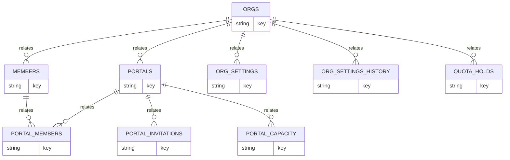
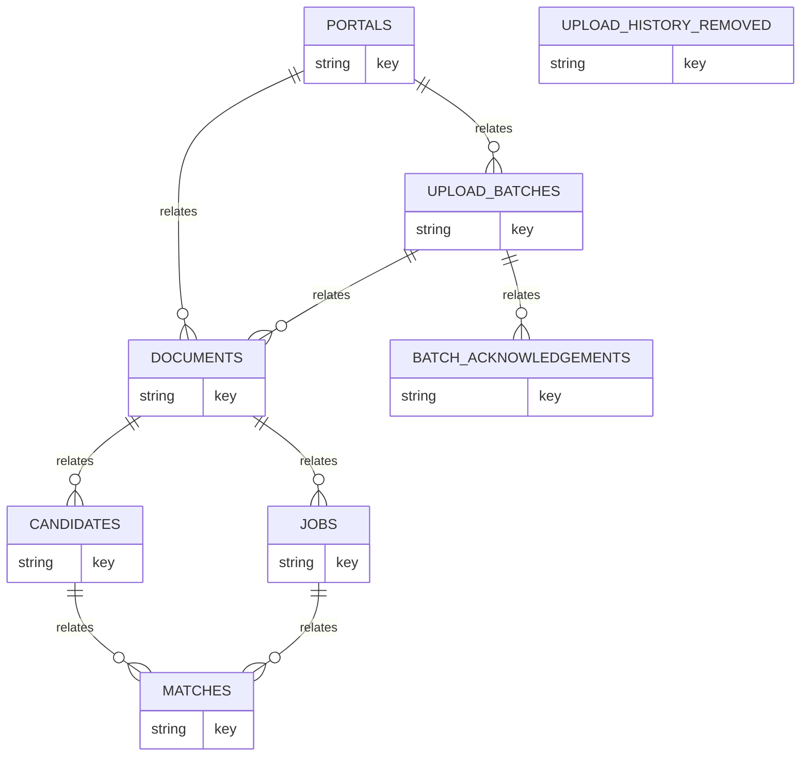
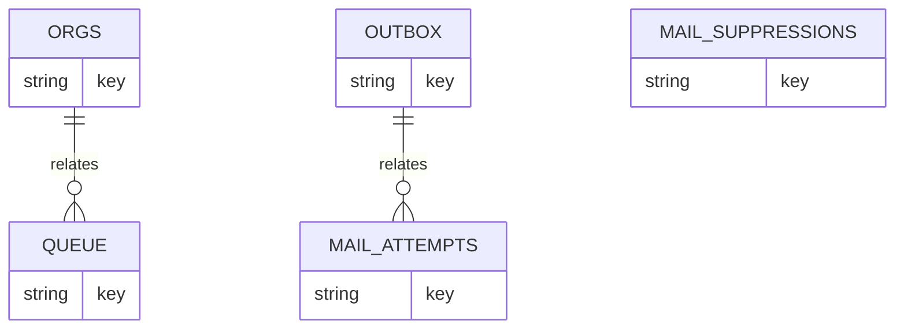
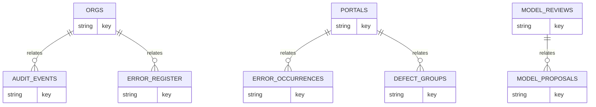

# Schema inventory and target

> **The real schema is now [03_SCHEMA.generated.md](03_SCHEMA.generated.md),** written from the database itself and checked by a test, with every table's purpose, personal information and retention (`data-classes.json`). The diagrams below have placeholder columns (`string key`) and are kept only for their links to migration lines, the proposed new tables and the source-transfer notes ([review](17_REVIEW_AND_IMPROVEMENTS.md) §3.1).

Static inventory of 34 numbered files. Baseline creation SQL and subsequent deltas are shown separately. Definitions are evidence from the checkout. Runtime catalog equivalence is unverified. Relationships in the diagrams include logical associations; exact keys and cardinality come from the definitions.

```mermaid
erDiagram
  ORGS ||--o{ MEMBERS : relates
  ORGS ||--o{ PORTALS : relates
  PORTALS ||--o{ PORTAL_MEMBERS : relates
  MEMBERS ||--o{ PORTAL_MEMBERS : relates
  PORTALS ||--o{ PORTAL_INVITATIONS : relates
  PORTALS ||--o{ PORTAL_CAPACITY : relates
  ORGS ||--o{ ORG_SETTINGS : relates
  ORGS ||--o{ ORG_SETTINGS_HISTORY : relates
  ORGS ||--o{ QUOTA_HOLDS : relates
  MEMBERS {
    string key
  }
  ORGS {
    string key
  }
  ORG_SETTINGS {
    string key
  }
  ORG_SETTINGS_HISTORY {
    string key
  }
  PORTALS {
    string key
  }
  PORTAL_CAPACITY {
    string key
  }
  PORTAL_INVITATIONS {
    string key
  }
  PORTAL_MEMBERS {
    string key
  }
  QUOTA_HOLDS {
    string key
  }
  PORTALS ||--o{ DOCUMENTS : relates
  PORTALS ||--o{ UPLOAD_BATCHES : relates
  UPLOAD_BATCHES ||--o{ DOCUMENTS : relates
  UPLOAD_BATCHES ||--o{ BATCH_ACKNOWLEDGEMENTS : relates
  DOCUMENTS ||--o{ CANDIDATES : relates
  DOCUMENTS ||--o{ JOBS : relates
  CANDIDATES ||--o{ MATCHES : relates
  JOBS ||--o{ MATCHES : relates
  BATCH_ACKNOWLEDGEMENTS {
    string key
  }
  CANDIDATES {
    string key
  }
  DOCUMENTS {
    string key
  }
  JOBS {
    string key
  }
  MATCHES {
    string key
  }
  PORTALS {
    string key
  }
  UPLOAD_BATCHES {
    string key
  }
  UPLOAD_HISTORY_REMOVED {
    string key
  }
  ORGS ||--o{ QUEUE : relates
  OUTBOX ||--o{ MAIL_ATTEMPTS : relates
  MAIL_ATTEMPTS {
    string key
  }
  MAIL_SUPPRESSIONS {
    string key
  }
  ORGS {
    string key
  }
  OUTBOX {
    string key
  }
  QUEUE {
    string key
  }
  ORGS ||--o{ AUDIT_EVENTS : relates
  ORGS ||--o{ ERROR_REGISTER : relates
  PORTALS ||--o{ ERROR_OCCURRENCES : relates
  PORTALS ||--o{ DEFECT_GROUPS : relates
  MODEL_REVIEWS ||--o{ MODEL_PROPOSALS : relates
  AUDIT_EVENTS {
    string key
  }
  DEFECT_GROUPS {
    string key
  }
  ERROR_OCCURRENCES {
    string key
  }
  ERROR_REGISTER {
    string key
  }
  MODEL_PROPOSALS {
    string key
  }
  MODEL_REVIEWS {
    string key
  }
  ORGS {
    string key
  }
  PORTALS {
    string key
  }
  ACCOUNTS ||--o{ MEMBERS : relates
  ACCOUNTS ||--o{ REFRESH_TOKENS : relates
  ACCOUNTS ||--o{ AUTH_CODES : relates
  ACCOUNTS ||--o{ PASSKEY_CREDENTIALS : relates
  ACCOUNTS ||--o{ PASSKEY_CHALLENGES : relates
  CONSOLE_OWNER ||--o{ CONSOLE_SESSIONS : relates
  OWNER_EVENTS ||--o{ OWNER_DELIVERIES : relates
  ORGS ||--o{ INTEGRATION_KEYS : relates
  ORGS ||--o{ WEBHOOK_SUBSCRIPTIONS : relates
  DOCUMENTS ||--o{ VAULT_OBJECTS : relates
  ACCOUNTS {
    string key
  }
  AUTH_CODES {
    string key
  }
  CONSOLE_OWNER {
    string key
  }
  CONSOLE_SESSIONS {
    string key
  }
  DELETION_RECEIPTS {
    string key
  }
  DOCUMENTS {
    string key
  }
  INTEGRATION_KEYS {
    string key
  }
  MEMBERS {
    string key
  }
  ORGS {
    string key
  }
  OWNER_DELIVERIES {
    string key
  }
  OWNER_EVENTS {
    string key
  }
  OWNER_PUSH_SUBSCRIPTIONS {
    string key
  }
  PASSKEY_CHALLENGES {
    string key
  }
  PASSKEY_CREDENTIALS {
    string key
  }
  PASSWORD_RESETS {
    string key
  }
  RATE_LIMITS {
    string key
  }
  REFRESH_TOKENS {
    string key
  }
  SCHEMA_MIGRATIONS {
    string key
  }
  SIGNED_OUT_SESSIONS {
    string key
  }
  SIGNUP_CHALLENGES {
    string key
  }
  VAULT_OBJECTS {
    string key
  }
  WEBHOOK_DELIVERIES {
    string key
  }
  WEBHOOK_SUBSCRIPTIONS {
    string key
  }
```



## Tenancy



### orgs

Baseline [001_init.sql](../../supabase/migrations/001_init.sql#L6).

```sql
create table orgs (id uuid primary key default gen_random_uuid(), name text not null, created_at timestamptz not null default now());
```

- [001_init.sql:10](../../supabase/migrations/001_init.sql#L10) `org_id uuid not null references orgs(id),`
- [001_init.sql:18](../../supabase/migrations/001_init.sql#L18) `org_id uuid not null references orgs(id),`
- [001_init.sql:30](../../supabase/migrations/001_init.sql#L30) `id uuid primary key default gen_random_uuid(), org_id uuid not null references orgs(id),`
- [001_init.sql:38](../../supabase/migrations/001_init.sql#L38) `alter table jobs add constraint jobs_org_fk foreign key (org_id) references orgs(id);`
- [001_init.sql:42](../../supabase/migrations/001_init.sql#L42) `id uuid primary key default gen_random_uuid(), org_id uuid not null references orgs(id),`
- [001_init.sql:49](../../supabase/migrations/001_init.sql#L49) `id uuid primary key default gen_random_uuid(), org_id uuid not null references orgs(id),`
- [001_init.sql:56](../../supabase/migrations/001_init.sql#L56) `id uuid primary key default gen_random_uuid(), org_id uuid not null references orgs(id),`
- [001_init.sql:68](../../supabase/migrations/001_init.sql#L68) `alter table orgs enable row level security;       alter table members enable row level security;`
- [009_org_settings.sql:4](../../supabase/migrations/009_org_settings.sql#L4) `org_id uuid primary key references orgs(id),`
- [009_org_settings.sql:12](../../supabase/migrations/009_org_settings.sql#L12) `org_id uuid not null references orgs(id),`
- [014_tenant_separation.sql:21](../../supabase/migrations/014_tenant_separation.sql#L21) `execute format('grant select on %I.orgs to rolematch_tenant', s);`
- [014_tenant_separation.sql:23](../../supabase/migrations/014_tenant_separation.sql#L23) `execute format('create policy own_org on %I.orgs for select to rolematch_tenant using (id = nullif(current_setting(''app.org_id'', true), '''')::uuid)', s);`
- [015_error_register.sql:8](../../supabase/migrations/015_error_register.sql#L8) `org_id uuid not null references orgs(id),`
- [016_upload_batches.sql:7](../../supabase/migrations/016_upload_batches.sql#L7) `org_id uuid not null references orgs(id),`
- [018_batch_report_and_error_occurrences.sql:13](../../supabase/migrations/018_batch_report_and_error_occurrences.sql#L13) `org_id uuid not null references orgs(id),`
- [018_batch_report_and_error_occurrences.sql:33](../../supabase/migrations/018_batch_report_and_error_occurrences.sql#L33) `org_id uuid not null references orgs(id),`
- [019_portals.sql:17](../../supabase/migrations/019_portals.sql#L17) `org_id uuid not null references orgs(id),`

Current owner: migration/runtime owner per 014, exact live identity unverified. Target owner: rm_schema_owner; access through organisation policy or platform-only access per grants in numbered migrations. Class: internal operational metadata; free text and JSON treated as potentially personal. Proposed retention: purge on expiry or lifecycle closure under approved schedule.

### members

Baseline [001_init.sql](../../supabase/migrations/001_init.sql#L8).

```sql
create table members (                     -- links Supabase Auth users to an organisation
  user_id uuid primary key references auth.users(id) on delete cascade,
  org_id uuid not null references orgs(id),
  name text not null,
  role text not null default 'recruiter' check (role in ('admin','recruiter','viewer')),
  created_at timestamptz not null default now()
);
```

- [001_init.sql:24](../../supabase/migrations/001_init.sql#L24) `created_by uuid not null references members(user_id),`
- [001_init.sql:45](../../supabase/migrations/001_init.sql#L45) `result jsonb not null, created_by uuid not null references members(user_id), created_at timestamptz not null default now()`
- [001_init.sql:68](../../supabase/migrations/001_init.sql#L68) `alter table orgs enable row level security;       alter table members enable row level security;`
- [002_server_support.sql:2](../../supabase/migrations/002_server_support.sql#L2) `alter table members add column if not exists email text;`
- [003_indexes.sql:8](../../supabase/migrations/003_indexes.sql#L8) `create index if not exists members_org on members (org_id);`
- [009_org_settings.sql:7](../../supabase/migrations/009_org_settings.sql#L7) `updated_by uuid references members(user_id),`
- [009_org_settings.sql:16](../../supabase/migrations/009_org_settings.sql#L16) `changed_by uuid references members(user_id),`
- [014_tenant_separation.sql:25](../../supabase/migrations/014_tenant_separation.sql#L25) `foreach t in array array['members', 'documents', 'candidates', 'jobs', 'matches', 'audit_events', 'queue', 'org_settings', 'org_settings_history'] loop`
- [016_upload_batches.sql:8](../../supabase/migrations/016_upload_batches.sql#L8) `created_by uuid not null references members(user_id),`
- [019_portals.sql:24](../../supabase/migrations/019_portals.sql#L24) `user_id uuid not null references members(user_id) on delete cascade,`
- [020_shared_capacity_reservations.sql:28](../../supabase/migrations/020_shared_capacity_reservations.sql#L28) `user_id uuid not null references members(user_id) on delete cascade,`
- [021_portal_creation_delegation.sql:3](../../supabase/migrations/021_portal_creation_delegation.sql#L3) `alter table members add column if not exists can_create_portals boolean not null default false;`
- [023_member_departure.sql:4](../../supabase/migrations/023_member_departure.sql#L4) `alter table members add column if not exists left_at timestamptz;`
- [027_hiring_manager_and_presence.sql:4](../../supabase/migrations/027_hiring_manager_and_presence.sql#L4) `alter table members drop constraint if exists members_role_check;`
- [027_hiring_manager_and_presence.sql:10](../../supabase/migrations/027_hiring_manager_and_presence.sql#L10) `alter table members add constraint members_role_check check (role in ('admin', 'recruiter', 'hiring_manager'));`

Current owner: migration/runtime owner per 014, exact live identity unverified. Target owner: rm_schema_owner; access through organisation policy or platform-only access per grants in numbered migrations. Class: restricted personal or derived records. Proposed retention: retain while record active; apply scoped deletion and expiry schedule.

### portals

Baseline [019_portals.sql](../../supabase/migrations/019_portals.sql#L15).

```sql
create table if not exists portals (
  id uuid primary key default gen_random_uuid(),
  org_id uuid not null references orgs(id),
  name text not null check (length(name) between 1 and 80),
  created_by uuid, created_at timestamptz not null default now(),
  unique (org_id, name), unique (id, org_id)
);
```

- [019_portals.sql:28](../../supabase/migrations/019_portals.sql#L28) `foreign key (portal_id, org_id) references portals (id, org_id)`
- [019_portals.sql:43](../../supabase/migrations/019_portals.sql#L43) `foreign key (portal_id, org_id) references portals (id, org_id)`
- [019_portals.sql:65](../../supabase/migrations/019_portals.sql#L65) `execute format('alter table %I add constraint %I foreign key (portal_id, org_id) references portals (id, org_id)', t, t || '_portal_org_fk');`
- [019_portals.sql:101](../../supabase/migrations/019_portals.sql#L101) `foreach t in array array['portals', 'portal_members', 'portal_invitations'] loop`
- [019_portals.sql:107](../../supabase/migrations/019_portals.sql#L107) `execute format('create policy own_org on %I.portals for all to rolematch_tenant using (org_id = nullif(current_setting(''app.org_id'', true), '''')::uuid) with check (org_id = nullif(current_setting(''app.org_id'', true), '''')::uuid)', s);`
- [020_shared_capacity_reservations.sql:32](../../supabase/migrations/020_shared_capacity_reservations.sql#L32) `foreign key (portal_id, org_id) references portals (id, org_id)`
- [020_shared_capacity_reservations.sql:53](../../supabase/migrations/020_shared_capacity_reservations.sql#L53) `foreign key (portal_id, org_id) references portals (id, org_id)`
- [022_outbox_and_invitation_delivery.sql:15](../../supabase/migrations/022_outbox_and_invitation_delivery.sql#L15) `foreign key (portal_id, org_id) references portals (id, org_id)`
- [024_model_reviews.sql:13](../../supabase/migrations/024_model_reviews.sql#L13) `foreign key (portal_id, org_id) references portals (id, org_id)`
- [026_upload_history_removed.sql:8](../../supabase/migrations/026_upload_history_removed.sql#L8) `foreign key (portal_id, org_id) references portals (id, org_id)`
- [028_quota_holds.sql:9](../../supabase/migrations/028_quota_holds.sql#L9) `foreign key (portal_id, org_id) references portals (id, org_id) on delete cascade`
- [029_model_proposals.sql:12](../../supabase/migrations/029_model_proposals.sql#L12) `foreign key (portal_id, org_id) references portals (id, org_id) on delete cascade`

Current owner: migration/runtime owner per 014, exact live identity unverified. Target owner: rm_schema_owner; access through organisation policy or platform-only access per grants in numbered migrations. Class: internal operational metadata; free text and JSON treated as potentially personal. Proposed retention: purge on expiry or lifecycle closure under approved schedule.

### portal_members

Baseline [019_portals.sql](../../supabase/migrations/019_portals.sql#L22).

```sql
create table if not exists portal_members (
  portal_id uuid not null, org_id uuid not null,
  user_id uuid not null references members(user_id) on delete cascade,
  role text not null default 'recruiter' check (role in ('admin', 'recruiter', 'viewer')),
  added_by uuid, created_at timestamptz not null default now(),
  primary key (portal_id, user_id),
  foreign key (portal_id, org_id) references portals (id, org_id)
);
```

- [019_portals.sql:30](../../supabase/migrations/019_portals.sql#L30) `create index if not exists portal_members_user on portal_members (user_id);`
- [019_portals.sql:101](../../supabase/migrations/019_portals.sql#L101) `foreach t in array array['portals', 'portal_members', 'portal_invitations'] loop`
- [019_portals.sql:108](../../supabase/migrations/019_portals.sql#L108) `foreach t in array array['portal_members', 'portal_invitations'] loop`
- [027_hiring_manager_and_presence.sql:5](../../supabase/migrations/027_hiring_manager_and_presence.sql#L5) `alter table portal_members drop constraint if exists portal_members_role_check;`
- [027_hiring_manager_and_presence.sql:11](../../supabase/migrations/027_hiring_manager_and_presence.sql#L11) `alter table portal_members add constraint portal_members_role_check check (role in ('admin', 'recruiter', 'hiring_manager'));`
- [027_hiring_manager_and_presence.sql:13](../../supabase/migrations/027_hiring_manager_and_presence.sql#L13) `alter table portal_members add column if not exists last_seen_at timestamptz;`

Current owner: migration/runtime owner per 014, exact live identity unverified. Target owner: rm_schema_owner; access through portal and organisation policies per 019 and later migrations. Class: restricted personal or derived records. Proposed retention: retain while record active; apply scoped deletion and expiry schedule.

### portal_invitations

Baseline [019_portals.sql](../../supabase/migrations/019_portals.sql#L34).

```sql
create table if not exists portal_invitations (
  id uuid primary key default gen_random_uuid(),
  org_id uuid not null, portal_id uuid not null,
  email text not null check (email = lower(email)),
  role text not null default 'recruiter' check (role in ('admin', 'recruiter', 'viewer')),
  token_hash text not null unique,
  invited_by uuid not null, invited_by_email text not null,
  created_at timestamptz not null default now(), expires_at timestamptz not null,
  accepted_at timestamptz, accepted_by uuid, revoked_at timestamptz,
  foreign key (portal_id, org_id) references portals (id, org_id)
);
```

- [019_portals.sql:45](../../supabase/migrations/019_portals.sql#L45) `create unique index if not exists portal_invitations_open on portal_invitations (portal_id, email) where accepted_at is null and revoked_at is null;`
- [019_portals.sql:101](../../supabase/migrations/019_portals.sql#L101) `foreach t in array array['portals', 'portal_members', 'portal_invitations'] loop`
- [019_portals.sql:108](../../supabase/migrations/019_portals.sql#L108) `foreach t in array array['portal_members', 'portal_invitations'] loop`
- [022_outbox_and_invitation_delivery.sql:30](../../supabase/migrations/022_outbox_and_invitation_delivery.sql#L30) `alter table portal_invitations add column if not exists token_version integer not null default 1;      -- bumped by a resend: the previous link stops working`
- [022_outbox_and_invitation_delivery.sql:31](../../supabase/migrations/022_outbox_and_invitation_delivery.sql#L31) `alter table portal_invitations add column if not exists email_state text not null default 'not_sent' check (email_state in ('not_sent', 'queued', 'accepted', 'previewed', 'failed', 'expired'));`
- [022_outbox_and_invitation_delivery.sql:32](../../supabase/migrations/022_outbox_and_invitation_delivery.sql#L32) `alter table portal_invitations add column if not exists email_attempts integer not null default 0;`
- [022_outbox_and_invitation_delivery.sql:33](../../supabase/migrations/022_outbox_and_invitation_delivery.sql#L33) `alter table portal_invitations add column if not exists email_sent_at timestamptz;`
- [022_outbox_and_invitation_delivery.sql:34](../../supabase/migrations/022_outbox_and_invitation_delivery.sql#L34) `alter table portal_invitations add column if not exists email_last_error text;`
- [022_outbox_and_invitation_delivery.sql:35](../../supabase/migrations/022_outbox_and_invitation_delivery.sql#L35) `alter table portal_invitations add column if not exists resend_count integer not null default 0;`
- [027_hiring_manager_and_presence.sql:6](../../supabase/migrations/027_hiring_manager_and_presence.sql#L6) `alter table portal_invitations drop constraint if exists portal_invitations_role_check;`
- [027_hiring_manager_and_presence.sql:12](../../supabase/migrations/027_hiring_manager_and_presence.sql#L12) `alter table portal_invitations add constraint portal_invitations_role_check check (role in ('admin', 'recruiter', 'hiring_manager'));`

Current owner: migration/runtime owner per 014, exact live identity unverified. Target owner: rm_schema_owner; access through portal and organisation policies per 019 and later migrations. Class: restricted personal or derived records. Proposed retention: retain while record active; apply scoped deletion and expiry schedule.

### portal_capacity

Baseline [020_shared_capacity_reservations.sql](../../supabase/migrations/020_shared_capacity_reservations.sql#L50).

```sql
create table if not exists portal_capacity (
  portal_id uuid primary key, org_id uuid not null,
  reserved integer not null default 0 check (reserved >= 0),
  foreign key (portal_id, org_id) references portals (id, org_id)
);
```

- [020_shared_capacity_reservations.sql:62](../../supabase/migrations/020_shared_capacity_reservations.sql#L62) `execute format('alter table %I.portal_capacity enable row level security', s);`
- [020_shared_capacity_reservations.sql:64](../../supabase/migrations/020_shared_capacity_reservations.sql#L64) `execute format('grant select, insert, update on %I.portal_capacity to rolematch_tenant', s);`
- [020_shared_capacity_reservations.sql:66](../../supabase/migrations/020_shared_capacity_reservations.sql#L66) `execute format('create policy own_portal on %I.portal_capacity for all to rolematch_tenant using (%s) with check (%s)', s, both_, both_);`

Current owner: migration/runtime owner per 014, exact live identity unverified. Target owner: rm_schema_owner; access through portal and organisation policies per 019 and later migrations. Class: internal operational metadata; free text and JSON treated as potentially personal. Proposed retention: purge on expiry or lifecycle closure under approved schedule.

### quota_holds

Baseline [028_quota_holds.sql](../../supabase/migrations/028_quota_holds.sql#L4).

```sql
create table if not exists quota_holds (
  id uuid primary key default gen_random_uuid(), org_id uuid not null, portal_id uuid not null,
  kind text not null check (kind in ('document', 'match')),
  units integer not null check (units > 0), bytes bigint not null default 0,
  expires_at timestamptz not null default now() + interval '5 minutes',
  foreign key (portal_id, org_id) references portals (id, org_id) on delete cascade
);
```

- [028_quota_holds.sql:11](../../supabase/migrations/028_quota_holds.sql#L11) `create index if not exists quota_holds_portal on quota_holds (portal_id, kind);`
- [028_quota_holds.sql:16](../../supabase/migrations/028_quota_holds.sql#L16) `execute format('alter table %I.quota_holds enable row level security', s);`
- [028_quota_holds.sql:18](../../supabase/migrations/028_quota_holds.sql#L18) `execute format('grant select, insert, delete on %I.quota_holds to rolematch_tenant', s);`
- [028_quota_holds.sql:20](../../supabase/migrations/028_quota_holds.sql#L20) `execute format('create policy own_portal on %I.quota_holds for all to rolematch_tenant using (%s) with check (%s)', s, both_, both_);`

Current owner: migration/runtime owner per 014, exact live identity unverified. Target owner: rm_schema_owner; access through organisation policy or platform-only access per grants in numbered migrations. Class: internal operational metadata; free text and JSON treated as potentially personal. Proposed retention: purge on expiry or lifecycle closure under approved schedule.

### org_settings

Baseline [009_org_settings.sql](../../supabase/migrations/009_org_settings.sql#L3).

```sql
create table org_settings (
  org_id uuid primary key references orgs(id),
  version integer not null,
  settings jsonb not null,
  updated_by uuid references members(user_id),
  updated_at timestamptz not null default now()
);
```

- [009_org_settings.sql:20](../../supabase/migrations/009_org_settings.sql#L20) `alter table org_settings enable row level security;`
- [014_tenant_separation.sql:25](../../supabase/migrations/014_tenant_separation.sql#L25) `foreach t in array array['members', 'documents', 'candidates', 'jobs', 'matches', 'audit_events', 'queue', 'org_settings', 'org_settings_history'] loop`

Current owner: migration/runtime owner per 014, exact live identity unverified. Target owner: rm_schema_owner; access through organisation policy or platform-only access per grants in numbered migrations. Class: internal operational metadata; free text and JSON treated as potentially personal. Proposed retention: purge on expiry or lifecycle closure under approved schedule.

### org_settings_history

Baseline [009_org_settings.sql](../../supabase/migrations/009_org_settings.sql#L10).

```sql
create table org_settings_history (
  id uuid primary key default gen_random_uuid(),
  org_id uuid not null references orgs(id),
  version integer not null,
  settings jsonb not null,
  change jsonb not null default '{}'::jsonb,
  changed_by uuid references members(user_id),
  created_at timestamptz not null default now(),
  unique (org_id, version)
);
```

- [009_org_settings.sql:21](../../supabase/migrations/009_org_settings.sql#L21) `alter table org_settings_history enable row level security;`
- [009_org_settings.sql:22](../../supabase/migrations/009_org_settings.sql#L22) `create index org_settings_history_org on org_settings_history (org_id, version desc);`
- [014_tenant_separation.sql:25](../../supabase/migrations/014_tenant_separation.sql#L25) `foreach t in array array['members', 'documents', 'candidates', 'jobs', 'matches', 'audit_events', 'queue', 'org_settings', 'org_settings_history'] loop`

Current owner: migration/runtime owner per 014, exact live identity unverified. Target owner: rm_schema_owner; access through organisation policy or platform-only access per grants in numbered migrations. Class: internal operational metadata; free text and JSON treated as potentially personal. Proposed retention: purge on expiry or lifecycle closure under approved schedule.

## Records



### documents

Baseline [001_init.sql](../../supabase/migrations/001_init.sql#L16).

```sql
create table documents (
  id uuid primary key default gen_random_uuid(),
  org_id uuid not null references orgs(id),
  kind text not null check (kind in ('cv','jd')),
  original_name text not null, mime text not null, size integer not null, sha256 text not null,
  storage_path text not null,               -- path inside the PRIVATE Supabase Storage bucket 'originals'
  status text not null, stage text not null, scan_result text,
  error_code text, error_message text, record_id uuid, source_text text,
  created_by uuid not null references members(user_id),
  created_at timestamptz not null default now(), updated_at timestamptz not null default now(),
  unique (org_id, kind, sha256)
);
```

- [001_init.sql:31](../../supabase/migrations/001_init.sql#L31) `document_id uuid not null references documents(id),`
- [001_init.sql:39](../../supabase/migrations/001_init.sql#L39) `alter table jobs add constraint jobs_doc_fk foreign key (document_id) references documents(id);`
- [001_init.sql:69](../../supabase/migrations/001_init.sql#L69) `alter table documents enable row level security;  alter table candidates enable row level security;`
- [003_indexes.sql:4](../../supabase/migrations/003_indexes.sql#L4) `create index if not exists documents_org_status on documents (org_id, status, created_at desc);`
- [003_indexes.sql:5](../../supabase/migrations/003_indexes.sql#L5) `create index if not exists documents_org_created on documents (org_id, created_at desc);`
- [006_dismiss.sql:2](../../supabase/migrations/006_dismiss.sql#L2) `alter table documents add column if not exists dismissed_at timestamptz;`
- [007_optimised.sql:2](../../supabase/migrations/007_optimised.sql#L2) `alter table documents add column if not exists original_size bigint;`
- [007_optimised.sql:3](../../supabase/migrations/007_optimised.sql#L3) `alter table documents add column if not exists optimised boolean not null default false;`
- [014_tenant_separation.sql:25](../../supabase/migrations/014_tenant_separation.sql#L25) `foreach t in array array['members', 'documents', 'candidates', 'jobs', 'matches', 'audit_events', 'queue', 'org_settings', 'org_settings_history'] loop`
- [016_upload_batches.sql:21](../../supabase/migrations/016_upload_batches.sql#L21) `alter table documents add column if not exists batch_id uuid references upload_batches(id);`
- [016_upload_batches.sql:22](../../supabase/migrations/016_upload_batches.sql#L22) `alter table documents add column if not exists manual_retries integer not null default 0;   -- bounded: a failing file is not retried for ever`
- [016_upload_batches.sql:23](../../supabase/migrations/016_upload_batches.sql#L23) `create index if not exists documents_batch on documents (org_id, batch_id) where batch_id is not null;`
- [017_upload_batches_lock_columns.sql:5](../../supabase/migrations/017_upload_batches_lock_columns.sql#L5) `alter table documents add column if not exists batch_id uuid references upload_batches(id);`
- [017_upload_batches_lock_columns.sql:6](../../supabase/migrations/017_upload_batches_lock_columns.sql#L6) `alter table documents add column if not exists manual_retries integer not null default 0;`
- [017_upload_batches_lock_columns.sql:7](../../supabase/migrations/017_upload_batches_lock_columns.sql#L7) `create index if not exists documents_batch on documents (org_id, batch_id) where batch_id is not null;`
- [019_portals.sql:57](../../supabase/migrations/019_portals.sql#L57) `foreach t in array array['documents', 'candidates', 'jobs', 'matches', 'upload_batches', 'error_occurrences', 'defect_groups', 'error_register', 'queue'] loop`
- [019_portals.sql:73](../../supabase/migrations/019_portals.sql#L73) `alter table documents add constraint documents_id_portal unique (id, portal_id);`
- [019_portals.sql:77](../../supabase/migrations/019_portals.sql#L77) `alter table candidates add constraint candidates_document_portal_fk foreign key (document_id, portal_id) references documents (id, portal_id);`
- [019_portals.sql:78](../../supabase/migrations/019_portals.sql#L78) `alter table jobs add constraint jobs_document_portal_fk foreign key (document_id, portal_id) references documents (id, portal_id);`
- [019_portals.sql:81](../../supabase/migrations/019_portals.sql#L81) `alter table documents add constraint documents_batch_portal_fk foreign key (batch_id, portal_id) references upload_batches (id, portal_id);`
- [019_portals.sql:92](../../supabase/migrations/019_portals.sql#L92) `foreach t in array array['documents', 'candidates', 'jobs', 'matches', 'upload_batches', 'error_occurrences', 'defect_groups', 'error_register', 'queue'] loop`
- [020_shared_capacity_reservations.sql:23](../../supabase/migrations/020_shared_capacity_reservations.sql#L23) `alter table documents add column if not exists uploaded_by_email text not null default '';   -- immutable snapshot of who uploaded it, at the time`
- [030_audit_gate.sql:2](../../supabase/migrations/030_audit_gate.sql#L2) `alter table documents add column if not exists awaiting_audit jsonb;`
- [031_documents_unique_per_portal.sql:2](../../supabase/migrations/031_documents_unique_per_portal.sql#L2) `alter table documents drop constraint if exists documents_org_id_kind_sha256_key;`
- [031_documents_unique_per_portal.sql:3](../../supabase/migrations/031_documents_unique_per_portal.sql#L3) `alter table documents drop constraint if exists documents_portal_kind_sha256;`
- [031_documents_unique_per_portal.sql:4](../../supabase/migrations/031_documents_unique_per_portal.sql#L4) `alter table documents add constraint documents_portal_kind_sha256 unique (portal_id, kind, sha256);`
- [032_database_review.sql:22](../../supabase/migrations/032_database_review.sql#L22) `create index if not exists documents_batch on documents (batch_id);`

Current owner: migration/runtime owner per 014, exact live identity unverified. Target owner: rm_schema_owner; access through portal and organisation policies per 019 and later migrations. Class: restricted personal or derived records. Proposed retention: retain while record active; apply scoped deletion and expiry schedule.

### candidates

Baseline [001_init.sql](../../supabase/migrations/001_init.sql#L29).

```sql
create table candidates (
  id uuid primary key default gen_random_uuid(), org_id uuid not null references orgs(id),
  document_id uuid not null references documents(id),
  data jsonb not null,                      -- current, recruiter-editable record
  extracted jsonb not null,                 -- original extraction, never overwritten
  version integer not null default 1,
  created_at timestamptz not null default now(), updated_at timestamptz not null default now()
);
```

- [001_init.sql:43](../../supabase/migrations/001_init.sql#L43) `candidate_id uuid not null references candidates(id), job_id uuid not null references jobs(id),`
- [001_init.sql:69](../../supabase/migrations/001_init.sql#L69) `alter table documents enable row level security;  alter table candidates enable row level security;`
- [003_indexes.sql:2](../../supabase/migrations/003_indexes.sql#L2) `create index if not exists candidates_org_created on candidates (org_id, created_at desc);`
- [004_search.sql:5](../../supabase/migrations/004_search.sql#L5) `alter table candidates add column if not exists search text generated always as (`
- [004_search.sql:20](../../supabase/migrations/004_search.sql#L20) `execute format('create index if not exists candidates_search_trgm on candidates using gin (search %I.gin_trgm_ops)', ext);`
- [004_search.sql:25](../../supabase/migrations/004_search.sql#L25) `create index if not exists candidates_org_status on candidates (org_id, (data->>'status'));`
- [004_search.sql:26](../../supabase/migrations/004_search.sql#L26) `create index if not exists candidates_org_review on candidates (org_id, (data->>'reviewState'));`
- [014_tenant_separation.sql:25](../../supabase/migrations/014_tenant_separation.sql#L25) `foreach t in array array['members', 'documents', 'candidates', 'jobs', 'matches', 'audit_events', 'queue', 'org_settings', 'org_settings_history'] loop`
- [019_portals.sql:57](../../supabase/migrations/019_portals.sql#L57) `foreach t in array array['documents', 'candidates', 'jobs', 'matches', 'upload_batches', 'error_occurrences', 'defect_groups', 'error_register', 'queue'] loop`
- [019_portals.sql:74](../../supabase/migrations/019_portals.sql#L74) `alter table candidates add constraint candidates_id_portal unique (id, portal_id);`
- [019_portals.sql:77](../../supabase/migrations/019_portals.sql#L77) `alter table candidates add constraint candidates_document_portal_fk foreign key (document_id, portal_id) references documents (id, portal_id);`
- [019_portals.sql:79](../../supabase/migrations/019_portals.sql#L79) `alter table matches add constraint matches_candidate_portal_fk foreign key (candidate_id, portal_id) references candidates (id, portal_id);`
- [019_portals.sql:92](../../supabase/migrations/019_portals.sql#L92) `foreach t in array array['documents', 'candidates', 'jobs', 'matches', 'upload_batches', 'error_occurrences', 'defect_groups', 'error_register', 'queue'] loop`
- [032_database_review.sql:18](../../supabase/migrations/032_database_review.sql#L18) `create index if not exists candidates_document on candidates (document_id);`

Current owner: migration/runtime owner per 014, exact live identity unverified. Target owner: rm_schema_owner; access through portal and organisation policies per 019 and later migrations. Class: restricted personal or derived records. Proposed retention: retain while record active; apply scoped deletion and expiry schedule.

### jobs

Baseline [001_init.sql](../../supabase/migrations/001_init.sql#L37).

```sql
create table jobs (like candidates including all);
```

Inherits the candidate creation shape with independent constraints and job-specific generated search from 004.

- [001_init.sql:38](../../supabase/migrations/001_init.sql#L38) `alter table jobs add constraint jobs_org_fk foreign key (org_id) references orgs(id);`
- [001_init.sql:39](../../supabase/migrations/001_init.sql#L39) `alter table jobs add constraint jobs_doc_fk foreign key (document_id) references documents(id);`
- [001_init.sql:43](../../supabase/migrations/001_init.sql#L43) `candidate_id uuid not null references candidates(id), job_id uuid not null references jobs(id),`
- [001_init.sql:70](../../supabase/migrations/001_init.sql#L70) `alter table jobs enable row level security;       alter table matches enable row level security;`
- [003_indexes.sql:3](../../supabase/migrations/003_indexes.sql#L3) `create index if not exists jobs_org_created on jobs (org_id, created_at desc);`
- [004_search.sql:10](../../supabase/migrations/004_search.sql#L10) `alter table jobs add column if not exists search text generated always as (`
- [004_search.sql:21](../../supabase/migrations/004_search.sql#L21) `execute format('create index if not exists jobs_search_trgm on jobs using gin (search %I.gin_trgm_ops)', ext);`
- [004_search.sql:27](../../supabase/migrations/004_search.sql#L27) `create index if not exists jobs_org_status on jobs (org_id, (data->>'status'));`
- [014_tenant_separation.sql:25](../../supabase/migrations/014_tenant_separation.sql#L25) `foreach t in array array['members', 'documents', 'candidates', 'jobs', 'matches', 'audit_events', 'queue', 'org_settings', 'org_settings_history'] loop`
- [019_portals.sql:57](../../supabase/migrations/019_portals.sql#L57) `foreach t in array array['documents', 'candidates', 'jobs', 'matches', 'upload_batches', 'error_occurrences', 'defect_groups', 'error_register', 'queue'] loop`
- [019_portals.sql:75](../../supabase/migrations/019_portals.sql#L75) `alter table jobs add constraint jobs_id_portal unique (id, portal_id);`
- [019_portals.sql:78](../../supabase/migrations/019_portals.sql#L78) `alter table jobs add constraint jobs_document_portal_fk foreign key (document_id, portal_id) references documents (id, portal_id);`
- [019_portals.sql:80](../../supabase/migrations/019_portals.sql#L80) `alter table matches add constraint matches_job_portal_fk foreign key (job_id, portal_id) references jobs (id, portal_id);`
- [019_portals.sql:92](../../supabase/migrations/019_portals.sql#L92) `foreach t in array array['documents', 'candidates', 'jobs', 'matches', 'upload_batches', 'error_occurrences', 'defect_groups', 'error_register', 'queue'] loop`
- [032_database_review.sql:19](../../supabase/migrations/032_database_review.sql#L19) `create index if not exists jobs_document on jobs (document_id);`

Current owner: migration/runtime owner per 014, exact live identity unverified. Target owner: rm_schema_owner; access through portal and organisation policies per 019 and later migrations. Class: restricted personal or derived records. Proposed retention: retain while record active; apply scoped deletion and expiry schedule.

### matches

Baseline [001_init.sql](../../supabase/migrations/001_init.sql#L41).

```sql
create table matches (                      -- immutable snapshots
  id uuid primary key default gen_random_uuid(), org_id uuid not null references orgs(id),
  candidate_id uuid not null references candidates(id), job_id uuid not null references jobs(id),
  candidate_version integer not null, job_version integer not null, engine_version text not null,
  result jsonb not null, created_by uuid not null references members(user_id), created_at timestamptz not null default now()
);
```

- [001_init.sql:70](../../supabase/migrations/001_init.sql#L70) `alter table jobs enable row level security;       alter table matches enable row level security;`
- [003_indexes.sql:6](../../supabase/migrations/003_indexes.sql#L6) `create index if not exists matches_org_candidate on matches (org_id, candidate_id, created_at desc);`
- [003_indexes.sql:7](../../supabase/migrations/003_indexes.sql#L7) `create index if not exists matches_org_job on matches (org_id, job_id, created_at desc);`
- [014_tenant_separation.sql:25](../../supabase/migrations/014_tenant_separation.sql#L25) `foreach t in array array['members', 'documents', 'candidates', 'jobs', 'matches', 'audit_events', 'queue', 'org_settings', 'org_settings_history'] loop`
- [019_portals.sql:57](../../supabase/migrations/019_portals.sql#L57) `foreach t in array array['documents', 'candidates', 'jobs', 'matches', 'upload_batches', 'error_occurrences', 'defect_groups', 'error_register', 'queue'] loop`
- [019_portals.sql:79](../../supabase/migrations/019_portals.sql#L79) `alter table matches add constraint matches_candidate_portal_fk foreign key (candidate_id, portal_id) references candidates (id, portal_id);`
- [019_portals.sql:80](../../supabase/migrations/019_portals.sql#L80) `alter table matches add constraint matches_job_portal_fk foreign key (job_id, portal_id) references jobs (id, portal_id);`
- [019_portals.sql:92](../../supabase/migrations/019_portals.sql#L92) `foreach t in array array['documents', 'candidates', 'jobs', 'matches', 'upload_batches', 'error_occurrences', 'defect_groups', 'error_register', 'queue'] loop`
- [032_database_review.sql:20](../../supabase/migrations/032_database_review.sql#L20) `create index if not exists matches_candidate on matches (candidate_id);`
- [032_database_review.sql:21](../../supabase/migrations/032_database_review.sql#L21) `create index if not exists matches_job on matches (job_id);`

Current owner: migration/runtime owner per 014, exact live identity unverified. Target owner: rm_schema_owner; access through portal and organisation policies per 019 and later migrations. Class: restricted personal or derived records. Proposed retention: retain while record active; apply scoped deletion and expiry schedule.

### upload_batches

Baseline [016_upload_batches.sql](../../supabase/migrations/016_upload_batches.sql#L5).

```sql
create table if not exists upload_batches (
  id uuid primary key default gen_random_uuid(),
  org_id uuid not null references orgs(id),
  created_by uuid not null references members(user_id),
  kind text not null check (kind in ('cv', 'jd')),
  declared_files integer not null check (declared_files > 0),
  declared_bytes bigint not null check (declared_bytes >= 0),
  duplicate_files integer not null default 0,          -- already in the organisation: answered, not processed again
  refusals jsonb not null default '[]'::jsonb,         -- [{ fileName, code, message }], capped;
```

- [016_upload_batches.sql:19](../../supabase/migrations/016_upload_batches.sql#L19) `create index if not exists upload_batches_org on upload_batches (org_id, created_at desc);`
- [016_upload_batches.sql:21](../../supabase/migrations/016_upload_batches.sql#L21) `alter table documents add column if not exists batch_id uuid references upload_batches(id);`
- [016_upload_batches.sql:28](../../supabase/migrations/016_upload_batches.sql#L28) `execute format('alter table %I.upload_batches enable row level security', s);`
- [016_upload_batches.sql:30](../../supabase/migrations/016_upload_batches.sql#L30) `execute format('grant select, insert, update, delete on %I.upload_batches to rolematch_tenant', s);`
- [016_upload_batches.sql:32](../../supabase/migrations/016_upload_batches.sql#L32) `execute format('create policy own_org on %I.upload_batches for all to rolematch_tenant using (org_id = nullif(current_setting(''app.org_id'', true), '''')::uuid) with check (org_id = nullif(current_setting(''app.org_id'', true), '''')::uuid)', s);`
- [017_upload_batches_lock_columns.sql:3](../../supabase/migrations/017_upload_batches_lock_columns.sql#L3) `alter table upload_batches add column if not exists last_activity_at timestamptz not null default now();   -- last file accepted: the upload-lock lease`
- [017_upload_batches_lock_columns.sql:4](../../supabase/migrations/017_upload_batches_lock_columns.sql#L4) `alter table upload_batches add column if not exists closed_at timestamptz;                                -- the person dismissed the progress panel`
- [017_upload_batches_lock_columns.sql:5](../../supabase/migrations/017_upload_batches_lock_columns.sql#L5) `alter table documents add column if not exists batch_id uuid references upload_batches(id);`
- [018_batch_report_and_error_occurrences.sql:5](../../supabase/migrations/018_batch_report_and_error_occurrences.sql#L5) `alter table upload_batches add column if not exists skipped jsonb not null default '[]'::jsonb;           -- [{ fileName, reason }], capped`
- [018_batch_report_and_error_occurrences.sql:6](../../supabase/migrations/018_batch_report_and_error_occurrences.sql#L6) `alter table upload_batches add column if not exists duplicate_names jsonb not null default '[]'::jsonb;   -- [fileName], capped`
- [019_portals.sql:57](../../supabase/migrations/019_portals.sql#L57) `foreach t in array array['documents', 'candidates', 'jobs', 'matches', 'upload_batches', 'error_occurrences', 'defect_groups', 'error_register', 'queue'] loop`
- [019_portals.sql:76](../../supabase/migrations/019_portals.sql#L76) `alter table upload_batches add constraint upload_batches_id_portal unique (id, portal_id);`
- [019_portals.sql:81](../../supabase/migrations/019_portals.sql#L81) `alter table documents add constraint documents_batch_portal_fk foreign key (batch_id, portal_id) references upload_batches (id, portal_id);`
- [019_portals.sql:92](../../supabase/migrations/019_portals.sql#L92) `foreach t in array array['documents', 'candidates', 'jobs', 'matches', 'upload_batches', 'error_occurrences', 'defect_groups', 'error_register', 'queue'] loop`
- [020_shared_capacity_reservations.sql:9](../../supabase/migrations/020_shared_capacity_reservations.sql#L9) `alter table upload_batches add column if not exists reserved_slots integer;`
- [020_shared_capacity_reservations.sql:10](../../supabase/migrations/020_shared_capacity_reservations.sql#L10) `alter table upload_batches add column if not exists reservation_state text not null default 'held' check (reservation_state in ('held', 'released'));`
- [020_shared_capacity_reservations.sql:11](../../supabase/migrations/020_shared_capacity_reservations.sql#L11) `alter table upload_batches add column if not exists released_at timestamptz;`
- [020_shared_capacity_reservations.sql:12](../../supabase/migrations/020_shared_capacity_reservations.sql#L12) `alter table upload_batches add column if not exists finished_at timestamptz;`
- [020_shared_capacity_reservations.sql:13](../../supabase/migrations/020_shared_capacity_reservations.sql#L13) `alter table upload_batches add column if not exists parent_batch_id uuid references upload_batches(id);   -- a manual retry after closure reserves anew, linked to the batch it retries`
- [020_shared_capacity_reservations.sql:14](../../supabase/migrations/020_shared_capacity_reservations.sql#L14) `alter table upload_batches add column if not exists submitted_by_email text not null default '';           -- immutable snapshot at admission`
- [020_shared_capacity_reservations.sql:15](../../supabase/migrations/020_shared_capacity_reservations.sql#L15) `alter table upload_batches add column if not exists request_key text;                                      -- the browser's key for this submission: a repeat reserves nothing new`
- [020_shared_capacity_reservations.sql:18](../../supabase/migrations/020_shared_capacity_reservations.sql#L18) `alter table upload_batches alter column reserved_slots set not null;`
- [020_shared_capacity_reservations.sql:19](../../supabase/migrations/020_shared_capacity_reservations.sql#L19) `alter table upload_batches add constraint upload_batches_reserved_positive check (reserved_slots > 0);`
- [020_shared_capacity_reservations.sql:20](../../supabase/migrations/020_shared_capacity_reservations.sql#L20) `create unique index if not exists upload_batches_request on upload_batches (portal_id, created_by, request_key) where request_key is not null;`
- [020_shared_capacity_reservations.sql:21](../../supabase/migrations/020_shared_capacity_reservations.sql#L21) `create index if not exists upload_batches_held on upload_batches (portal_id) where reservation_state = 'held';`
- [020_shared_capacity_reservations.sql:31](../../supabase/migrations/020_shared_capacity_reservations.sql#L31) `foreign key (batch_id, portal_id) references upload_batches (id, portal_id),`
- [032_database_review.sql:24](../../supabase/migrations/032_database_review.sql#L24) `create index if not exists upload_batches_parent on upload_batches (parent_batch_id);`

Current owner: migration/runtime owner per 014, exact live identity unverified. Target owner: rm_schema_owner; access through portal and organisation policies per 019 and later migrations. Class: restricted personal or derived records. Proposed retention: retain while record active; apply scoped deletion and expiry schedule.

### batch_acknowledgements

Baseline [020_shared_capacity_reservations.sql](../../supabase/migrations/020_shared_capacity_reservations.sql#L26).

```sql
create table if not exists batch_acknowledgements (
  batch_id uuid not null, portal_id uuid not null, org_id uuid not null,
  user_id uuid not null references members(user_id) on delete cascade,
  acknowledged_at timestamptz not null default now(),
  primary key (batch_id, user_id),
  foreign key (batch_id, portal_id) references upload_batches (id, portal_id),
  foreign key (portal_id, org_id) references portals (id, org_id)
);
```

- [020_shared_capacity_reservations.sql:34](../../supabase/migrations/020_shared_capacity_reservations.sql#L34) `alter table batch_acknowledgements alter column portal_id set default nullif(current_setting('app.portal_id', true), '')::uuid;`
- [020_shared_capacity_reservations.sql:39](../../supabase/migrations/020_shared_capacity_reservations.sql#L39) `execute format('alter table %I.batch_acknowledgements enable row level security', s);`
- [020_shared_capacity_reservations.sql:41](../../supabase/migrations/020_shared_capacity_reservations.sql#L41) `execute format('grant select, insert, update, delete on %I.batch_acknowledgements to rolematch_tenant', s);`
- [020_shared_capacity_reservations.sql:43](../../supabase/migrations/020_shared_capacity_reservations.sql#L43) `execute format('create policy own_portal on %I.batch_acknowledgements for all to rolematch_tenant using (%s) with check (%s)', s, both_, both_);`

Current owner: migration/runtime owner per 014, exact live identity unverified. Target owner: rm_schema_owner; access through portal and organisation policies per 019 and later migrations. Class: internal operational metadata; free text and JSON treated as potentially personal. Proposed retention: purge on expiry or lifecycle closure under approved schedule.

### upload_history_removed

Baseline [026_upload_history_removed.sql](../../supabase/migrations/026_upload_history_removed.sql#L3).

```sql
create table if not exists upload_history_removed (
  id uuid primary key,   -- the document's id, so the line stays the same line in the history
  org_id uuid not null, portal_id uuid not null,
  kind text not null, uploaded_by text not null default '', uploaded_at timestamptz not null, via_batch boolean not null default false,
  deleted_by text not null default '', deleted_at timestamptz not null default now(),
  foreign key (portal_id, org_id) references portals (id, org_id)
);
```

- [026_upload_history_removed.sql:10](../../supabase/migrations/026_upload_history_removed.sql#L10) `create index if not exists upload_history_removed_portal on upload_history_removed (org_id, portal_id, uploaded_at desc);`
- [026_upload_history_removed.sql:13](../../supabase/migrations/026_upload_history_removed.sql#L13) `create trigger upload_history_no_change before update or delete on upload_history_removed for each row execute function upload_history_immutable();`
- [026_upload_history_removed.sql:18](../../supabase/migrations/026_upload_history_removed.sql#L18) `execute format('alter table %I.upload_history_removed enable row level security', s);`
- [026_upload_history_removed.sql:20](../../supabase/migrations/026_upload_history_removed.sql#L20) `execute format('grant select, insert on %I.upload_history_removed to rolematch_tenant', s);`
- [026_upload_history_removed.sql:22](../../supabase/migrations/026_upload_history_removed.sql#L22) `execute format('create policy own_portal on %I.upload_history_removed for all to rolematch_tenant using (%s) with check (%s)', s, both_, both_);`

Current owner: migration/runtime owner per 014, exact live identity unverified. Target owner: rm_schema_owner; access through portal and organisation policies per 019 and later migrations. Class: restricted personal or derived records. Proposed retention: retain while record active; apply scoped deletion and expiry schedule.

## Workers



### queue

Baseline [001_init.sql](../../supabase/migrations/001_init.sql#L55).

```sql
create table queue (
  id uuid primary key default gen_random_uuid(), org_id uuid not null references orgs(id),
  type text not null, payload jsonb not null, status text not null default 'queued',
  attempts integer not null default 0, max_attempts integer not null default 3,
  run_after timestamptz not null default now(), last_error text, created_at timestamptz not null default now()
);
```

- [001_init.sql:61](../../supabase/migrations/001_init.sql#L61) `create index queue_ready on queue (status, run_after);`
- [001_init.sql:71](../../supabase/migrations/001_init.sql#L71) `alter table audit_events enable row level security; alter table queue enable row level security;`
- [002_server_support.sql:3](../../supabase/migrations/002_server_support.sql#L3) `alter table queue add column if not exists locked_at timestamptz;`
- [002_server_support.sql:4](../../supabase/migrations/002_server_support.sql#L4) `create index if not exists queue_org_running on queue (org_id, status);`
- [003_indexes.sql:9](../../supabase/migrations/003_indexes.sql#L9) `create index if not exists queue_claim on queue (status, run_after, created_at);`
- [014_tenant_separation.sql:25](../../supabase/migrations/014_tenant_separation.sql#L25) `foreach t in array array['members', 'documents', 'candidates', 'jobs', 'matches', 'audit_events', 'queue', 'org_settings', 'org_settings_history'] loop`
- [019_portals.sql:57](../../supabase/migrations/019_portals.sql#L57) `foreach t in array array['documents', 'candidates', 'jobs', 'matches', 'upload_batches', 'error_occurrences', 'defect_groups', 'error_register', 'queue'] loop`
- [019_portals.sql:92](../../supabase/migrations/019_portals.sql#L92) `foreach t in array array['documents', 'candidates', 'jobs', 'matches', 'upload_batches', 'error_occurrences', 'defect_groups', 'error_register', 'queue'] loop`

Current owner: migration/runtime owner per 014, exact live identity unverified. Target owner: rm_schema_owner; access through organisation policy or platform-only access per grants in numbered migrations. Class: internal operational metadata; free text and JSON treated as potentially personal. Proposed retention: purge on expiry or lifecycle closure under approved schedule.

### outbox

Baseline [022_outbox_and_invitation_delivery.sql](../../supabase/migrations/022_outbox_and_invitation_delivery.sql#L5).

```sql
create table if not exists outbox (
  id uuid primary key, org_id uuid not null, portal_id uuid not null,
  kind text not null, aggregate_id uuid not null, version integer not null default 1,
  dedupe_key text not null unique,
  payload jsonb not null default '{}'::jsonb,
  status text not null default 'pending' check (status in ('pending', 'sending', 'sent', 'previewed', 'skipped', 'expired', 'dead')),
  class text not null default 'invitation', priority smallint not null default 1, expires_at timestamptz,   -- authentication = 0, invitation = 1;
```

- [022_outbox_and_invitation_delivery.sql:17](../../supabase/migrations/022_outbox_and_invitation_delivery.sql#L17) `create index if not exists outbox_due on outbox (status, priority, run_after);`
- [022_outbox_and_invitation_delivery.sql:22](../../supabase/migrations/022_outbox_and_invitation_delivery.sql#L22) `execute format('alter table %I.outbox enable row level security', s);`
- [022_outbox_and_invitation_delivery.sql:24](../../supabase/migrations/022_outbox_and_invitation_delivery.sql#L24) `execute format('grant select, insert, update on %I.outbox to rolematch_tenant', s);`
- [022_outbox_and_invitation_delivery.sql:26](../../supabase/migrations/022_outbox_and_invitation_delivery.sql#L26) `execute format('create policy own_portal on %I.outbox for all to rolematch_tenant using (%s) with check (%s)', s, both_, both_);`
- [022_outbox_and_invitation_delivery.sql:41](../../supabase/migrations/022_outbox_and_invitation_delivery.sql#L41) `id uuid primary key, outbox_id uuid references outbox(id) on delete set null, org_id uuid, portal_id uuid,`

Current owner: migration/runtime owner per 014, exact live identity unverified. Target owner: rm_schema_owner; access through organisation policy or platform-only access per grants in numbered migrations. Class: restricted personal or derived records. Proposed retention: retain while record active; apply scoped deletion and expiry schedule.

### mail_attempts

Baseline [022_outbox_and_invitation_delivery.sql](../../supabase/migrations/022_outbox_and_invitation_delivery.sql#L40).

```sql
create table if not exists mail_attempts (
  id uuid primary key, outbox_id uuid references outbox(id) on delete set null, org_id uuid, portal_id uuid,
  class text not null, template text not null, template_version text not null, transport text not null, simulated boolean not null default false,
  recipient_hash text not null, recipient_domain text not null,
  started_at timestamptz not null default now(), finished_at timestamptz,
  outcome text not null default 'attempting' check (outcome in ('attempting', 'accepted', 'temporary_failure', 'permanent_failure', 'uncertain', 'unavailable', 'suppressed', 'cancelled', 'blocked')),
  smtp_code integer, error_class text, message_id text, response text
);
```

- [022_outbox_and_invitation_delivery.sql:48](../../supabase/migrations/022_outbox_and_invitation_delivery.sql#L48) `create index if not exists mail_attempts_recent on mail_attempts (started_at);`
- [022_outbox_and_invitation_delivery.sql:62](../../supabase/migrations/022_outbox_and_invitation_delivery.sql#L62) `foreach t in array array['mail_attempts', 'mail_suppressions', 'signup_challenges'] loop`
- [022_outbox_and_invitation_delivery.sql:66](../../supabase/migrations/022_outbox_and_invitation_delivery.sql#L66) `execute format('grant select on %I.mail_attempts to rolematch_tenant', s);`
- [022_outbox_and_invitation_delivery.sql:68](../../supabase/migrations/022_outbox_and_invitation_delivery.sql#L68) `execute format('create policy own_org on %I.mail_attempts for select to rolematch_tenant using (org_id = nullif(current_setting(''app.org_id'', true), '''')::uuid)', s);`
- [032_database_review.sql:25](../../supabase/migrations/032_database_review.sql#L25) `create index if not exists mail_attempts_outbox on mail_attempts (outbox_id);`

Current owner: migration/runtime owner per 014, exact live identity unverified. Target owner: rm_schema_owner; access through organisation policy or platform-only access per grants in numbered migrations. Class: restricted personal or derived records. Proposed retention: retain while record active; apply scoped deletion and expiry schedule.

### mail_suppressions

Baseline [022_outbox_and_invitation_delivery.sql](../../supabase/migrations/022_outbox_and_invitation_delivery.sql#L49).

```sql
create table if not exists mail_suppressions (
  recipient_hash text primary key, reason text not null, enhanced_status text, created_at timestamptz not null default now(), expires_at timestamptz not null
);
```

- [022_outbox_and_invitation_delivery.sql:62](../../supabase/migrations/022_outbox_and_invitation_delivery.sql#L62) `foreach t in array array['mail_attempts', 'mail_suppressions', 'signup_challenges'] loop`

Current owner: migration/runtime owner per 014, exact live identity unverified. Target owner: rm_schema_owner; access through organisation policy or platform-only access per grants in numbered migrations. Class: internal operational metadata; free text and JSON treated as potentially personal. Proposed retention: purge on expiry or lifecycle closure under approved schedule.

## Audit and learning



### audit_events

Baseline [001_init.sql](../../supabase/migrations/001_init.sql#L48).

```sql
create table audit_events (
  id uuid primary key default gen_random_uuid(), org_id uuid not null references orgs(id),
  actor_id uuid, action text not null, entity_type text not null, entity_id uuid,
  detail jsonb not null default '{}', correlation_id text, created_at timestamptz not null default now()
);
```

- [001_init.sql:53](../../supabase/migrations/001_init.sql#L53) `create index audit_entity on audit_events (org_id, entity_id);`
- [001_init.sql:65](../../supabase/migrations/001_init.sql#L65) `create trigger audit_no_update before update or delete on audit_events for each row execute function audit_immutable();`
- [001_init.sql:71](../../supabase/migrations/001_init.sql#L71) `alter table audit_events enable row level security; alter table queue enable row level security;`
- [014_tenant_separation.sql:25](../../supabase/migrations/014_tenant_separation.sql#L25) `foreach t in array array['members', 'documents', 'candidates', 'jobs', 'matches', 'audit_events', 'queue', 'org_settings', 'org_settings_history'] loop`
- [019_portals.sql:69](../../supabase/migrations/019_portals.sql#L69) `alter table audit_events add column if not exists portal_id uuid default nullif(current_setting('app.portal_id', true), '')::uuid;`
- [019_portals.sql:70](../../supabase/migrations/019_portals.sql#L70) `create index if not exists audit_events_portal on audit_events (portal_id);`
- [019_portals.sql:99](../../supabase/migrations/019_portals.sql#L99) `execute format('create policy own_org on %I.audit_events for all to rolematch_tenant using (org_id = nullif(current_setting(''app.org_id'', true), '''')::uuid and (portal_id is null or portal_id = nullif(current_setting(''app.portal_id'', true), '''')::uuid)) with check (org_id = nullif(current_setting(''app.org_id'', true), '''')::uuid and (portal_id is null or portal_id = nullif(current_setting(''app.portal_id'', true), '''')::uuid))', s);`
- [027_hiring_manager_and_presence.sql:16](../../supabase/migrations/027_hiring_manager_and_presence.sql#L16) `create index if not exists audit_portal_time on audit_events (portal_id, created_at desc);`
- [027_hiring_manager_and_presence.sql:17](../../supabase/migrations/027_hiring_manager_and_presence.sql#L17) `create index if not exists audit_org_time on audit_events (org_id, created_at desc);`

Current owner: migration/runtime owner per 014, exact live identity unverified. Target owner: rm_schema_owner; access through organisation policy with optional portal scope. Class: restricted personal or derived records. Proposed retention: retain while record active; apply scoped deletion and expiry schedule.

### error_register

Baseline [015_error_register.sql](../../supabase/migrations/015_error_register.sql#L6).

```sql
create table if not exists error_register (
  id uuid primary key default gen_random_uuid(),
  org_id uuid not null references orgs(id),
  record_kind text not null check (record_kind in ('candidate', 'job')),
  record_id uuid not null,
  document_id uuid,
  field_path text not null,
  from_value jsonb,
  to_value jsonb,
  change_kind text not null check (change_kind in ('extraction_correction', 'candidate_update', 'recruiter_preference', 'disputed_interpretation')),
  category text,   -- decided when the row is checked: image_quality, detection, recognition, reading_order, field_extraction, association, normalisation, ...
  status text not null default 'unverified' check (status in ('unverified', 'verified', 'rejected')),
  parser_version text,
  created_by uuid,
  created_at timestamptz not null default now()
);
```

- [015_error_register.sql:22](../../supabase/migrations/015_error_register.sql#L22) `create index if not exists error_register_org_record on error_register (org_id, record_id);`
- [015_error_register.sql:23](../../supabase/migrations/015_error_register.sql#L23) `create index if not exists error_register_org_status on error_register (org_id, status, created_at);`
- [015_error_register.sql:30](../../supabase/migrations/015_error_register.sql#L30) `execute format('alter table %I.error_register enable row level security', s);`
- [015_error_register.sql:32](../../supabase/migrations/015_error_register.sql#L32) `execute format('grant select, insert, update, delete on %I.error_register to rolematch_tenant', s);`
- [015_error_register.sql:34](../../supabase/migrations/015_error_register.sql#L34) `execute format('create policy own_org on %I.error_register for all to rolematch_tenant using (org_id = nullif(current_setting(''app.org_id'', true), '''')::uuid) with check (org_id = nullif(current_setting(''app.org_id'', true), '''')::uuid)', s);`
- [019_portals.sql:57](../../supabase/migrations/019_portals.sql#L57) `foreach t in array array['documents', 'candidates', 'jobs', 'matches', 'upload_batches', 'error_occurrences', 'defect_groups', 'error_register', 'queue'] loop`
- [019_portals.sql:92](../../supabase/migrations/019_portals.sql#L92) `foreach t in array array['documents', 'candidates', 'jobs', 'matches', 'upload_batches', 'error_occurrences', 'defect_groups', 'error_register', 'queue'] loop`
- [034_learning_records.sql:2](../../supabase/migrations/034_learning_records.sql#L2) `alter table error_register`
- [034_learning_records.sql:14](../../supabase/migrations/034_learning_records.sql#L14) `create unique index if not exists error_register_one_lesson on error_register (org_id, dedupe_key) where dedupe_key is not null;`
- [034_learning_records.sql:16](../../supabase/migrations/034_learning_records.sql#L16) `alter table error_register drop constraint if exists error_register_general_is_fictional;`
- [034_learning_records.sql:17](../../supabase/migrations/034_learning_records.sql#L17) `alter table error_register add constraint error_register_general_is_fictional check (scope <> 'general' or (status = 'verified' and regression_case is not null and permitted_use = 'fictional_reproduction_only'));`
- [034_learning_records.sql:18](../../supabase/migrations/034_learning_records.sql#L18) `create index if not exists error_register_org_scope on error_register (org_id, scope, status);`

Current owner: migration/runtime owner per 014, exact live identity unverified. Target owner: rm_schema_owner; access through portal and organisation policies per 019 and later migrations. Class: restricted personal or derived records. Proposed retention: retain while record active; apply scoped deletion and expiry schedule.

### error_occurrences

Baseline [018_batch_report_and_error_occurrences.sql](../../supabase/migrations/018_batch_report_and_error_occurrences.sql#L11).

```sql
create table if not exists error_occurrences (
  id uuid primary key default gen_random_uuid(),
  org_id uuid not null references orgs(id),
  occurred_at timestamptz not null default now(),
  correlation_id text not null,                  -- the request or job that failed: what a person quotes to support
  component text not null,                       -- upload, batch, pipeline, ...
  stage text,                                    -- received, security, reading, extracting, ...
  code text not null,                            -- the stable error code
  kind text not null check (kind in ('expected_validation', 'operational_transient', 'suspected_defect', 'confirmed_defect', 'model_error', 'ambiguous')),
  severity text not null check (severity in ('info', 'low', 'medium', 'high', 'critical')),
  batch_id uuid, document_id uuid, user_id uuid, -- references by id only: the evidence is looked up under the same access rules, never copied here
  defect_key text not null,                      -- groups repeats of the same suspected defect
  attempt integer,
  versions jsonb not null default '{}'::jsonb,   -- parser, application and runtime versions in force
  detail jsonb not null default '{}'::jsonb      -- sanitised
);
```

- [018_batch_report_and_error_occurrences.sql:27](../../supabase/migrations/018_batch_report_and_error_occurrences.sql#L27) `create index if not exists error_occurrences_org_time on error_occurrences (org_id, occurred_at desc);`
- [018_batch_report_and_error_occurrences.sql:28](../../supabase/migrations/018_batch_report_and_error_occurrences.sql#L28) `create index if not exists error_occurrences_org_key on error_occurrences (org_id, defect_key, occurred_at desc);`
- [018_batch_report_and_error_occurrences.sql:47](../../supabase/migrations/018_batch_report_and_error_occurrences.sql#L47) `foreach t in array array['error_occurrences', 'defect_groups'] loop`
- [019_portals.sql:57](../../supabase/migrations/019_portals.sql#L57) `foreach t in array array['documents', 'candidates', 'jobs', 'matches', 'upload_batches', 'error_occurrences', 'defect_groups', 'error_register', 'queue'] loop`
- [019_portals.sql:92](../../supabase/migrations/019_portals.sql#L92) `foreach t in array array['documents', 'candidates', 'jobs', 'matches', 'upload_batches', 'error_occurrences', 'defect_groups', 'error_register', 'queue'] loop`

Current owner: migration/runtime owner per 014, exact live identity unverified. Target owner: rm_schema_owner; access through portal and organisation policies per 019 and later migrations. Class: internal operational metadata; free text and JSON treated as potentially personal. Proposed retention: purge on expiry or lifecycle closure under approved schedule.

### defect_groups

Baseline [018_batch_report_and_error_occurrences.sql](../../supabase/migrations/018_batch_report_and_error_occurrences.sql#L32).

```sql
create table if not exists defect_groups (
  org_id uuid not null references orgs(id),
  defect_key text not null,
  component text not null, code text not null, kind text not null,
  first_seen timestamptz not null default now(), last_seen timestamptz not null default now(),
  occurrences integer not null default 1,
  status text not null default 'suspected' check (status in ('suspected', 'confirmed', 'resolved', 'accepted_limitation')),
  register_ref text,                              -- e.g. R24 in docs/learning/ERROR_REGISTER.md, set when a person confirms it
  status_changed_by uuid, status_changed_at timestamptz,
  primary key (org_id, defect_key)
);
```

- [018_batch_report_and_error_occurrences.sql:47](../../supabase/migrations/018_batch_report_and_error_occurrences.sql#L47) `foreach t in array array['error_occurrences', 'defect_groups'] loop`
- [019_portals.sql:57](../../supabase/migrations/019_portals.sql#L57) `foreach t in array array['documents', 'candidates', 'jobs', 'matches', 'upload_batches', 'error_occurrences', 'defect_groups', 'error_register', 'queue'] loop`
- [019_portals.sql:84](../../supabase/migrations/019_portals.sql#L84) `alter table defect_groups drop constraint if exists defect_groups_pkey;`
- [019_portals.sql:85](../../supabase/migrations/019_portals.sql#L85) `alter table defect_groups add primary key (org_id, portal_id, defect_key);`
- [019_portals.sql:92](../../supabase/migrations/019_portals.sql#L92) `foreach t in array array['documents', 'candidates', 'jobs', 'matches', 'upload_batches', 'error_occurrences', 'defect_groups', 'error_register', 'queue'] loop`

Current owner: migration/runtime owner per 014, exact live identity unverified. Target owner: rm_schema_owner; access through portal and organisation policies per 019 and later migrations. Class: internal operational metadata; free text and JSON treated as potentially personal. Proposed retention: purge on expiry or lifecycle closure under approved schedule.

### model_reviews

Baseline [024_model_reviews.sql](../../supabase/migrations/024_model_reviews.sql#L3).

```sql
create table if not exists model_reviews (
  id uuid primary key, org_id uuid not null, portal_id uuid not null,
  kind text not null check (kind in ('extraction', 'matching')),
  subject_id uuid not null,   -- the candidate (extraction) or the match (matching)
  input_hash text not null,   -- what the model was given, so the same input is never answered twice
  status text not null default 'queued' check (status in ('queued', 'running', 'done', 'failed', 'skipped')),
  model text not null, model_digest text, prompt_version text not null,
  result jsonb, reason text, ms integer,
  created_at timestamptz not null default now(), finished_at timestamptz,
  unique (kind, subject_id, input_hash, model),
  foreign key (portal_id, org_id) references portals (id, org_id)
);
```

- [024_model_reviews.sql:15](../../supabase/migrations/024_model_reviews.sql#L15) `create index if not exists model_reviews_subject on model_reviews (subject_id, kind, created_at desc);`
- [024_model_reviews.sql:20](../../supabase/migrations/024_model_reviews.sql#L20) `execute format('alter table %I.model_reviews enable row level security', s);`
- [024_model_reviews.sql:22](../../supabase/migrations/024_model_reviews.sql#L22) `execute format('grant select, insert, update on %I.model_reviews to rolematch_tenant', s);`
- [024_model_reviews.sql:24](../../supabase/migrations/024_model_reviews.sql#L24) `execute format('create policy own_portal on %I.model_reviews for all to rolematch_tenant using (%s) with check (%s)', s, both_, both_);`
- [029_model_proposals.sql:4](../../supabase/migrations/029_model_proposals.sql#L4) `review_id uuid not null references model_reviews (id) on delete cascade,`
- [030_audit_gate.sql:3](../../supabase/migrations/030_audit_gate.sql#L3) `alter table model_reviews drop constraint if exists model_reviews_kind_check;`
- [030_audit_gate.sql:4](../../supabase/migrations/030_audit_gate.sql#L4) `alter table model_reviews add constraint model_reviews_kind_check check (kind in ('extraction', 'matching', 'audit'));`
- [033_model_review_lookup.sql:2](../../supabase/migrations/033_model_review_lookup.sql#L2) `create index if not exists model_reviews_kind_input_hash on model_reviews (kind, input_hash) where status = 'done';`

Current owner: migration/runtime owner per 014, exact live identity unverified. Target owner: rm_schema_owner; access through portal and organisation policies per 019 and later migrations. Class: restricted personal or derived records. Proposed retention: retain while record active; apply scoped deletion and expiry schedule.

### model_proposals

Baseline [029_model_proposals.sql](../../supabase/migrations/029_model_proposals.sql#L2).

```sql
create table if not exists model_proposals (
  id uuid primary key default gen_random_uuid(), org_id uuid not null, portal_id uuid not null,
  review_id uuid not null references model_reviews (id) on delete cascade,
  subject_id uuid not null,      -- the candidate
  field text not null, value text not null, quote text not null default '', line integer not null default 0,
  recorded text,                 -- what the record held, where the model read it differently
  outcome text not null check (outcome in ('suggested', 'applied', 'logged', 'conflict')),
  decision text check (decision in ('accepted', 'rejected')), decided_by uuid, decided_at timestamptz, undone boolean not null default false,
  model text not null, prompt_version text not null, policy_version text not null,
  created_at timestamptz not null default now(),
  foreign key (portal_id, org_id) references portals (id, org_id) on delete cascade
);
```

- [029_model_proposals.sql:14](../../supabase/migrations/029_model_proposals.sql#L14) `create index if not exists model_proposals_subject on model_proposals (subject_id, created_at desc);`
- [029_model_proposals.sql:15](../../supabase/migrations/029_model_proposals.sql#L15) `create index if not exists model_proposals_measure on model_proposals (field, prompt_version) where decision is not null;`
- [029_model_proposals.sql:20](../../supabase/migrations/029_model_proposals.sql#L20) `execute format('alter table %I.model_proposals enable row level security', s);`
- [029_model_proposals.sql:22](../../supabase/migrations/029_model_proposals.sql#L22) `execute format('grant select, insert, update on %I.model_proposals to rolematch_tenant', s);`
- [029_model_proposals.sql:24](../../supabase/migrations/029_model_proposals.sql#L24) `execute format('create policy own_portal on %I.model_proposals for all to rolematch_tenant using (%s) with check (%s)', s, both_, both_);`
- [032_database_review.sql:23](../../supabase/migrations/032_database_review.sql#L23) `create index if not exists model_proposals_review on model_proposals (review_id);`

Current owner: migration/runtime owner per 014, exact live identity unverified. Target owner: rm_schema_owner; access through portal and organisation policies per 019 and later migrations. Class: restricted personal or derived records. Proposed retention: retain while record active; apply scoped deletion and expiry schedule.

## Identity and platform

```mermaid
erDiagram
  ACCOUNTS ||--o{ MEMBERS : relates
  ACCOUNTS ||--o{ REFRESH_TOKENS : relates
  ACCOUNTS ||--o{ AUTH_CODES : relates
  ACCOUNTS ||--o{ PASSKEY_CREDENTIALS : relates
  ACCOUNTS ||--o{ PASSKEY_CHALLENGES : relates
  CONSOLE_OWNER ||--o{ CONSOLE_SESSIONS : relates
  OWNER_EVENTS ||--o{ OWNER_DELIVERIES : relates
  ORGS ||--o{ INTEGRATION_KEYS : relates
  ORGS ||--o{ WEBHOOK_SUBSCRIPTIONS : relates
  DOCUMENTS ||--o{ VAULT_OBJECTS : relates
  ACCOUNTS {
    string key
  }
  AUTH_CODES {
    string key
  }
  CONSOLE_OWNER {
    string key
  }
  CONSOLE_SESSIONS {
    string key
  }
  DELETION_RECEIPTS {
    string key
  }
  DOCUMENTS {
    string key
  }
  INTEGRATION_KEYS {
    string key
  }
  MEMBERS {
    string key
  }
  ORGS {
    string key
  }
  OWNER_DELIVERIES {
    string key
  }
  OWNER_EVENTS {
    string key
  }
  OWNER_PUSH_SUBSCRIPTIONS {
    string key
  }
  PASSKEY_CHALLENGES {
    string key
  }
  PASSKEY_CREDENTIALS {
    string key
  }
  PASSWORD_RESETS {
    string key
  }
  RATE_LIMITS {
    string key
  }
  REFRESH_TOKENS {
    string key
  }
  SCHEMA_MIGRATIONS {
    string key
  }
  SIGNED_OUT_SESSIONS {
    string key
  }
  SIGNUP_CHALLENGES {
    string key
  }
  VAULT_OBJECTS {
    string key
  }
  WEBHOOK_DELIVERIES {
    string key
  }
  WEBHOOK_SUBSCRIPTIONS {
    string key
  }
```



### signup_challenges

Baseline [022_outbox_and_invitation_delivery.sql](../../supabase/migrations/022_outbox_and_invitation_delivery.sql#L54).

```sql
create table if not exists signup_challenges (
  id uuid primary key, email text not null, code_hash text not null,
  issued_at timestamptz not null default now(), superseded_at timestamptz, consumed_at timestamptz,
  unique (email, code_hash)
);
```

- [022_outbox_and_invitation_delivery.sql:62](../../supabase/migrations/022_outbox_and_invitation_delivery.sql#L62) `foreach t in array array['mail_attempts', 'mail_suppressions', 'signup_challenges'] loop`

Current owner: migration/runtime owner per 014, exact live identity unverified. Target owner: rm_schema_owner; access through organisation policy or platform-only access per grants in numbered migrations. Class: restricted credential or security metadata. Proposed retention: purge on expiry or lifecycle closure under approved schedule.

### password_resets

Baseline [025_password_resets.sql](../../supabase/migrations/025_password_resets.sql#L2).

```sql
create table if not exists password_resets (
  id uuid primary key, email text not null, code_hash text not null,
  issued_at timestamptz not null default now(), superseded_at timestamptz, consumed_at timestamptz,
  unique (email, code_hash)
);
```

- [025_password_resets.sql:10](../../supabase/migrations/025_password_resets.sql#L10) `execute format('alter table %I.password_resets enable row level security', s);`

Current owner: migration/runtime owner per 014, exact live identity unverified. Target owner: rm_schema_owner; access through organisation policy or platform-only access per grants in numbered migrations. Class: restricted credential or security metadata. Proposed retention: purge on expiry or lifecycle closure under approved schedule.

### signed_out_sessions

Baseline [013_signed_out_sessions.sql](../../supabase/migrations/013_signed_out_sessions.sql#L4).

```sql
create table if not exists signed_out_sessions (
  session_hash text primary key,
  expires_at bigint not null            -- seconds since 1970, the token's own expiry
);
```

- [013_signed_out_sessions.sql:8](../../supabase/migrations/013_signed_out_sessions.sql#L8) `create index if not exists signed_out_sessions_expiry on signed_out_sessions (expires_at);`
- [013_signed_out_sessions.sql:9](../../supabase/migrations/013_signed_out_sessions.sql#L9) `alter table signed_out_sessions enable row level security;   -- not reachable through Supabase's public API (see 012)`

Current owner: migration/runtime owner per 014, exact live identity unverified. Target owner: rm_schema_owner; access through organisation policy or platform-only access per grants in numbered migrations. Class: restricted credential or security metadata. Proposed retention: purge on expiry or lifecycle closure under approved schedule.

### rate_limits

Baseline [010_rate_limits.sql](../../supabase/migrations/010_rate_limits.sql#L3).

```sql
create unlogged table if not exists rate_limits (
  key text not null,
  window_start bigint not null,
  count integer not null default 0,
  primary key (key, window_start)
);
```

- [010_rate_limits.sql:9](../../supabase/migrations/010_rate_limits.sql#L9) `alter table rate_limits enable row level security;`

Current owner: migration/runtime owner per 014, exact live identity unverified. Target owner: rm_schema_owner; access through organisation policy or platform-only access per grants in numbered migrations. Class: restricted credential or security metadata. Proposed retention: purge on expiry or lifecycle closure under approved schedule.

### schema_migrations

Runner ledger: name text and applied_at timestamptz expected by server/src/schema.ts. Exact DDL from migration runner must be checked in rehearsal. 014 enables RLS.

Current owner: migration/runtime owner per 014, exact live identity unverified. Target owner: rm_schema_owner; access through organisation policy or platform-only access per grants in numbered migrations. Class: internal operational metadata; free text and JSON treated as potentially personal. Proposed retention: purge on expiry or lifecycle closure under approved schedule.

## Proposed new tables

Default ownership rm_schema_owner. Enable RLS and revoke PUBLIC. Identity, owner and receipt tables grant only narrowly scoped service routines. Vault and integration tables require org and portal where applicable. Durable secret digests and encryption keys have separate roles. Numeric retention is provisional.

| Table | Columns, keys and indexes | Class and proposed retention |
|---|---|---|
| accounts | id uuid PK; email_normalized text UNIQUE; password_hash text; hash_algorithm text; state text CHECK; created_at timestamptz; password_changed_at timestamptz | Restricted; active lifecycle plus approved deletion or recovery horizon |
| refresh_tokens | id uuid PK; family_id uuid; account_id uuid FK; digest bytea UNIQUE; parent_id uuid UNIQUE nullable; issued_at, expires_at, used_at, revoked_at timestamptz; family_id and expiry indexes | Restricted; expiry plus bounded investigation window |
| auth_codes | id uuid PK; account_id uuid nullable FK; subject_digest bytea; purpose text CHECK; generation bigint; digest bytea; expires_at, used_at timestamptz; unique subject/purpose/generation; expiry index | Restricted; expiry plus bounded investigation window |
| passkey_credentials | credential_id bytea PK; account_id uuid FK; public_key bytea; counter bigint CHECK >=0; rp_id text; transports text[]; created_at timestamptz; account index | Restricted; active lifecycle plus approved deletion or recovery horizon |
| passkey_challenges | id uuid PK; account_id uuid nullable FK; digest bytea; purpose text; origin text; expires_at, used_at timestamptz; expiry index | Restricted; expiry plus bounded investigation window |
| console_owner | singleton smallint PK CHECK singleton=1; email_normalized text UNIQUE; password_hash text; generation bigint; updated_at timestamptz | Restricted; active lifecycle plus approved deletion or recovery horizon |
| console_sessions | id uuid PK; singleton smallint FK; digest bytea UNIQUE; generation bigint; idle_until, expires_at, revoked_at timestamptz; expiry index | Restricted; expiry plus bounded investigation window |
| vault_objects | id uuid PK; document_id uuid UNIQUE; portal_id, org_id uuid; composite scoped FK to document; object_key text UNIQUE; sha256 bytea CHECK length=32; bytes bigint CHECK >=0; key_id text; state text CHECK; created_at timestamptz | Restricted; active lifecycle plus approved deletion or recovery horizon |
| owner_events | id bigint identity PK; type text; severity text CHECK; fingerprint text; safe_payload jsonb; count integer CHECK >0; opened_at, last_seen_at, acknowledged_at, resolved_at timestamptz; partial unique open fingerprint | Restricted; active lifecycle plus approved deletion or recovery horizon |
| owner_deliveries | id uuid PK; event_id bigint FK; channel text CHECK; attempt integer; status text; next_at timestamptz; unique event/channel/attempt; due index | Restricted; expiry plus bounded investigation window |
| owner_push_subscriptions | id uuid PK; endpoint_digest bytea UNIQUE; encrypted_subscription bytea; created_at, revoked_at timestamptz | Restricted; active lifecycle plus approved deletion or recovery horizon |
| deletion_receipts | id uuid PK; subject_ref uuid; scope_ref uuid; effective_at timestamptz; expires_at timestamptz; keyed subject index; opaque metadata only | Restricted; active lifecycle plus approved deletion or recovery horizon |
| integration_keys | id uuid PK; org_id uuid FK; digest bytea UNIQUE; scopes text[]; expires_at, revoked_at timestamptz; org index | Restricted; active lifecycle plus approved deletion or recovery horizon |
| webhook_subscriptions | id uuid PK; org_id uuid FK; url text; key_id text; event_types text[]; enabled boolean; unique org/url; org index | Restricted; active lifecycle plus approved deletion or recovery horizon |
| webhook_deliveries | id uuid PK; subscription_id uuid FK; event_id uuid; state text; next_at timestamptz; attempt integer; unique subscription/event; due index | Restricted; expiry plus bounded investigation window |

## Source transfer

001 references auth.users and inserts the originals bucket. 012 references provider roles. Create portable bootstrap for empty PostgreSQL plus a tested import transform for upgraded data. Export only authorised auth IDs, verified email state and hashes; preserve UUIDs and membership. Resolve normalized-email collisions and unsupported hashes before freeze. Import no provider refresh sessions. Export storage.objects metadata only for originals, fetch bytes through the existing private adapter, check SHA-256 and size against documents (account for optimised originals), stage encrypted bytes, then commit mapped metadata. Report missing, duplicate and orphan keys; block cutover on unexplained discrepancies.

Migration 034 extends error_register rather than creating a separate learning table. Dynamic DDL in 014/019 and later migrations remains authoritative for generated policies and constraints. Confirm final grants, FORCE RLS, owner and index definitions from pg_catalog on rehearsal.

## Migration ledger

Every file is part of the baseline, including function and backfill migrations:
- [001_init.sql](../../supabase/migrations/001_init.sql)
- [002_server_support.sql](../../supabase/migrations/002_server_support.sql)
- [003_indexes.sql](../../supabase/migrations/003_indexes.sql)
- [004_search.sql](../../supabase/migrations/004_search.sql)
- [005_scrub_audit.sql](../../supabase/migrations/005_scrub_audit.sql)
- [006_dismiss.sql](../../supabase/migrations/006_dismiss.sql)
- [007_optimised.sql](../../supabase/migrations/007_optimised.sql)
- [008_rename_scrub_setting.sql](../../supabase/migrations/008_rename_scrub_setting.sql)
- [009_org_settings.sql](../../supabase/migrations/009_org_settings.sql)
- [010_rate_limits.sql](../../supabase/migrations/010_rate_limits.sql)
- [011_rate_limit_function.sql](../../supabase/migrations/011_rate_limit_function.sql)
- [012_lock_down_public_api.sql](../../supabase/migrations/012_lock_down_public_api.sql)
- [013_signed_out_sessions.sql](../../supabase/migrations/013_signed_out_sessions.sql)
- [014_tenant_separation.sql](../../supabase/migrations/014_tenant_separation.sql)
- [015_error_register.sql](../../supabase/migrations/015_error_register.sql)
- [016_upload_batches.sql](../../supabase/migrations/016_upload_batches.sql)
- [017_upload_batches_lock_columns.sql](../../supabase/migrations/017_upload_batches_lock_columns.sql)
- [018_batch_report_and_error_occurrences.sql](../../supabase/migrations/018_batch_report_and_error_occurrences.sql)
- [019_portals.sql](../../supabase/migrations/019_portals.sql)
- [020_shared_capacity_reservations.sql](../../supabase/migrations/020_shared_capacity_reservations.sql)
- [021_portal_creation_delegation.sql](../../supabase/migrations/021_portal_creation_delegation.sql)
- [022_outbox_and_invitation_delivery.sql](../../supabase/migrations/022_outbox_and_invitation_delivery.sql)
- [023_member_departure.sql](../../supabase/migrations/023_member_departure.sql)
- [024_model_reviews.sql](../../supabase/migrations/024_model_reviews.sql)
- [025_password_resets.sql](../../supabase/migrations/025_password_resets.sql)
- [026_upload_history_removed.sql](../../supabase/migrations/026_upload_history_removed.sql)
- [027_hiring_manager_and_presence.sql](../../supabase/migrations/027_hiring_manager_and_presence.sql)
- [028_quota_holds.sql](../../supabase/migrations/028_quota_holds.sql)
- [029_model_proposals.sql](../../supabase/migrations/029_model_proposals.sql)
- [030_audit_gate.sql](../../supabase/migrations/030_audit_gate.sql)
- [031_documents_unique_per_portal.sql](../../supabase/migrations/031_documents_unique_per_portal.sql)
- [032_database_review.sql](../../supabase/migrations/032_database_review.sql)
- [033_model_review_lookup.sql](../../supabase/migrations/033_model_review_lookup.sql)
- [034_learning_records.sql](../../supabase/migrations/034_learning_records.sql)
