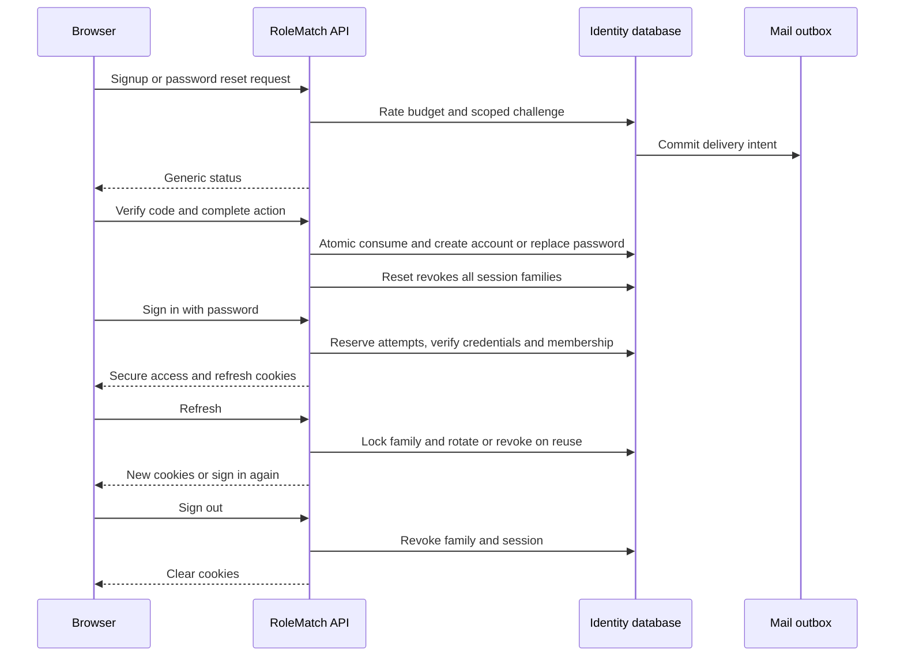
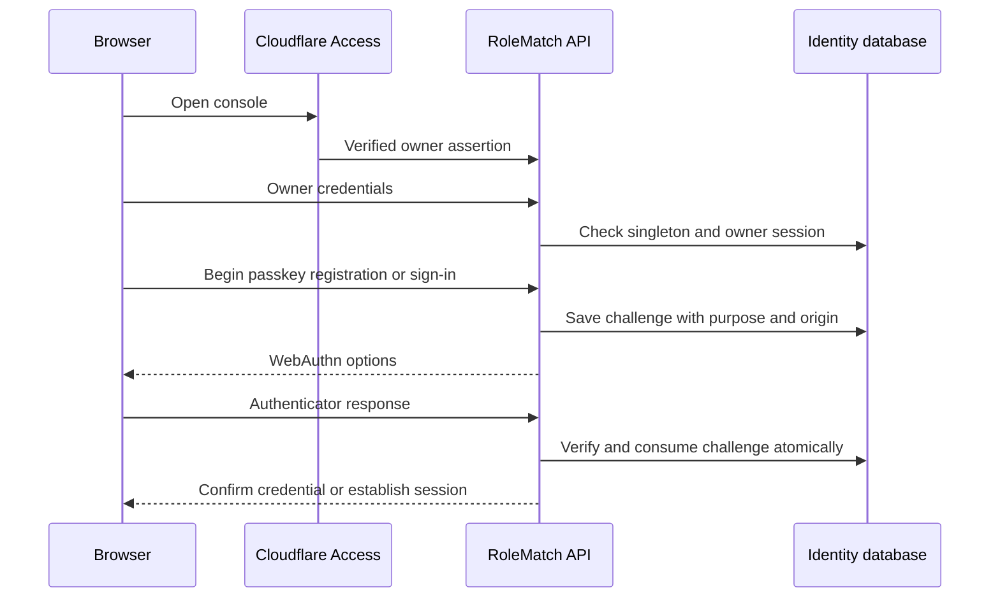

# Identity

Current behaviour sources: server/src/{supabase,auth,tokens,passkeys,ratelimit}.ts and docs/security/PASSKEYS.md. Target: ADR-004 §§4,6. Proposed Argon2id, imported bcrypt verification after sample validation, ES256 via maintained JWT library, SimpleWebAuthn with licence/version verification. Benchmark Argon2 memory and concurrency under WSL before pinning parameters. Preserve account UUIDs and verify password on imported hash, then upgrade with compare-and-swap. Never export plaintext.

Proposed defaults: app access 15 minutes, refresh idle 7 days and absolute 30 days; console access 5 minutes, idle 15 minutes, absolute 8 hours, fresh verification within 5 minutes for reveal/reset. Secure HttpOnly host-only cookies with appropriate SameSite, strict origin checks and CSRF protection on mutations. Lock rotation per family, hash random refresh tokens, serialize refresh in browser across tabs, allow short same-session retry only with bounded encrypted response replay or require re-sign-in. Never accept two successor tokens. Deny old issuer after cutover. Check revocation at sensitive actions and bound any read cache.

Code policy: existing 15 minute verification and 60 second resend as starting contract, verify reset-specific expiry from source before finalising. At most five guesses per rolling 15 minutes independently per account and trusted source, across related endpoints. Reserve before verifying, persist counters across crashes, fail closed if unavailable. Use keyed digest and constant-time comparison, bind purpose/account/generation, consume once, invalidate superseded codes. Outbox ciphertext payload expires with code, delete promptly, redact logs. No arbitrary recipient endpoint.

Passkeys require UV, exact HTTPS origin/RP, registered credential ownership and recent reauthentication for add/remove. Preserve counters where applicable; test synced passkeys and cloned-counter signals. Existing credential portability depends on RP and source export, unverified. Password remains recovery path; reset may require re-enrolment for passkeys on a changed hostname.

Owner bootstrap under audited local operator role with constant singleton PK and CHECK, no delete permission, startup/readiness requires one row after provisioning. Separate issuer/audience and cookies from app identities. Proposed recovery: root on PC re-verifies owner through offline recovery procedure, enters new password interactively, revokes console sessions and recovery credentials, records event and sends owner alert. Restore owner Access separately if Cloudflare identity is lost. CLI engineers use separate attributed accounts and no console identity.
