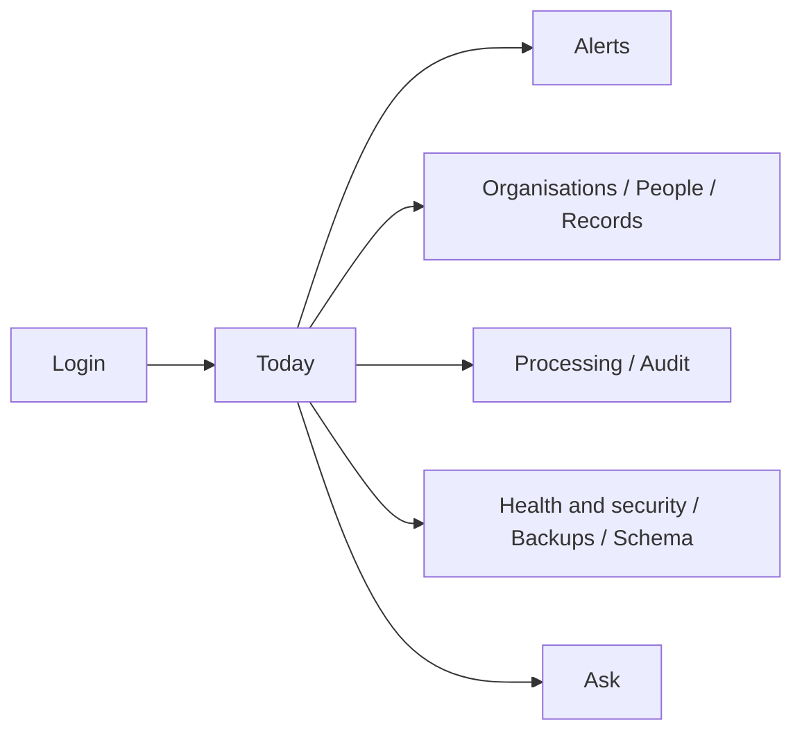

# RoleMatch Console

Basis: ADR-004 and src/theme/tokens.ts, src/theme/semantic-tokens.ts. Proposed wire maps, not an implementation. One owner; Cloudflare Access plus separate RoleMatch session. CLI operators never get console accounts.

Read each wire left to right on laptop, top to bottom on phone. Detail panels on phone become full-screen views with a Back button; retain filters and scroll position.

| Page | Phone wire | Laptop wire | Primary copy |
|---|---|---|---|
| Today | Header → critical alert → health cards → latest activity | Sidebar → health strip over activity / attention columns | What needs your attention |
| Alerts | Severity chips → incident cards → detail → acknowledge | Filters above incident table / detail drawer | Acknowledge alert |
| Organisations | Search → organisation cards → portal list → detail | Search and org table / portal inspector | Choose a portal |
| People | Scope selector → search → masked rows → person | Scope and filters above table / identity drawer | Show personal details |
| Records | Scope → candidate/job tabs → cards → evidence | Scope and tabs above table / record inspector | View original |
| Processing | Stage chips → oldest jobs → job timeline | Queue summary above workers / jobs and trace drawer | Check why it is waiting |
| Audit | Date and action filters → timeline → event | Filter bar → audit table / event inspector | Who changed what |
| Health and security | Status cards → failed check → next action | Advisor grid / details and trend | Check what needs attention |
| Backups | Last verified recovery → copy status → drill details | Recovery summary above snapshot and drill tables | Last verified restore |
| Schema | Search → area → table → columns | Area tree / ER diagram / column inspector | Browse schema |
| Ask | Question examples → input → answer and sources | Input and result / scope and sources | Ask about system health |

| Page | Empty | Loading | Error | Masked | Revealed |
|---|---|---|---|---|---|
| Today | No recent activity | Loading overview | Overview unavailable | Counts only | No reveal here |
| Alerts | No open alerts | Checking alerts | Could not load alerts | Safe messages only | No reveal here |
| Organisations | No organisations found | Loading organisations | Could not load organisations | Contacts hidden | Authorised contact fields only |
| People | No people found | Loading people | Could not load people | Name/contact hidden | Selected fields only |
| Records | No records found | Loading records | Could not load records | Details hidden | Selected evidence/original only |
| Processing | Nothing waiting | Checking queues | Queue status unavailable | Job ID only | Source requires separate Records reveal |
| Audit | No events in this range | Loading history | History unavailable | Identifiers only | No raw payload reveal |
| Health and security | No checks reported yet | Checking health | Health status unavailable | Infrastructure secrets omitted | No reveal here |
| Backups | No verified restore yet | Checking copies | Backup status unavailable | Safe copy IDs only | No reveal here |
| Schema | No matching table | Loading schema | Schema unavailable | Metadata only | No row reveal |
| Ask | Try “Which queue is oldest?” | Checking authorised sources | Could not answer | Approved aggregate views only | No reveal here |

Common error action: Retry, with time of last successful update if applicable. Reason and recent owner verification required for sensitive reveal; audit actor, scope, reason and outcome without revealed values. Remask on timeout/navigation. Ask uses allowlisted read queries with row/time caps; no SQL console, destructive operations, or personal-data prompts.

Use existing RoleMatch wordmark, cyan action, green success, amber warning, red critical, neutral surfaces and existing type scale via semantic light/dark tokens; never encode meaning in colour alone. Primary filled and secondary outlined buttons; visible keyboard focus; reduced-motion preference; announce alerts without stealing focus; test contrast, keyboard and screen reader. Use short state transitions, no flashing or motion-dependent information.

Install only the Console shell, never cache responses containing private data. iPhone: Safari share → Add to Home Screen → open installed app → Enable alerts; permission requested only after click ([WebKit Home Screen Web Push](https://webkit.org/blog/13878/web-push-for-web-apps-on-ios-and-ipados/), reviewed 2026-11-06). Android: browser Install/Add to Home Screen → open → Enable alerts; verify supported devices in rehearsal. Denial leaves feed usable; browser settings can re-enable, console can revoke subscription. Push requires fresh sign-in to see detail.
