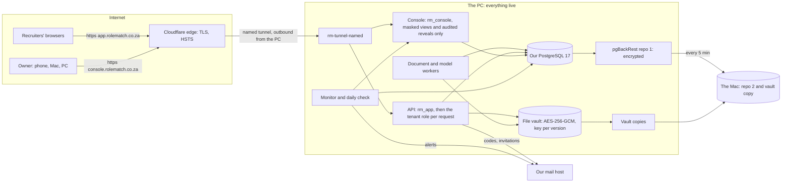
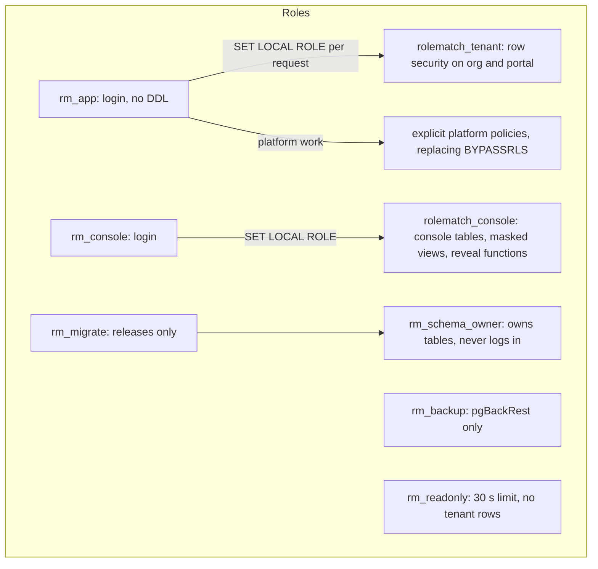

# Database platform v1: our own database, sign-in, file store and console as one platform

**Owner, 8 Nov 2026 ~10:05:** "my focus of the day is developing the database … the database and this console need to be in the same platform … it needs to be complex, tick every single corporate, privacy and security box, but it must also be beautiful, simple, look good in my browser and be easy to understand … everything that works in unison with this database and console, see that out too." Everything else is paused (training, reader work, quick tunnel retirement, Zero Trust) until this is done.

This chapter joins what chapters 01–20 designed and what is already built into one programme, in the order it will be built. It claims nothing that is not built and proven; each slice says how it will be proven.

## 1. Where we start (8 Nov, checked on the PC)

| Part | State |
|---|---|
| Live's database | **Supabase** (hosted, Ireland) for data, sign-in and files. |
| Our own PostgreSQL 17 (`rm-db`) | Running on the PC, 127.0.0.1 only. All migrations apply. Roles: `rm_schema_owner`, `rm_migrate`, `rm_app` (no DDL, but still BYPASSRLS), `rm_readonly`, `rolematch_tenant` (row security). **No live data.** |
| Backups of `rm-db` | pgBackRest, encrypted; WAL closed every 60 s; full on Sunday, differential nightly; the Mac copies the store every 5 minutes. Weekly restore drill to a chosen second, 11 s last time. |
| Own sign-in | Built and tested (`ownIdentity.ts`, migrations 036–037), **off**. |
| Own file vault | Built (`fileVault.ts`), live's 5 originals copied into a rehearsal and verified; **off**. |
| Console | Live at `console.rolematch.co.za`: password + e-mailed code; Today and Alerts pages; reads counts only (`rolematch_console`). |
| Clean slate | The owner decided every account and record is deleted at the switch: **no import**, which removes the riskiest part of chapter 12. |

## 1b. Our own Supabase, feature by feature

**Owner, 8 Nov ~10:40:** "this now needs to be our version of Supabase, needs to cover absolutely everything … configurations might be king in certain aspects of a database … make sure everything works: authentication, sign-ups, etc." Every part of Supabase that RoleMatch uses or should have, and what replaces it:

| Supabase gives | Ours | State | Console page |
|---|---|---|---|
| PostgreSQL database | `rm-db`, PostgreSQL 17 on the PC | built, no live data | Database (B1) |
| Table editor / schema view | Schema page, generated from the database with each table's purpose, personal data and retention; read-only by design | building | Schema (B3) |
| Row-level security, policies | Row security on every table; the roles of §3; a live check of grants against what they should be | built; A2 removes the app's BYPASSRLS | Security (B4) |
| Auth: sign-up with e-mailed code | `ownIdentity.ts`: sign-up, code, confirm | built, off | Accounts (B9) |
| Auth: sign-in, sessions, refresh | Passwords (argon2id), 15-minute tokens, refresh tokens that change at every use, reuse detection | built, off | Accounts |
| Auth: password reset | Recovery code, new password ends old sessions | built, off | Accounts |
| Auth: invitations | Invited accounts created confirmed, through our outbox | built, off | Accounts |
| Auth: sign out, sign out everywhere | Shared sign-out list across servers | built, off | Accounts |
| Auth: passkeys | Own WebAuthn (a well-known library, recorded as a dependency); off on live today, so not needed for the switch | slice A9 | Accounts |
| Auth: user management (list, disable, delete, force sign-out, resend) | Console Accounts page: masked list, the same actions, each audited | slice B9 | Accounts |
| Auth: rate limits and lockouts | 5 tries per 15 minutes (AUTH_ATTEMPTS), durable in the database | built | Security |
| Auth: e-mail templates and SMTP | Our mail host and outbox; templates in code, previewed in tests | built | Settings |
| Storage: buckets and files | Encrypted file vault, path-bound, versioned with tombstones (A3) | built, off | Files (B10) |
| Storage: signed URLs | The app streams originals only after the person's own access check; no public links | built | Files |
| Backups and point-in-time recovery | pgBackRest, change log every 60 s, the Mac every 5 minutes, weekly drill | built | Backups (B2) |
| Logs | Structured logs without personal data; audit log in the database | built | Audit (B6) |
| Database settings, API settings | **Settings page**: every setting the platform runs on, its value, where it comes from (file, environment, organisation), when it last changed and by whom; changes versioned and audited | slice B11 | Settings |
| Usage and reports | Sizes, counts, growth, queue times | B1, B8 | Database, Processing |
| Migrations | Numbered SQL files, applied by the release step, shown on the Database page | built | Database |
| REST data API (PostgREST), Realtime, Edge Functions | **Deliberately not copied.** RoleMatch's own API is the only way to data, always scoped to one organisation; a generic data API would be a second door. Live updates in the app use its own channel. | by design | — |

**"Everything works" means a rehearsal that proves it (A6), in a real browser on the PC against our own database:** sign up → code e-mailed → confirm → sign in → upload a CV → it is read → match → invite a colleague → they accept → reset a password → old sessions end → sign out everywhere → a copied refresh token ends the session → five wrong passwords lock → the console shows each of these in Accounts and Audit. Every one is a test that fails if it breaks.

## 2. The platform when this is done

**One path:** the app, the console, the workers and the tests all use this database, this sign-in and this vault. Supabase is gone at the end (chapter 12's retirement).

## 3. Four ways in, each with its own key

No role can do another's work. Each has its own password file on the PC, readable only by the container that needs it.

## 4. The work, in order

Each slice: built, tested against a real database, released through the guarded suite, recorded. **A** makes the platform ours; **B** makes it visible and manageable; **C** is the evidence for every corporate, privacy and security box; **D** is what works in unison with it.

### A. The switch to our own platform

| # | Slice | Proven by |
|---|---|---|
| A1 | People point at our own accounts: `profiles.user_id` and every other reference to `auth.users` move to `identity_accounts`; the Supabase stand-ins retire. | Fresh database from migrations has no `auth` schema; isolation and identity suites pass. |
| A2 | `rm_app` without BYPASSRLS: explicit platform policies for the work that spans organisations (queue, outbox, monitor counts). | A grants test: `rm_app` cannot read an organisation's rows outside a scoped request; workers still work. |
| A3 | Vault, database side: one row per stored version (path, size, SHA-256, key id), tombstones on deletion, a reconciler that compares rows and files, sampled verification nightly. | Crash between file and row is found and repaired by the reconciler; a tampered file is refused. |
| A4 | One release line again: the main branch carries live's reader (0.4.0 + R165) instead of the rejected 0.7.0, so identity, vault and console ship from one branch. | Replay on the 30 real CVs equals live's numbers exactly. |
| A5 | Keys on the PC: token signing, code HMAC, vault keys (with key ids and rotation dates), each in its own root-only file. | Start refuses without them; nothing secret in images, logs or Git (scan). |
| A6 | Rehearsal on the PC: the whole suite against `rm-db` with our sign-in and vault; browser journeys (sign up, verify, upload, match, sign out); a PC restart; a restore to a second. | All pass; timings recorded. |
| A7 | **The switch** (separately announced): live points at `rm-db`; Supabase's data is deleted as the owner decided; the owner signs up and tests. | Outside checks, browser journeys on live, the owner's own sign-up. |
| A9 | Own passkeys (WebAuthn), after the switch: off on live today. | Register, sign in, remove a passkey; a cloned credential is refused. |
| A8 | Retirement after 14 days of observation: the Supabase project and the PC's local Supabase stack go; their secrets are revoked. | Dependency scan finds no Supabase; one runtime path. |

### B. The console becomes the database's home

Plain words, two taps to any fact, no silent zeros, light and dark, phone and laptop (chapter 09, chapter 17 §5). Each page reads through `rolematch_console` only.

| # | Page | What the owner sees |
|---|---|---|
| B1 | **Database** | Is it healthy: connections used of allowed, size and growth, slowest queries now, locks, last vacuum, WAL archiving, migrations applied and any pending. |
| B2 | **Backups** | Last backup, the Mac's copy age, the last restore drill (passed, seconds, to which second), the list of backups, what a restore would cost in time. |
| B3 | **Schema** | Every table in plain words: what it is for, what personal information it holds, how long it is kept, who can read it; generated from the database itself. |
| B4 | **Security** | Who can do what (roles and grants, checked live against what they should be), row security on every table, sign-in activity and locks (app and console), key ages and rotation due. |
| B5 | **Privacy** | Retention: each rule, when it last ran, what it removed; requests from people (see, correct, delete their data) with their state and deadline; the deletion log. |
| B6 | **Audit** | Who changed what, when, from what to what, across the app and the console; the console's own actions included. |
| B7 | **Organisations, People, Records** | Masked by default; reveal one field with a reason, after a fresh code, re-masked on leaving; each reveal is audited without the value. |
| B8 | **Processing** | Queues, oldest waiting job, failures and why. |
| B9 | **Accounts** | Every account, masked: state (waiting for code, active, locked, disabled), last sign-in, open sessions; disable, end sessions, resend a code, delete, each audited. |
| B10 | **Files** | The file store: how many originals, total size, last integrity check, any file whose record and bytes disagree. |
| B11 | **Settings** | Every setting the platform runs on, with its value, source and history; changing one is versioned, audited and, for the risky ones, needs a fresh code. Configuration is first-class: the platform's rules live here, not in code. |

### C. The boxes, with evidence

A controls register (`docs/database/22_CONTROLS.md`, next): each control, how it is met, the test that proves it, and the console page that shows it. It aligns with **POPIA's eight conditions** (accountability, processing limitation, purpose specification, further processing, information quality, openness, security safeguards, data subject participation, plus section 22 breach notification) and the themes of **ISO/IEC 27001 Annex A** and **SOC 2** (security, availability, confidentiality, processing integrity, privacy). Aligned and evidenced, **not certified**: certification is an external audit, which needs the owner.

Controls in scope: tenant isolation; least privilege; encryption in transit and at rest (vault, backups; the PC's disk is the owner's BitLocker decision); key management and rotation; multi-factor sign-in for administrators; session limits; rate limits; append-only, tamper-evident audit; backups with point-in-time recovery, an off-machine copy and drills; stated recovery objectives; retention and deletion that run themselves; data minimisation by data class; requests from people; breach detection and a notification runbook; change management (versioned, tested migrations); dependency and image scanning; secrets management; logs without personal data; monitoring and alerts.

**Owner tasks this will list, because only the owner can do them:** register the Information Officer with the Information Regulator; approve the recovery objectives and retention periods; decide disk encryption on the PC; sign the incident runbook.

### D. Working in unison

The monitor and the daily check write into the console's alerts and e-mail the owner; the console shows the database, backups, security and privacy in one place; Web Push to the owner's phone (chapter 09) once the pages exist; the status of every scheduled job (backups, drills, retention, reconciler) on one list.

## 5. Order of the days (a target, not a promise)

1. **Today:** this plan; C (controls register); B1 Database and B3 Schema pages; A1.
2. A2, A3, A4, A5; B2 Backups, B4 Security.
3. A6 rehearsal; B5 Privacy, B6 Audit.
4. A7 switch when the rehearsal passes, announced first; B7, B8.
5. Observation; A8 retirement after 14 days.

## 6. How the console pages are built

Server-rendered HTML from the console's own server, as Today and Alerts are: no scripts, a strict content-security policy, `no-store`, the RoleMatch tokens. Each page reads a fixed, allow-listed query through a security-definer function that returns what the page needs and nothing more (counts, states, masked fields). No SQL box, no generic table browser, no destructive action. Every page has its empty, loading, error and unknown states written before its happy state.
