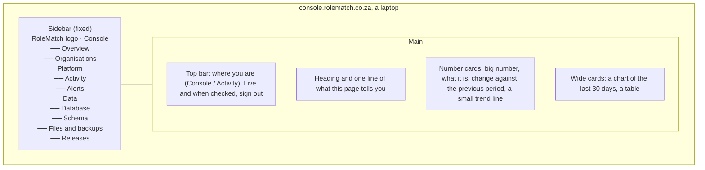

# The console's look: calm, clear, RoleMatch

Owner, 11 Nov 2026: "can we make the database look so nice and appealing? I must have that RoleMatch identity ... really informative and very easy to
navigate ... it's important to me that it looks very, very good", pointing at Cloudflare's dashboard: "that same feel and slickness must never go away".
Built on the Mac (where every change can be seen as it is made) and served by rm-console on the PC; it looks the same in any browser.

## Layout

On a phone the sidebar becomes a menu at the top and the cards stack in one column.

## Rules

1. **Calm.** A pale page, white cards with a thin border and a soft corner, one accent colour (RoleMatch cerulean), generous space; type in two weights.
2. **RoleMatch.** The wordmark at the top of the sidebar; the four letters' colours (R blue, o orange, l yellow, e green) only where they carry meaning
   (the four kinds of activity); the approved button (cerulean, teal sweeping across on hover).
3. **Every number says what it is and against what.** "CVs read · 30 days · +12% on the 30 before". No number without its words; no colour without its word.
4. **Charts drawn on the server** as plain SVG: no script, nothing from another site (the console's security policy stays as strict as today).
5. **Numbers and organisation names only.** No person's name, e-mail, phone, address or CV text ever reaches the console (as since 6 Nov): what is
   counted comes from fixed database functions that return numbers.
6. **Light and dark**, following the device.

## Pages

| Page | What it shows | From |
|---|---|---|
| Overview | All well or what needs you; live health; the week in four numbers with trend lines; latest alerts | console_overview(), console_activity(), health |
| Organisations | Each company: portals, people, CVs, jobs, matches, AI spend this month, last activity; totals at the top | console_organisations() (new) |
| Activity | 30 days of CVs read, jobs read, matches, shortlisted and AI spend, each a chart with its total and change | console_activity(30) (new) |
| Alerts | as today, in the new look | owner_events |
| Database | where it is, size, connections, cache, longest query, migrations; largest tables | console_database() |
| Schema | as today, in the new look | the schema bible |
| Files and backups | last backup, how many kept, the Mac's copy, the restore drill, originals in the vault | host status file |
| Releases | what is running and the last releases | deploys log via the host status file |

## Proof

The console's own tests keep passing (sign-in, codes, numbers only, no personal data); a new test that the new functions return numbers and names only
and that the console role still cannot read people, CVs or documents; screenshots light, dark and phone width, looked at before release.
