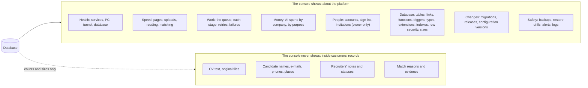
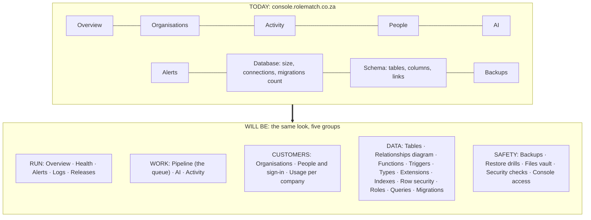
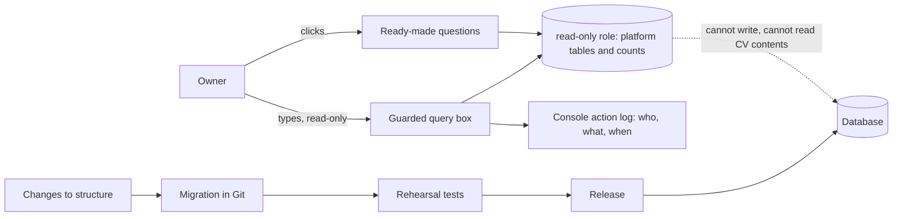
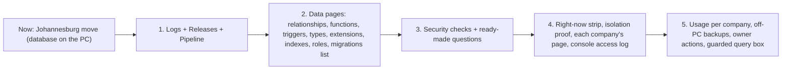

# The console: everything about the platform, in one place (plan)

Owner, 11 Nov 2026: "if a CEO comes to me and they're like, let's see the database, let's see the console ... there's nothing that they shouldn't be
able to see from there"; "SQL editors ... logs ... pipelines, backups, migrations"; "I'm not saying just because Supabase has it, we should have it ...
think about it for me." This plan sets out what the console should show, what it should do, and what it should leave out, with the reason for
each. Nothing here is built yet beyond the "Today" column. Read from the running code on 11 Nov 2026 (release 4b45ae9).

## 1. The one rule that decides most of this

The console belongs to the people who run RoleMatch. The records inside belong to RoleMatch's customers: their candidates' CVs, names, phone numbers,
and their recruiters' notes. Under POPIA a South African company may give the platform its candidates' data only for running the service, never for
browsing. So:

- **The console shows everything about the platform**: whether it is healthy, how fast it is, what it costs, what is queued, what failed, who signed in,
  how the database is built, how big it is, what was released, what is backed up and whether a restore works.
- **The console never shows what is inside a customer's records**: no CV text, no candidate names, no phone numbers, no notes, no match reasons. It
  counts them, measures them and shows their structure, but never their contents.

This is also the honest answer for a visiting CEO. "You can see everything about how RoleMatch runs, and you cannot see one of our customers'
candidates" is exactly what a CIO buying the platform wants to hear. It is a selling point, not a gap.

## 2. Today vs what it will be

TODAY (4b45ae9): Overview, Organisations, Activity, People and sign-in, AI, Alerts, Database, Schema, Backups and files. One trip to the database per
page, summaries kept 15 s. Read-only except clearing an alert.

## 3. Each part: what it is, why we need it, where it reads from

| Part | What it shows | Why it is needed | Reads from | Built |
|---|---|---|---|---|
| Overview | the day at a glance | first screen for anyone | all below, summarised | yes |
| Health | each service (api, worker, AI worker, mail, tunnel, database) up or down, since when; the PC's CPU, memory, disk, temperature later | "is it working" answered in one look | live's health report, the PC's status file | partly (Overview) |
| Alerts | what needs a person, by urgency; cleared ones for 7 days | nobody watches screens all day | owner_events | yes |
| **Logs** | one searchable stream: API requests (route, status, time taken, company, never bodies), worker steps, AI calls, sign-ins, errors, cron jobs | when something goes wrong, the first question is "what happened at 14:02" | a new log table written by the API and workers, kept 30 days | **no** |
| **Releases** | every release: version, time, note, how long it was down (zero), rollback target, the tests that passed | "what changed?" is the second question in any problem | /srv/rolematch/deploys.log, shared read-only | **no** |
| **Pipeline** | each stage of reading (received, checks, reading, validating, published), how many are in each, how long each takes, retries, failures, stuck files the watchdog rescued | the platform's main work; CLAUDE.md asks for "observable queues, bounded retries and manual recovery" | the documents table and the queue | **no** |
| AI | spend this month by purpose, model and company; answered, refused, failed | cost is per company; credit lock later | ai_usage | yes |
| Activity | 30 days of CVs, jobs, matches, shortlists, new people, spend | growth and use over time | documents, matches, audit_events | yes |
| Organisations | each company: portals, people, records, spend, last activity | the customer list | orgs and counts | yes |
| People and sign-in | accounts, last sign-in, invitations; failed sign-ins and locked accounts | support ("I can't log in") and security | auth.users, members, login limits | partly |
| **Usage per company** | per company: records, storage used, AI spend, against its plan | billing later; fair limits | counts, ai_usage | **no** |
| Tables | every table: rows, size, growth, row security on or off, how many rules | how the data is kept | catalogue | yes (Schema) |
| **Relationships diagram** | the tables drawn with the links between them (like Supabase's schema visualizer) | the clearest way to explain the database to anyone | catalogue | **no** |
| **Functions, triggers, types, extensions** | each one, what it does, who may call it, security definer or not | nothing hidden; a reviewer checks these first | catalogue | **no** |
| **Indexes and slow queries** | each index, its size, whether it is used; the slowest queries and how often they run | speed problems are found here | catalogue, pg_stat_statements | **no** |
| **Roles and grants** | each database role and what it may do | least privilege must be visible to be trusted | catalogue | **no** |
| **Queries** | ready-made questions with answers (see section 4), not a free SQL box | answers to the questions people actually ask | the database, as a read-only role | **no** |
| Migrations | every migration: name, when applied, matches the code or not | proof the database is the version the code expects | schema_migrations, the code's list | count only |
| Backups | nightly dumps, full and daily backups, size, last verified restore drill; copies off the PC (to build) | "can we recover" with proof, not hope | backup logs, the drill file | partly |
| Files vault | how many originals, total size, encrypted, last checked | originals are the most sensitive thing we hold | storage, counts only | partly |
| **Security checks** | automatic checks: a table without row security, a function anyone can call, an unused index, an account with no sign-in for 90 days, expired invitations | what Supabase calls Advisors: problems found before anyone else finds them | catalogue and counts | **no** |
| **Console access** | who can open the console, with what role, their sessions, every action they took | a console that sees this much must itself be audited | console_sessions, an action log | **no** |

## 4. The SQL editor: why not a free one, and what instead

A free SQL box on a website is the most dangerous thing a console can have: one stolen session, or one wrong `delete`, and every company's data is
gone or copied. Supabase can offer it because only the database's owner uses it. Ours would be reachable from the internet.

What we build instead:

1. **Ready-made questions** (first): about 30 questions we write, test and keep in the code, each with a clear answer. "Which companies uploaded
   nothing this week?", "How long did reading take today, slowest first?", "Which matches failed and why?", "How much did each company spend on the AI
   this month?". Click, get the answer, and nothing can go wrong.
2. **A guarded query box** (later, owner only): read-only, through a database role that can read the platform's own tables and counts but not
   customers' records; at most 5 seconds and 1,000 rows; every query written to the console's action log with who ran it and when. It cannot write.
3. **Changes to the database never go through the console.** They go through migrations in Git: written, tested on the rehearsal, reviewed,
   released, recorded. That is the audit trail CLAUDE.md requires, and it means the console can never be the way someone breaks the database.

## 5. Who may open it (decided by the owner, 11 Nov 2026)

Only the owner. No viewer accounts, no visitor role. If someone else ever needs access, the owner creates an account for them at the PC's terminal and
decides then what it may see; until then the console has one account, and every sign-in and every action is recorded and shown on Console access.

## 6. What we do not need, and why

| Supabase has | We need it? | Why |
|---|---|---|
| Table Editor (edit rows by hand) | No | Editing customers' records by hand breaks the audit trail and POPIA. Corrections go through the app, recorded. |
| Free SQL Editor | Not as it is | See section 4: ready-made questions, then a guarded read-only box. |
| Realtime | No | The platform does not use it (no part of the code subscribes to it). |
| Edge Functions | No | Our own server does that work; there are none. |
| Storage browser (open files) | No | Originals are private. We show counts, size and encryption, never the files. |
| Branching | No | The rehearsal on this Mac is our branch: every release is tested there first. |
| Compute add-ons | No | After the move the database is on our own PC. |
| Integrations marketplace | No | Nothing there that we use. |
| Grafana Cloud integration (your second screenshot) | No, not now | It reads Supabase's metrics, and we are leaving Supabase for the PC in Johannesburg. It would also send our measurements to Grafana's cloud abroad. Our console already shows the numbers that matter; if we ever want deep graphs, Grafana can run free on the PC itself, with nothing leaving it. |
| Advisors | **Yes**, as Security checks | Finding problems before anyone else does is exactly the owner's rule. |
| Logs | **Yes** | We have none in one place today; it is the biggest gap. |
| Schema visualizer | **Yes**, as Relationships | The clearest picture of the database. |
| Functions, triggers, types, extensions | **Yes** | Read-only lists, cheap to build, nothing hidden. |
| Backups, migrations | **Yes** | Already partly there; finish them with proof. |

## 6a. Many companies, many people at once (owner, 11 Nov 2026: "if 10 people sign up at the exact same time, this thing needs to reflect that")

Tenant isolation and load are not one page: they run through every page. What the console must show:

**Right now** (a strip at the top of every page, refreshed every few seconds):
- people signed in now, and in each company; sign-ups in the last 5 minutes; uploads being read; matches running; the queue's wait
- database connections in use against the most allowed; the slowest request in the last minute

**Isolation, proved rather than promised:**
- every table that holds a company's records: row security on, and a rule that limits it to its own company. Checked on every page load; red the moment
  one is missing
- requests refused because they reached for another company's records (PERM-002 and the like), per day and per company: zero is normal, any is a
  question
- the last run of the isolation tests (two companies trying to see each other's CVs, jobs, matches and files) and the last load test (many companies
  uploading and matching at once): when, how many people, passed or failed
- fairness: no company waits because another uploaded 500 CVs; each company's share of the queue and its own limits from Settings

**Each company on its own page:** its people, sessions, records, storage, AI spend, limits and where it stands against them, its errors and refused
requests, its configuration versions, its last activity. Counts and measurements only, as everywhere.

## 6b. What a large company would expect (Hollard, Infostrat): the things auditors ask for

| They ask | The console shows |
|---|---|
| How available was it? | uptime each month, measured from outside every minute; every outage with start, end, cause |
| What happened, and what did you do? | incidents: a timeline from the first alert to the fix, linked to the release that fixed it |
| What changed, who approved it? | releases: version, time, tests passed, rollback target; configuration versions per company |
| Who has access to what? | every account and its role, per company; the console's own account and its sessions; a monthly access review |
| Can you recover, and how much would you lose? | backups with sizes and times, the weekly restore drill's result, how far back we can restore, how long a restore takes |
| Is personal data handled lawfully? | retention per company, records past their keep-until date, deletion requests and when each was done (POPIA) |
| Is anything about to expire or out of date? | domain and certificate dates, software versions with known security problems, the PC's disk, the UPS |
| What does it cost? | AI spend per company and per purpose, against plan |

## 7. Speed

The console is slow today because every trip to the database goes to Ireland and back (about 0.2 s), and a page needs at least one. Release 4b45ae9
cut each page to one trip. After the move to Johannesburg the database is on the same PC: a trip takes about 1 ms, and every page should arrive in
well under half a second. The check: every console page measured on each release, and the release fails if one takes longer than 500 ms.

## 8. Order of work

The move goes first because it makes everything after it fast, and because several pages (backups, files vault, health) read from the PC's own
database, which exists only after the move. Logs come first after it because they are the biggest gap: today, finding what happened at a given minute
means reading container output on the PC by hand.

## 9. Decided (owner, 11 Nov 2026: "think big corporation")

1. **Access:** the owner only (section 5).
2. **The query box: yes, built last, for the owner only.** Ready-made questions answer most things; a large company's people will still ask one nobody
   thought of, and the alternative is opening a terminal on the PC, which is worse. Guarded as in section 4: read-only, no customers' records, 5
   seconds, 1,000 rows, asks for a fresh e-mailed code before it opens, and every query recorded.
3. **How long records of what happened are kept, in three kinds** (what ISO 27001 and SOC 2 audits expect, held against POPIA's "no longer than
   needed"; none of them holds a CV's contents, a password or a code):
   - everyday logs (requests, worker steps, AI calls): **90 days**, enough to look into any problem a customer raises a quarter later
   - security records (sign-ins, failed sign-ins, lockouts, access changes, console actions, refused cross-company requests): **12 months**, what
     auditors ask to see
   - the audit trail of changes to records (who changed what, from what, to what): **as long as the record exists**, as now, and removed with it under
     the company's own retention setting
