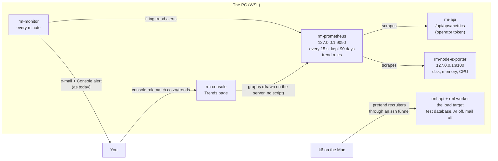

# Trends and load testing

Owner, 23 Nov 2026: "Yes, both", "we need these live". This adds two things to what already watches live (`MONITORING.md`, `src/scripts/monitor.ts`):

1. **Trends:** Prometheus keeps RoleMatch's numbers over time, and the Console draws them. The monitor answers "is it working right now?" Trends answer "has it been getting slower since Tuesday?" and "will the disk be full in two weeks?"
2. **Load testing:** k6 sends a crowd of pretend recruiters at a copy of RoleMatch on the same PC and reports where it slows.

## How it fits

## Decisions (mine, for your veto)

| Decision | Why |
|---|---|
| Graphs in the Console, not Grafana | One place to look; the Console already has its sign-in, look and rules (no script on its pages). Grafana's AGPL licence was avoided on purpose in ADR-003. |
| No Alertmanager | The monitor already e-mails you and raises Console alerts, with reminders and "back to normal". It reads Prometheus's firing alerts each minute and treats them like any other problem. One alert path, not two. |
| Numbers only, counted across the platform | The metrics carry counts, ages, durations and states. No organisation, person, document or address appears, so nothing in Prometheus is personal data. |
| Prometheus and node-exporter listen on 127.0.0.1 only | Nothing new is reachable from the internet. The operator token is given to Prometheus as a root-only file, never on a command line. |
| 90 days kept, at most 5 GB | Long enough to compare this week with last month; the disk has 868 GB free. |
| The load test never runs against live | Live's data, accounts and AI credit are real. The load target is the same image on the same PC, pointed at the PC's test database, with the AI off and e-mail off. Same machine, so the result is the PC's real capacity. |
| A watchdog stops the load test if live suffers | As with the test suite (R166): live's health is asked every 15 seconds while k6 runs; two slow or incomplete answers in a row stop it at once. |

## What the trend alerts watch

| Alert | Fires when | For |
|---|---|---|
| Disk filling | at the last 6 hours' rate, the disk is full within 14 days | 1 hour |
| Disk low | under 10% free | 15 minutes |
| Memory low | under 10% of the PC's memory available | 15 minutes |
| Slower than last week | pages' slowest 5% over the last hour is twice last week's same hour, and over half a second | 30 minutes |
| Errors rising | over 1% of requests in the last hour failed on the server, and at least 20 | 15 minutes |
| Numbers missing | Prometheus cannot read the API or the PC for 5 minutes | 5 minutes |

If Prometheus itself stops answering, the monitor says so ("trends cannot be read"), as it does for any check it cannot measure.

## Load test

The approach follows "Why Test Twice?" (Sarah, 2023), which the owner shared: one script of what a recruiter does (`load/journey.js`), run under different crowd shapes (`load/profiles.js`), each run saved with its date so this release can be compared with the last.

| Step | Command |
|---|---|
| Start the load target on the PC (once per release to test) | `deploy/pc/load-target.sh up <commit>` (8 companies of 10 recruiters unless told otherwise) |
| Run k6 from the Mac | `load/run.sh` (steps), or `load/run.sh smoke`, `spike`, `steady` |
| Remove the load target and everything the test made | `deploy/pc/load-target.sh down` |

| Shape | What it is |
|---|---|
| smoke | one recruiter, once; stops at the first failure. "Does it work at all" after a release |
| steps | 10, then 25, 50 and 100 recruiters at once, 3 minutes each, stopping at the first step that misses the pass marks |
| spike | from none to 100 recruiters in 30 seconds, a minute there, then away (`SPIKE=200` for more) |
| steady | 30 new journeys a minute for 5 minutes, however long each takes (`RATE=60` for more) |

What each pretend recruiter does, with a person's pauses: signs in once, then over and over opens the candidate list, opens a candidate, writes a note, opens the jobs list, and one time in four uploads an invented CV (`sample-documents/cvs`, made unique each time so it is really read) and waits for it to leave the processing list.

**Pass marks**, from the live health report's own limits: under 1% of requests failing; pages' slowest 5% under 2 seconds. Signing in (slow on purpose, so passwords resist guessing) under 5 seconds, uploads under 10.

**Not measured:** the AI's own speed. It is set by Anthropic's service, costs money per call, and is switched off in the load target.

**Safety:** `server/src/scripts/loadTarget.ts` refuses any database but a `load_` schema of a test database on the same machine (proved: it refused `ROLEMATCH_ENVIRONMENT=live` and the `public` schema). Every account is `@load.test`. `down` removes the accounts, files and schema (proved on the Mac: 6 accounts, 13 files and the schema removed, nothing left).

**Trial on the Mac, 23 Nov 2026** (6 recruiters, 1 minute, the Mac's own test database; it proves the script, not the PC's capacity): no request failed; pages answered in 11 ms typically and 31 ms for the slowest 5%; 7 of 7 CVs read, the slowest in 3 s. It found two faults in the test itself, both fixed: k6 forgets sign-ins between rounds unless told (`noCookiesReset`), and the set-up made colleagues in separate companies when it made them at once.

**First full run on the PC, 23 Nov 2026** (k6 from the Mac, 10 companies of 10 recruiters, the AI off):

| Recruiters at once | Requests | Failed | Pages, typical | Pages, slowest 5% | CVs read | Slowest CV (95%) |
|---|---|---|---|---|---|---|
| 10 | 407 | 0.5% | 40 ms | 109 ms | 24 of 24 | 3 s |
| 25 | 1,000 | 0.1% | 39 ms | 132 ms | 63 of 63 | 3 s |
| 50 | 2,143 | 0.1% | 43 ms | 139 ms | 110 of 110 | 3 s |
| 100 | 4,200 | 0.2% | 40 ms | 135 ms | 218 of 218 | 3 s |
| **100, after the fix below** | **4,217** | **0%** | **37 ms** | **108 ms** | **238 of 238** | **3.2 s** |

The PC itself, from Prometheus over the whole session: processors 6% busy in a typical minute, 12.7% at the busiest; memory at most 40% of what Linux is given. Live had no server errors throughout.

What the runs found:
1. **Saves lost between the server and what sits in front of it (fixed, 0e691f0).** About 1% of note saves never reached the server. The server closed an idle connection after 5 seconds while the client could still reuse it for longer; a request sent at that moment was lost. Reads were retried by the client unseen; saves were not. Live has the same shape: Cloudflare's tunnel keeps idle connections 90 seconds. The server now keeps them 95 seconds. Proved: 100 recruiters, 4,217 requests, none failed.
2. **Many sign-ins in the same instant.** With 50 people pressing "sign in" at the very same moment: 30 signed in, 10 were told "too many failed attempts" (one address may have 30 sign-ins counted at once, since they are counted before the password is checked; the message wrongly says "failed"), and 10 were told "very busy, try again in a few seconds" (one server takes 40 requests at once and refuses the rest at once rather than slowing everyone, by design, R113). Arrivals spread over half a minute, as people really arrive, saw none of this. Not changed yet: the owner decides whether one office address should be allowed more than 30 sign-ins at the very same moment.
3. **The metrics were refused when the server was busy** (fixed, 0e691f0): they now always answer, like the health check, so a busy hour shows on the Trends page as a line, not a gap.
4. **In the test itself:** the crowd now arrives over 30 seconds (all at once is the spike shape's job).

What this does not cover: the AI was off, so reading a CV took about 3 seconds here; with the AI on it takes 10 to 45 seconds per CV and depends on Anthropic's service, not the PC. One server process was tested; the server's limits (40 requests at once, 5 database connections) were live's.

## Proof

- Server tests: the metrics endpoint refuses anyone without the token, carries no organisation, person or token, and counts requests but not the watchers' own (`server/test/ops-health.test.ts`); the Console's Trends page shows firing warnings only, breaks a line where a number is missing, and shows one refused chart as unknown while the rest still show (`server/test/console.test.ts`); the monitor turns firing trend alerts into problems in the rule's own words, and treats an unreachable Prometheus as a check that could not be measured (`server/test/monitor.test.ts`).
- The configuration and the 6 trend rules pass Prometheus's own `promtool` (checked on the PC, 23 Nov 2026), and `deploy/pc/prometheus.sh` checks them again before every install.
